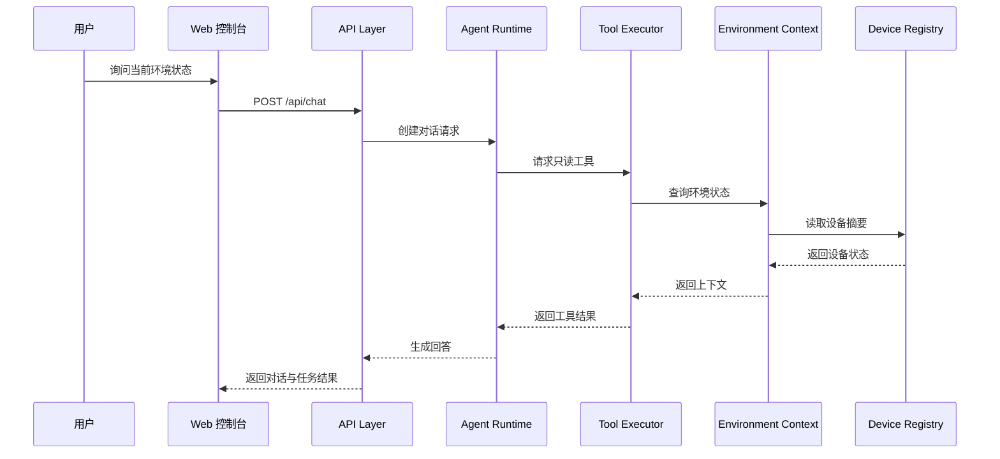
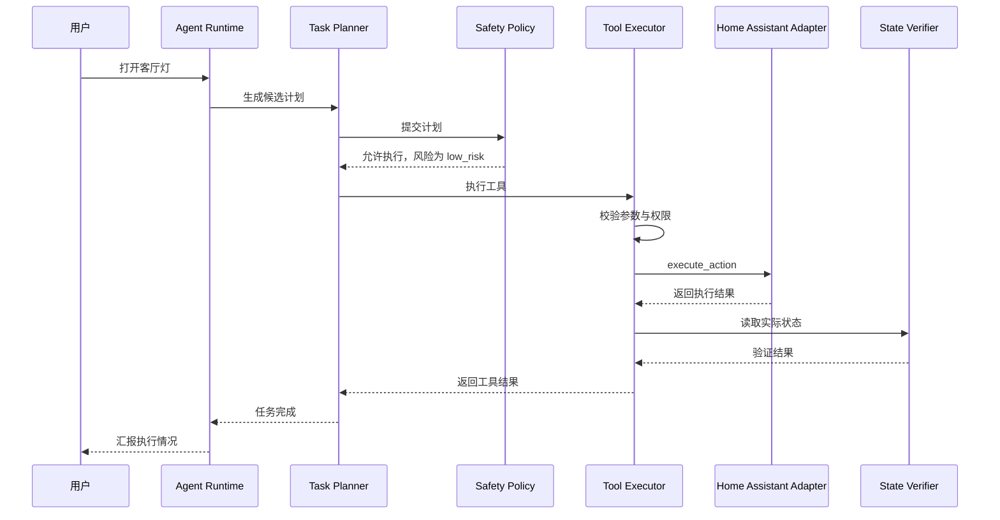
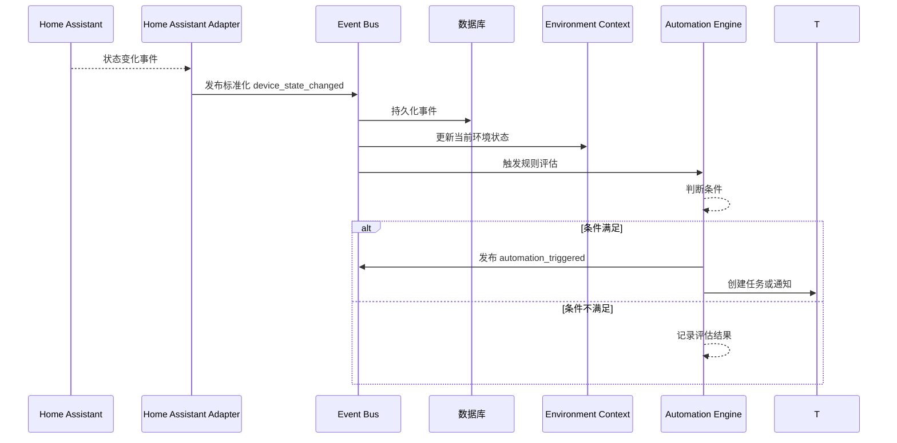

# 02. 系统架构

## 架构结论

Arvuno Core 第一阶段采用 **Windows 本地运行的模块化单体架构**。

推荐运行形态：

- 一个 FastAPI 后端进程，承载 API、设备适配、事件系统、任务系统、Agent Runtime 和自动化引擎。
- 一个 React Web 控制台，由 Vite 开发服务器运行或构建后由后端静态托管。
- 一个 SQLite 数据库文件，保存设备、事件、任务、对话、记忆和配置数据。
- 一个应用内事件总线，负责进程内事件分发。
- 一个可选的独立前端开发服务器，只在开发阶段使用。

第一阶段不使用微服务、Kubernetes、Kafka、RabbitMQ 或分布式数据库。

## 分层架构

```text
┌─────────────────────────────────────────────┐
│ Frontend Dashboard                          │
│ React + TypeScript + Ant Design             │
└──────────────────┬──────────────────────────┘
                   │ REST + WebSocket
┌──────────────────▼──────────────────────────┐
│ API Layer                                   │
│ FastAPI 路由、认证、请求/响应模型、错误封装 │
└──────────────────┬──────────────────────────┘
┌──────────────────▼──────────────────────────┐
│ Application Services                        │
│ Agent Runtime / Task System / Automation    │
│ Environment Context / Memory / Safety       │
└──────────────────┬──────────────────────────┘
┌──────────────────▼──────────────────────────┐
│ Tool System                                 │
│ Tool Registry / Permission / Tool Executor  │
└──────────────────┬──────────────────────────┘
┌──────────────────▼──────────────────────────┐
│ Device Integration                          │
│ Device Registry / Device Adapter Interface  │
│ Home Assistant Adapter / Mock Adapter       │
└──────────────────┬──────────────────────────┘
┌──────────────────▼──────────────────────────┐
│ External Systems                            │
│ Home Assistant / AI Provider / Notification │
└─────────────────────────────────────────────┘
```

所有模块运行在同一后端进程中，但通过明确的接口和领域模型隔离边界。

## 模块化单体

### 为什么选择模块化单体

1. **个人可维护：** 部署和调试简单，不需要服务编排。
2. **本地运行友好：** Windows 11 上启动一个后端服务即可。
3. **低延迟：** 进程内调用，避免跨服务网络开销。
4. **易于测试：** 可以用依赖注入替换外部适配器。
5. **边界仍清晰：** 模块之间通过接口通信，后续必要时可以拆分。

### 必须坚持的约束

模块化单体不等于随意互相引用。实施时必须遵守：

1. API 层不承载业务逻辑。
2. Agent 不直接调用 Home Assistant HTTP API。
3. Agent 不导入 Repository、SQLAlchemy 模型或数据库会话。
4. Tool Executor 不直接访问数据库表结构，持久化通过应用服务和 Repository 完成。
5. 设备控制工具不直接依赖 Home Assistant HTTP 客户端，只依赖 Device Integration 的应用接口。
6. 业务模块不直接依赖 SQLite 方言。
7. 事件处理不能因为单个订阅者失败而丢失主流程。
8. 外部调用必须有超时、重试上限和错误日志。

### 与 Home Assistant 的复用边界

| 能力 | 归属 | 第一阶段处理 |
| --- | --- | --- |
| 设备集成、发现、协议适配 | Home Assistant | Arvuno 不实现 |
| 设备实体注册和维护 | Home Assistant | Arvuno 只保存轻量投影和权限映射 |
| 设备当前状态和控制 | Home Assistant | Arvuno 通过 Adapter 读取和调用 |
| 完整设备历史和图表 | Home Assistant | Arvuno 不复制 |
| 基础自动化和场景 | Home Assistant 优先 | Arvuno 不做通用替代品 |
| 任务、工具、执行验证审计 | Arvuno | 独立保存 |
| AI 上下文和用户偏好 | Arvuno | 独立保存 |

Event System 只订阅 Arvuno 需要的实体和事件类型，不默认保存 Home Assistant 全量事件。

## 核心运行流程

### 1. 环境查询流程



只读查询不修改设备状态，但需要记录模型调用和工具调用日志。

### 2. 低风险设备控制流程



如果计划被判定为高风险，则进入 `waiting_confirmation` 或直接拒绝。

### 3. 设备事件流程



## Home Assistant 集成边界

Arvuno 通过 Home Assistant Adapter 访问 Home Assistant，而不是让业务模块直接依赖它的 API。

```text
Home Assistant REST / WebSocket API
        ↓
Home Assistant Adapter
        ↓
Device Adapter Interface
        ↓
Device Registry / Environment Context / Tools
```

这个适配层承担防腐层职责：

- 将 Home Assistant 实体转换为 Arvuno 的 Device 模型。
- 将状态字符串转换为标准状态类型。
- 将服务调用转换为 Device Action。
- 统一错误类型。
- 统一超时和重试策略。
- 屏蔽平台特有字段。

## AI Provider 边界

AI Provider 只负责模型请求和响应，不负责业务决策与设备执行。

```text
Agent Runtime
    ↓
AI Provider Interface
    ↓
OpenAI-compatible Provider / 未来其他 Provider
```

Provider 输出必须是可校验的结构化对象。Agent 不能信任模型返回的自由文本作为执行指令，所有工具调用都要经过 Tool Registry 和 Safety Policy。

## 部署视图

### 开发环境

```text
Windows 11
├── FastAPI 后端
│   ├── API Server
│   ├── Agent Runtime
│   ├── Event Bus
│   ├── Device Adapter
│   └── SQLite
├── Vite 开发服务器
└── Home Assistant / Mock Adapter
```

开发时前后端分别启动，后端提供 OpenAPI 文档，前端通过代理或环境变量访问 API。

### 本地运行

```text
Windows 11
├── Arvuno Backend 进程
│   ├── REST API
│   ├── WebSocket
│   ├── 静态前端资源（可选）
│   └── SQLite / logs / backups
└── Home Assistant
```

第一阶段推荐 Windows 原生运行，暂不使用 Docker。

## 数据流

### 实时状态流

1. Device Adapter 获取设备状态。
2. Device Registry 更新或刷新设备记录。
3. Environment Context 保存当前状态摘要。
4. Web 控制台通过 API 或 WebSocket 获取状态。

### 历史事件流

1. 事件进入 Event Bus。
2. Event System 写入数据库。
3. 事件时间线 API 查询历史。
4. Automation Engine 根据事件评估规则。

### 任务执行流

1. Agent 或 Automation 创建 Task。
2. Task Planner 生成 task steps。
3. Tool Executor 执行每个步骤。
4. 系统记录工具调用和状态验证。
5. Task System 更新任务状态和结果。

## 错误处理原则

统一错误层级：

```text
Domain Error
├── DeviceUnavailableError
├── DeviceActionUnsupportedError
├── ToolPermissionDeniedError
├── RiskPolicyRejectedError
├── ToolValidationError
├── StateVerificationFailedError
├── ProviderTimeoutError
└── TaskExecutionError
```

API 层将这些错误转换为稳定错误码，不暴露堆栈给前端。日志中记录 correlation ID，用于串起一次请求、任务、工具调用和设备事件。

## 可观测性

第一阶段不引入复杂 APM，但必须有：

- 结构化日志
- 请求 ID 和 correlation ID
- 模型调用日志
- 工具调用日志
- 任务状态日志
- 设备适配器健康检查
- 启动配置检查
- 数据库迁移状态检查

## 架构审查结论

| 检查项 | 结论 |
| --- | --- |
| 是否重复实现 Home Assistant | 否，只做设备投影、AI 上下文、任务编排和审计 |
| 是否过度依赖 Home Assistant | 否，通过 Device Adapter Interface 隔离 |
| AI、设备控制和数据库是否耦合 | 否，Agent 不接触数据库实现和设备协议，执行交给 Tool System |
| 是否缺少环境状态模型 | 否，Environment Context 为核心模块 |
| 是否缺少事件系统 | 否，统一 Event Schema + 应用内总线 + 持久化 |
| 是否缺少任务记录 | 否，Task 与 ToolExecution 独立持久化 |
| 是否缺少权限控制 | 否，Safety Policy 和 Tool Permission 提前设计 |
| 是否缺少结果验证 | 否，State Verifier 属于工具执行链路 |
| 是否过度设计 | 不引入消息队列、微服务、向量数据库、多 Agent 和机器人模块 |
| 是否适合 Windows | 是，单进程后端 + SQLite + 本地前端 |
| 是否适合个人开发 | 是，模块少、边界清晰、部署简单 |

第一阶段架构应保持克制：先把设备抽象、事件、任务、工具安全执行和验证闭环做牢，再考虑扩展。
