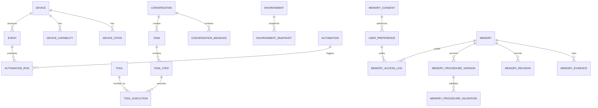

# 05. 数据模型

## 设计原则

1. 数据库模型服务于 Arvuno 领域，不复制 Home Assistant 内部结构。
2. `devices` 是 Home Assistant 实体的轻量投影，不是完整设备注册表。只保存 Arvuno 需要的名称、区域、类型、能力摘要、别名和权限等信息。
3. 不复制 Home Assistant 的完整设备配置、协议元数据、设备发现结果或完整历史。
4. `events` 只保存 Arvuno 上下文、任务、工具、审计和自动化所需事件，不是 Home Assistant 历史库的副本。
5. `automations` 只建模少量需要 Arvuno 上下文的规则，不是通用自动化平台模型。
6. API Schema、领域模型和数据库模型分离。
7. 所有主键使用 UUID 字符串，便于未来分布式或迁移。
8. 时间统一使用 UTC ISO-8601 字符串。
9. 变化快的数据使用快照表，当前状态使用摘要表。
10. 事件 payload 和工具参数使用 JSON 字段，但必须由 Pydantic 校验。
11. 不引入向量数据库，长期记忆先用结构化字段和关键词/时间查询。
12. 业务逻辑不直接依赖 SQLite 特有能力。

## ER 总览



`memory_evidence` 中的 `evidence_type` 和 `evidence_id` 是应用层维护的多态引用，
分别指向 `observations`、`events`、`tasks`、`conversation_messages`、
`environment_snapshots` 或 `tool_executions`。SQLite 层不为多态引用建立物理外键；
Memory Repository 在写入证据前验证目标记录存在，读取时关联原始记录。

ARS-03.2 的 History 查询是只读应用层读模型，不新增历史表，也不复制上述数据。
`HistoryRepository` 按时间、空间、实体、事件主体、任务和 correlation ID 组装
`observations`、`events`、`tasks`、`environment_snapshots`、空间树和归属区间。
快照差异只比较已保存的 `environment_snapshots.context`，原始记录仍留在各自表中。

## 表结构

### 1. `devices`

设备投影表，保存 Arvuno 需要的稳定设备信息。设备发现、完整注册信息、协议配置和完整历史仍由 Home Assistant 管理。

| 字段 | 类型 | 说明 |
| --- | --- | --- |
| id | UUID PK | Arvuno 设备 ID |
| adapter_id | string | 适配器 ID，例如 `home_assistant`、`mock` |
| external_id | string | 平台内实体或设备 ID |
| name | string | 展示名称 |
| normalized_name | string | 标准化名称，用于匹配 |
| device_type | string | Arvuno 标准设备类型 |
| area | string nullable | 区域，例如客厅 |
| manufacturer | string nullable | 厂商 |
| model | string nullable | 型号 |
| is_online | boolean | 最近一次已知在线状态 |
| is_enabled | boolean | 是否允许 Arvuno 使用 |
| risk_level | string | 默认风险等级 |
| capabilities | JSON | 能力描述 |
| metadata | JSON | 适配器原始元数据摘要 |
| last_seen_at | timestamp nullable | 最近更新时间 |
| created_at | timestamp | 创建时间 |
| updated_at | timestamp | 更新时间 |

唯一约束：`(adapter_id, external_id)`。

### 2. `device_states`

设备状态快照，用于 Arvuno 的短期上下文、任务验证和问题排查。只保存已配置纳入 Arvuno 的实体，不替代 Home Assistant 历史记录。

| 字段 | 类型 | 说明 |
| --- | --- | --- |
| id | UUID PK | 快照 ID |
| device_id | UUID FK | 设备 ID |
| state | string | 标准状态 |
| attributes | JSON | 标准化属性 |
| raw_state | string nullable | 平台原始状态 |
| source | string | 来源 |
| observed_at | timestamp | 状态观察时间 |
| created_at | timestamp | 写入时间 |

### 3. `device_capabilities`

设备能力描述。

| 字段 | 类型 | 说明 |
| --- | --- | --- |
| id | UUID PK | 能力 ID |
| device_id | UUID FK | 设备 ID |
| capability | string | 能力类型，例如 `switch`、`light`、`sensor` |
| supported_actions | JSON | 支持动作 |
| parameters | JSON | 参数 Schema |
| risk_level | string | 动作风险 |
| requires_confirmation | boolean | 是否需要确认 |
| enabled | boolean | 是否启用 |
| created_at | timestamp | 创建时间 |

### 4. `environments`

环境定义，第一阶段可以是默认环境 `home`。

| 字段 | 类型 | 说明 |
| --- | --- | --- |
| id | UUID PK | 环境 ID |
| name | string | 环境名称 |
| description | string nullable | 描述 |
| is_default | boolean | 是否默认环境 |
| created_at | timestamp | 创建时间 |

### 5. `environment_snapshots`

环境上下文快照。

| 字段 | 类型 | 说明 |
| --- | --- | --- |
| id | UUID PK | 快照 ID |
| environment_id | UUID FK | 环境 ID |
| context | JSON | 设备、传感器、区域和任务摘要 |
| active_task_ids | JSON | 当前活动任务 |
| anomaly_count | integer | 异常数量 |
| created_at | timestamp | 快照时间 |

当前状态可以由最新快照或缓存对象提供，历史快照用于回放和排查。

### 6. `events`

Arvuno 领域事件表，只保存上下文、任务、工具、审计和自动化所需事件。

| 字段 | 类型 | 说明 |
| --- | --- | --- |
| id | UUID PK | Event ID |
| event_type | string | 事件类型 |
| source | string | 事件来源 |
| subject_type | string nullable | 关联对象类型 |
| subject_id | string nullable | 关联对象 ID |
| payload | JSON | 事件内容 |
| correlation_id | string nullable | 关联 ID |
| occurred_at | timestamp | 事件发生时间 |
| created_at | timestamp | 写入时间 |

索引：

- `(event_type, occurred_at)`
- `(subject_type, subject_id, occurred_at)`
- `(correlation_id)`

### 7. `conversations`

AI 对话。

| 字段 | 类型 | 说明 |
| --- | --- | --- |
| id | UUID PK | 对话 ID |
| title | string | 对话标题 |
| status | string | active / archived |
| created_at | timestamp | 创建时间 |
| updated_at | timestamp | 更新时间 |

### 8. `conversation_messages`

对话消息。

| 字段 | 类型 | 说明 |
| --- | --- | --- |
| id | UUID PK | 消息 ID |
| conversation_id | UUID FK | 对话 ID |
| role | string | user / assistant / system / tool |
| content | text | 文本内容 |
| structured_data | JSON nullable | 结构化输出 |
| provider_log_id | UUID nullable | 模型调用日志 |
| correlation_id | string nullable | 关联 ID |
| created_at | timestamp | 创建时间 |

### 9. `tasks`

任务记录。

| 字段 | 类型 | 说明 |
| --- | --- | --- |
| id | UUID PK | 任务 ID |
| task_type | string | 任务类型 |
| title | string | 标题 |
| description | string nullable | 描述 |
| status | string | 任务状态 |
| origin | string | 用户 / Agent / Automation / System |
| conversation_id | UUID nullable | 对话 ID |
| plan | JSON | 任务计划 |
| result | JSON nullable | 任务结果 |
| error | JSON nullable | 错误信息 |
| correlation_id | string nullable | 关联 ID |
| created_at | timestamp | 创建时间 |
| started_at | timestamp nullable | 开始时间 |
| completed_at | timestamp nullable | 完成时间 |

### 10. `task_steps`

任务步骤。

| 字段 | 类型 | 说明 |
| --- | --- | --- |
| id | UUID PK | 步骤 ID |
| task_id | UUID FK | 任务 ID |
| step_index | integer | 步骤序号 |
| name | string | 步骤名称 |
| description | string nullable | 描述 |
| tool_name | string nullable | 工具名称 |
| status | string | 步骤状态 |
| input | JSON nullable | 输入 |
| output | JSON nullable | 输出 |
| error | JSON nullable | 错误 |
| started_at | timestamp nullable | 开始时间 |
| completed_at | timestamp nullable | 完成时间 |

### 11. `tools`

工具注册表。

| 字段 | 类型 | 说明 |
| --- | --- | --- |
| id | UUID PK | 工具 ID |
| name | string unique | 工具名 |
| version | string | 工具版本 |
| description | string | 描述 |
| category | string | 类别 |
| input_schema | JSON | 输入 Schema |
| output_schema | JSON | 输出 Schema |
| risk_level | string | 风险等级 |
| default_permission | string | 默认权限 |
| requires_confirmation | boolean | 是否需要确认 |
| enabled | boolean | 是否启用 |
| created_at | timestamp | 创建时间 |
| updated_at | timestamp | 更新时间 |

### 12. `tool_executions`

工具执行记录。

| 字段 | 类型 | 说明 |
| --- | --- | --- |
| id | UUID PK | 执行 ID |
| tool_id | UUID FK | 工具 ID |
| task_id | UUID nullable | 任务 ID |
| task_step_id | UUID nullable | 步骤 ID |
| status | string | 执行状态 |
| input | JSON | 已验证输入 |
| output | JSON nullable | 输出 |
| validation | JSON nullable | 结果验证 |
| risk_level | string | 风险等级 |
| permission_result | string | 权限结果 |
| error | JSON nullable | 错误 |
| correlation_id | string nullable | 关联 ID |
| started_at | timestamp | 开始时间 |
| completed_at | timestamp nullable | 完成时间 |
| duration_ms | integer nullable | 耗时 |

### 13. `provider_logs`

AI 模型调用日志。

| 字段 | 类型 | 说明 |
| --- | --- | --- |
| id | UUID PK | 调用 ID |
| provider | string | Provider 名称 |
| model | string | 模型名 |
| request_kind | string | chat / structured / tools |
| input_summary | JSON | 脱敏输入摘要 |
| output_summary | JSON | 脱敏输出摘要 |
| status | string | 成功或失败 |
| error | JSON nullable | 错误 |
| latency_ms | integer nullable | 耗时 |
| prompt_tokens | integer nullable | 输入 Token |
| completion_tokens | integer nullable | 输出 Token |
| created_at | timestamp | 创建时间 |

### 14. `user_preferences`

用户偏好是用户偏好的权威存储，长期记忆表不得复制一份结构化偏好键值。
服务要求偏好来源必须是用户，并保留授权、确认时间、有效期和适用范围。

| 字段 | 类型 | 说明 |
| --- | --- | --- |
| id | UUID PK | 偏好 ID |
| key | string unique | 偏好键 |
| value | JSON | 偏好值 |
| category | string | 类别 |
| description | string nullable | 描述 |
| source | string | 来源 |
| source_type | string | 权威来源类型，约束为 `user` |
| source_record_id | string | 用户陈述、会话消息或设置操作记录 ID |
| status | string | `draft` / `active` / `revoked` |
| scope | JSON | 适用环境、房间、时间或用途范围 |
| conversation_id | UUID FK nullable | 来源对话 |
| consent_id | UUID FK nullable | `memory_consents` 授权记录 |
| confirmed | boolean | 用户是否确认 |
| confirmed_at | timestamp nullable | 用户确认时间 |
| valid_from | timestamp | 生效开始时间 |
| expires_at | timestamp nullable | 业务过期时间 |
| retention_until | timestamp nullable | 撤销或过期后保留截止时间 |
| superseded_at | timestamp nullable | 被替代或撤销时间 |
| created_at | timestamp | 创建时间 |
| updated_at | timestamp | 更新时间 |

约束和索引：

- `(key)` 唯一；同一键不允许同时存在多个 draft 或 active 偏好，服务在创建时检查。
- `confirmed` 与 `confirmed_at` 必须一致。
- `source_type` 必须为 `user` 且 `source_record_id` 非空。
- 索引 `(status, key)`，并关联对话与授权记录。

draft 偏好不参与检索；active 偏好超过 `expires_at` 后由生命周期清理改为 revoked。

### 15. `memories`

持久长期记忆。表不保存 Working Memory 的完整对话上下文、未筛选传感器流或
原始事件历史；这些记录继续留在 conversations、observations、events、tasks 和
tool_executions 中。Memory 保存经过筛选的事实、事件摘要、经验和可验证流程，
并通过 evidence 引用原始历史。

| 字段 | 类型 | 说明 |
| --- | --- | --- |
| id | UUID PK | 记忆 ID |
| memory_type | string | `episodic` / `semantic` / `procedural` |
| title | string | 标题 |
| content | text | 内容 |
| summary | text nullable | 摘要 |
| keywords | JSON | 关键词 |
| importance | integer | 重要性，1 到 5 |
| source_type | string | 来源类型 |
| source_id | string nullable | 来源记录 ID |
| user_confirmed | boolean | 用户确认 |
| status | string | `active` / `candidate` / `corrected` / `superseded` / `expired` / `archived` |
| confidence | float | 置信度，0 到 1 |
| verification_status | string | `unverified` / `verified` / `rejected` |
| owner_id | string | 记忆所有者 |
| access_level | string | `owner_only` / `household` |
| scope | JSON | 适用范围 |
| environment_id | UUID FK nullable | 环境范围 |
| space_id | UUID FK nullable | 空间范围 |
| entity_id | UUID FK nullable | 实体范围 |
| conversation_id | UUID FK nullable | 来源对话 |
| task_id | UUID FK nullable | 来源任务 |
| subject_type | string nullable | 语义主体类型 |
| subject_id | string nullable | 语义主体 ID |
| predicate | string nullable | 语义谓词 |
| object_value | JSON nullable | 语义对象值 |
| valid_from | timestamp | 生效开始时间 |
| retention_until | timestamp nullable | 物理删除截止时间 |
| superseded_by_id | UUID FK nullable | 替代记忆 |
| last_reviewed_at | timestamp nullable | 最近确认、纠正或验证时间 |
| correction_count | integer | 纠正次数 |
| expires_at | timestamp nullable | 过期时间 |
| created_at | timestamp | 创建时间 |
| updated_at | timestamp | 更新时间 |

约束和语义：

- `memory_type` 仅允许 `episodic`、`semantic`、`procedural`。
- Working Memory 不落新表；当前对话和环境状态继续复用现有短期上下文表和缓存。
- `active` 或 `corrected` 是默认查询 `status=current` 时可用的当前记忆。
- `source_type=ai_inference` 强制为 `candidate`、未确认、未验证且必须有 `expires_at`。
- 只有 `source_type=user` 的记忆允许显式用户确认。
- `procedural` 必须有 `subject_id`，并通过 procedure version 验证后才可检索。
- `subject_type + subject_id + predicate` 用于语义冲突检查；同一键下不同
  `object_value` 的当前记忆由服务拒绝或要求用户纠正。
- 索引覆盖类型/状态、来源、环境/空间/实体、语义三元组、过期时间和保留时间。

### 16. `memory_evidence`

长期记忆的来源证据，不复制完整历史记录。

| 字段 | 类型 | 说明 |
| --- | --- | --- |
| id | UUID PK | 证据 ID |
| memory_id | UUID FK | 记忆 ID |
| evidence_type | string | `observation` / `event` / `task` / `conversation` / `procedure_execution` / `user_statement` / `environment_snapshot` |
| evidence_id | string nullable | 原始记录 ID；显式用户陈述可为空 |
| source_type | string | 原始记录来源 |
| source_record_id | string nullable | 上游来源记录 ID |
| trust_level | float | 证据可信度，0 到 1 |
| snapshot | JSON | 创建记忆时的最小脱敏快照 |
| occurred_at | timestamp nullable | 原始事件时间 |
| created_at | timestamp | 创建时间 |

`procedure_execution` 指向 `tool_executions.id`；observation 指向
`observations.observation_id`。Repository 在写入前验证引用存在。

### 17. `memory_revisions`

记忆生命周期审计与可追溯内容修订。

| 字段 | 类型 | 说明 |
| --- | --- | --- |
| id | UUID PK | 修订 ID |
| memory_id | UUID FK | 记忆 ID |
| revision_type | string | `create` / `update` / `correct` / `confirm` / `expire` / `archive` / `validate` |
| previous_content | text | 修订前内容 |
| previous_summary | text nullable | 修订前摘要 |
| changed_fields | JSON | 变更字段和值 |
| actor_type | string | 用户、系统或验证者类型 |
| actor_id | string | 操作者 ID |
| reason | text nullable | 原因 |
| created_at | timestamp | 修订时间 |

### 18. `memory_consents`

用户授权记录。偏好创建时生成 `preference_store` 授权；扩展功能可使用
`memory_store` 和 `retrieval` 授权类型。

| 字段 | 类型 | 说明 |
| --- | --- | --- |
| id | UUID PK | 授权 ID |
| subject_id | string | 用户主体 ID |
| grant_type | string | `memory_store` / `preference_store` / `retrieval` |
| statement | text | 用户授权语句 |
| scope | JSON | 授权范围 |
| granted_at | timestamp | 授权时间 |
| revoked_at | timestamp nullable | 撤销时间 |
| expires_at | timestamp nullable | 授权过期时间 |
| actor_type | string | 操作者类型 |

### 19. `memory_procedure_versions`

可复用流程的版本化定义。

| 字段 | 类型 | 说明 |
| --- | --- | --- |
| id | UUID PK | 版本 ID |
| memory_id | UUID FK | Procedural Memory ID |
| version | string | 流程版本 |
| steps | JSON | 已定义步骤 |
| input_schema | JSON | 输入 Schema |
| output_schema | JSON | 输出 Schema |
| risk_level | string | 风险等级 |
| status | string | `testing` / `validated` / `retired` |
| required_successes | integer | 需要的成功验证数，必须大于 0 |
| successful_validations | integer | 成功验证数 |
| failed_validations | integer | 失败验证数 |
| validated_at | timestamp nullable | 达标验证时间 |
| retired_at | timestamp nullable | 退役时间 |
| created_at | timestamp | 创建时间 |
| updated_at | timestamp | 更新时间 |

约束：`(memory_id, version)` 唯一。

### 20. `memory_procedure_validations`

流程验证记录。流程必须累计达到 `required_successes` 才会成为可检索技能；
关联 task 或 tool execution 时保留验证来源。

| 字段 | 类型 | 说明 |
| --- | --- | --- |
| id | UUID PK | 验证 ID |
| procedure_version_id | UUID FK | 流程版本 ID |
| task_id | UUID FK nullable | 验证任务 |
| tool_execution_id | UUID FK nullable | 验证工具执行 |
| status | string | `passed` / `failed` |
| result | JSON | 验证结果 |
| validator_type | string | 验证者类型 |
| validated_at | timestamp | 验证时间 |

### 21. `memory_access_logs`

记忆和偏好的访问审计。当前 API 代码先显式删除目标相关的日志，再删除记忆或
偏好；数据库 FK 为 `SET NULL`，用于兜底保持删除路径可完成。

| 字段 | 类型 | 说明 |
| --- | --- | --- |
| id | UUID PK | 审计 ID |
| memory_id | UUID FK nullable | 记忆 ID |
| preference_id | UUID FK nullable | 偏好 ID |
| access_type | string | `create` / `read` / `retrieve` / `update` / `confirm` / `correct` / `delete` / `expire` |
| actor_type | string | 操作者类型 |
| actor_id | string | 操作者 ID |
| authorized | boolean | 是否通过授权 |
| query | JSON nullable | 脱敏查询或变更摘要 |
| accessed_at | timestamp | 访问时间 |

### 22. `automations`

Arvuno 上下文自动化规则。普通定时、状态触发和场景自动化优先由 Home Assistant 提供，本表不做通用自动化平台模型。

| 字段 | 类型 | 说明 |
| --- | --- | --- |
| id | UUID PK | 规则 ID |
| name | string | 规则名 |
| description | string nullable | 描述 |
| enabled | boolean | 是否启用 |
| trigger | JSON | 触发条件 |
| condition | JSON | 附加条件列表，API 模型名为 `conditions`，应用层按 AND 评估 |
| action | JSON | 执行动作 |
| cooldown_seconds | integer | 冷却时间 |
| risk_level | string | 动作风险等级，通知动作固定为 `read_only`，工具动作来自配置 |
| created_at | timestamp | 创建时间 |
| updated_at | timestamp | 更新时间 |

### 23. `automation_runs`

自动化执行记录。

| 字段 | 类型 | 说明 |
| --- | --- | --- |
| id | UUID PK | 执行 ID |
| automation_id | UUID FK | 规则 ID |
| event_id | UUID nullable | 触发事件 |
| status | string | 执行状态 |
| matched_context | JSON | 命中上下文 |
| task_id | UUID nullable | 创建的任务 |
| notification_id | string nullable | 通知动作生成的通知 ID；当前从 `matched_context.notification_id` 还原，不单独建列 |
| error | JSON nullable | 错误 |
| started_at | timestamp | 开始时间 |
| completed_at | timestamp nullable | 完成时间 |

### 24. `system_settings`

系统配置。敏感信息只保存引用或本地加密值，不保存明文 API Key。

| 字段 | 类型 | 说明 |
| --- | --- | --- |
| id | UUID PK | 配置 ID |
| key | string unique | 配置键 |
| value | JSON | 配置值 |
| value_type | string | 类型 |
| is_secret | boolean | 是否敏感 |
| description | string nullable | 描述 |
| updated_at | timestamp | 更新时间 |

API Key、Home Assistant Token 等优先从环境变量读取，数据库中只保存配置状态或脱敏摘要。

### 25. `notifications`

通知记录。

| 字段 | 类型 | 说明 |
| --- | --- | --- |
| id | UUID PK | 通知 ID |
| channel | string | 通知渠道 |
| title | string | 标题 |
| content | text | 内容 |
| level | string | 级别 |
| status | string | 发送状态 |
| related_event_id | UUID nullable | 关联事件 |
| related_task_id | UUID nullable | 关联任务 |
| created_at | timestamp | 创建时间 |
| sent_at | timestamp nullable | 发送时间 |

## 任务状态机

```text
pending
  → planning
  → waiting_confirmation
  → running
  → completed

planning → failed
running → failed
waiting_confirmation → cancelled
running → cancelled
```

状态说明：

| 状态 | 含义 |
| --- | --- |
| pending | 已创建，尚未规划 |
| planning | 正在生成计划 |
| waiting_confirmation | 等待用户确认 |
| running | 正在执行 |
| completed | 成功完成 |
| failed | 执行失败 |
| cancelled | 已取消 |

## 自动化执行状态机

```text
condition_not_met
cooldown_skipped
risk_rejected

running → completed
running → failed
```

状态说明：

| 状态 | 含义 |
| --- | --- |
| running | 条件与风险检查通过，动作正在执行 |
| completed | 通知已生成，或自动化任务成功完成 |
| failed | 动作或任务执行失败 |
| cooldown_skipped | 规则命中但处于冷却期 |
| condition_not_met | 触发事件匹配但附加条件不满足 |
| risk_rejected | 工具动作风险高于 `low_risk`，在任务创建前拒绝 |

## 事件类型

| 事件类型 | 说明 |
| --- | --- |
| device_state_changed | 设备状态变化 |
| sensor_updated | 传感器数据更新 |
| device_unavailable | 设备不可用 |
| automation_triggered | 自动化触发 |
| task_started | 任务开始 |
| task_completed | 任务完成 |
| task_failed | 任务失败 |
| tool_executed | 工具执行完成 |
| user_confirmed | 用户确认 |

## 数据保留策略

| 数据 | 保留策略 |
| --- | --- |
| 当前设备状态 | 保留最新状态 |
| 设备状态快照 | 默认保留 30 天，可配置 |
| 事件记录 | 默认保留 180 天，可配置 |
| 对话记录 | 用户可选择保留或归档 |
| 任务记录 | 长期保留 |
| 工具执行记录 | 长期保留 |
| Provider 日志 | 默认保留 90 天，内容脱敏 |
| 用户偏好 | 长期保留，可编辑和删除 |
| 长期记忆 | 用户确认后保留，可删除 |

## 备份方案

第一阶段使用 SQLite 文件备份：

1. 停止或短暂暂停写入。
2. 使用 SQLite backup API 或导出快照。
3. 备份文件写入 `backups/`。
4. 保留最近 N 份备份。
5. 每次数据库迁移前强制备份。

备份目录不提交到 Git。

## 迁移原则

1. 所有表结构变更通过 Alembic 管理。
2. 迁移前自动备份数据库。
3. 破坏性迁移必须提供回滚说明。
4. 迁移脚本不得包含业务逻辑。
5. 每次迁移必须有对应测试。

## PostgreSQL 迁移预留

为保持迁移能力：

- 使用 UUID 字符串，不使用 SQLite 自增整数作为业务 ID。
- JSON 字段结构在应用层严格校验。
- 时间统一 UTC。
- 不使用 SQLite 专属函数。
- 不依赖大小写不敏感的隐式行为。

第一阶段不部署 PostgreSQL。
