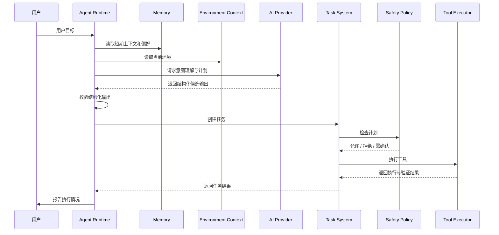

# 09. Agent 与工具设计

## 设计原则

Agent 负责理解和规划，Tool System 负责安全执行。

必须分离：

```text
AI 推理
≠ 权限判断
≠ 设备调用
≠ 结果验证
≠ 任务状态更新
```

AI 输出永远只能作为候选意图或候选计划，不能直接作为可信执行指令。

## 依赖隔离

| 组件 | 允许依赖 | 禁止依赖 |
| --- | --- | --- |
| Agent Runtime | AI Provider、Task System、Environment Context、Memory Service、只读 Tool Catalog 投影 | Repository、SQLAlchemy 模型、数据库会话、Home Assistant HTTP 客户端、Device Adapter |
| Task System | Tool System、Event Service、Task Repository | AI Provider、Home Assistant HTTP 客户端 |
| Tool System | Safety Policy、领域服务、Repository | 直接 SQL、Home Assistant HTTP 客户端 |
| Device Tool Handler | Device Application Service | 数据库会话、AI Provider、Home Assistant HTTP 客户端 |
| AI Provider | HTTP 客户端和配置 | 数据库、Device Adapter、任务状态 |

后端运行在同一个 FastAPI 进程中，不代表模块之间可以随意 import。工程初始化时应通过目录结构和 import 规则强制约束这些边界。

## Agent Runtime

### 职责

1. 接收用户消息。
2. 读取对话历史和短期上下文。
3. 获取 Environment Context。
4. 理解用户意图。
5. 判断是否需要工具。
6. 生成候选任务计划。
7. 将候选计划提交给 Task System。
8. 接收 Task System 返回的任务结果摘要。
9. 必要时基于结果摘要重新规划。
10. 向用户报告结果。

### 不负责

1. 直接调用 Home Assistant。
2. 直接读写数据库。
3. 绕过权限检查。
4. 执行系统命令。
5. 管理工具实现细节。

## Agent 执行流程



## AI Provider 输入

Provider 收到的信息应包括：

- 系统角色说明
- 可用工具定义
- 当前环境摘要
- 相关用户偏好
- 最近对话上下文
- 用户当前消息
- 输出格式要求

Provider 不收到：

- API Key
- 数据库连接信息
- 完整历史事件
- 用户未授权的敏感记忆
- 不相关设备全部详情

## 结构化输出

Agent 请求模型返回结构化 JSON，例如：

```json
{
  "intent": {
    "type": "device_control",
    "confidence": 0.92,
    "target": "living_room_light",
    "action": "turn_on"
  },
  "requires_tool": true,
  "plan": [
    {
      "name": "turn_on_living_room_light",
      "tool_name": "control_device",
      "input": {
        "device_id": "device-uuid",
        "action": "turn_on"
      }
    }
  ],
  "reply_to_user": "我将为你打开客厅灯。"
}
```

该输出必须通过 Pydantic 校验。字段缺失、工具不存在、参数非法、设备不存在时，都不能执行。

## 意图类型

第一阶段建议支持：

| Intent | 说明 | 默认风险 |
| --- | --- | --- |
| `environment_query` | 查询环境状态 | read_only |
| `device_query` | 查询设备状态 | read_only |
| `event_query` | 查询事件历史 | read_only |
| `device_control` | 控制设备 | low_risk 或更高 |
| `automation_request` | 创建或修改自动化 | medium_risk |
| `smalltalk` | 普通对话 | read_only |
| `unsupported` | 不支持的目标 | 不执行 |

`automation_request` 只允许描述少量 Nova 上下文规则。普通定时、状态触发和场景自动化应继续由用户在 Home Assistant 中配置，Nova 不提供通用自动化编辑器。

## Tool Registry

每个工具必须注册：

| 字段 | 说明 |
| --- | --- |
| name | 唯一名称 |
| version | 版本 |
| description | 用途说明 |
| category | 工具类别 |
| input_schema | 输入 Schema |
| output_schema | 输出 Schema |
| risk_level | 风险等级 |
| default_permission | 默认权限 |
| requires_confirmation | 是否需要确认 |
| handler | 内部处理函数引用 |

Agent 只能看见已启用且当前用户有权限调用的工具。

Agent 接收到的是 Tool Catalog 的只读投影，只包含工具名、用途说明、输入 Schema、输出 Schema 和风险等级，不包含 handler 引用、数据库对象或外部平台客户端。

## 第一阶段工具

### 1. `list_devices`

**用途：** 查询设备列表。

**输入：**

```json
{
  "area": "living_room",
  "device_type": "light",
  "online": true
}
```

**输出：**

```json
{
  "devices": [
    {
      "id": "device-uuid",
      "name": "客厅灯",
      "type": "light",
      "state": "on"
    }
  ]
}
```

**风险：** `read_only`

### 2. `get_device_state`

**用途：** 查询单个设备当前状态。

**输入：**

```json
{
  "device_id": "device-uuid"
}
```

**输出：**

```json
{
  "device_id": "device-uuid",
  "state": "on",
  "attributes": {
    "brightness": 80
  },
  "observed_at": "2026-10-26T10:00:00Z"
}
```

**风险：** `read_only`

### 3. `get_environment_state`

**用途：** 查询当前环境上下文。

**输入：**

```json
{
  "include_devices": true,
  "include_recent_events": true,
  "area": "living_room"
}
```

**风险：** `read_only`

### 4. `control_device`

**用途：** 执行低风险设备动作。

**输入：**

```json
{
  "device_id": "device-uuid",
  "action": "turn_on",
  "parameters": {},
  "expected_state": "on"
}
```

**输出：**

```json
{
  "device_id": "device-uuid",
  "action": "turn_on",
  "executed": true,
  "verified": true,
  "actual_state": "on"
}
```

**风险：** 默认 `low_risk`，设备或能力配置可以提高风险等级。

### 5. `query_events`

**用途：** 查询事件历史。

**输入：**

```json
{
  "event_type": "device_state_changed",
  "subject_id": "device-uuid",
  "limit": 20
}
```

**风险：** `read_only`

## Tool Executor 执行链

```text
接收工具调用
→ 查找 Tool Registry
→ 检查工具启用状态
→ Pydantic 参数校验
→ Safety Policy 权限检查
→ 风险等级检查
→ 用户确认检查
→ 执行 handler
→ 处理错误
→ 执行结果验证
→ 写入 ToolExecutionRecord
→ 发布 tool_executed 事件
→ 返回标准 ToolResult
```

任何一步失败都不会继续执行。

## Tool Result

```json
{
  "tool_name": "control_device",
  "status": "completed",
  "input": {},
  "output": {},
  "verified": true,
  "risk_level": "low_risk",
  "permission_result": "allowed",
  "error": null,
  "correlation_id": "correlation-uuid"
}
```

## 权限模型

### 风险等级

| 等级 | 含义 | 默认策略 |
| --- | --- | --- |
| read_only | 只读查询 | 登录后允许 |
| low_risk | 影响小且可逆 | 允许，但记录日志 |
| medium_risk | 可能影响舒适度或触发自动化 | 默认需确认 |
| high_risk | 涉及安全、财产或不可逆操作 | 默认禁止 |

### 工具权限

第一阶段使用配置驱动：

```json
{
  "tool_permissions": {
    "list_devices": "allow",
    "get_device_state": "allow",
    "get_environment_state": "allow",
    "control_device": "allow_low_risk",
    "query_events": "allow"
  }
}
```

### 设备权限

设备级可以覆盖工具默认策略：

```json
{
  "device_id": "device-uuid",
  "enabled": true,
  "allowed_actions": ["turn_on", "turn_off"],
  "max_risk_level": "low_risk"
}
```

## 用户确认

当 Safety Policy 返回 `confirmation_required`：

1. Task 状态变为 `waiting_confirmation`。
2. Agent 向用户展示动作、设备、参数和风险。
3. 前端提交确认。
4. 系统校验 confirmation token。
5. 任务恢复执行。
6. 记录 `user_confirmed` 事件。

未确认任务超时后应转为 `cancelled` 或保持等待用户处理，第一阶段建议使用可配置超时。

## 执行结果验证

只读工具验证输出 Schema。

设备控制工具必须验证：

1. 设备执行前状态。
2. 预期状态。
3. 执行后实际状态。
4. 是否与预期一致。
5. 是否超时。
6. 是否出现设备离线。

如果服务调用成功但状态未达到预期，任务不能标记为成功，应标记为执行后验证失败。

## 模型输出错误处理

| 错误 | 处理 |
| --- | --- |
| JSON 解析失败 | 不执行，要求模型重试一次 |
| Schema 校验失败 | 不执行，记录 Provider 日志 |
| 工具不存在 | 不执行，返回不支持 |
| 参数非法 | 不执行，返回参数错误 |
| 设备不存在 | 尝试设备匹配或要求用户澄清 |
| 权限不足 | 不执行，返回权限拒绝 |
| 高风险动作 | 不执行，要求确认或直接拒绝 |
| Provider 超时 | 任务失败或转为待重试 |

## 防提示注入

设备名称、事件内容或外部数据可能包含恶意指令。Agent 必须把这些内容当作数据，不当作系统指令。

控制措施：

1. 外部数据放在明确的数据字段中。
2. 系统提示声明外部内容不可改变规则。
3. 工具调用仍必须经过 Schema 和 Safety Policy。
4. 高风险操作不因文本中的“已授权”而跳过确认。
5. 用户确认必须来自 Web 控制台或明确交互接口，不能来自模型输出。

## 第一阶段不做

1. 多 Agent 协作。
2. 自动执行任意系统命令。
3. 任意网络访问工具。
4. 文件删除工具。
5. 高风险设备自动控制。
6. 复杂自主反思循环。
7. 插件市场。

## 测试要求

1. 意图识别成功和失败。
2. 工具选择正确。
3. 结构化输出校验。
4. 参数非法拒绝。
5. 权限不足拒绝。
6. 高风险确认。
7. 设备离线处理。
8. 控制后状态验证。
9. Provider 超时。
10. 工具执行日志完整。
11. 提示注入不改变权限判断。

## 未来扩展

1. 多步任务规划。
2. 工具组合。
3. 失败自动重规划。
4. 本地模型 Provider。
5. 语音输入 Agent。
6. 视觉理解工具。
7. 机器人能力评估。

以上能力必须在安全策略成熟后再实现。机器人只作为远期评估方向，不在当前 Tool Registry 中预留工具集。
