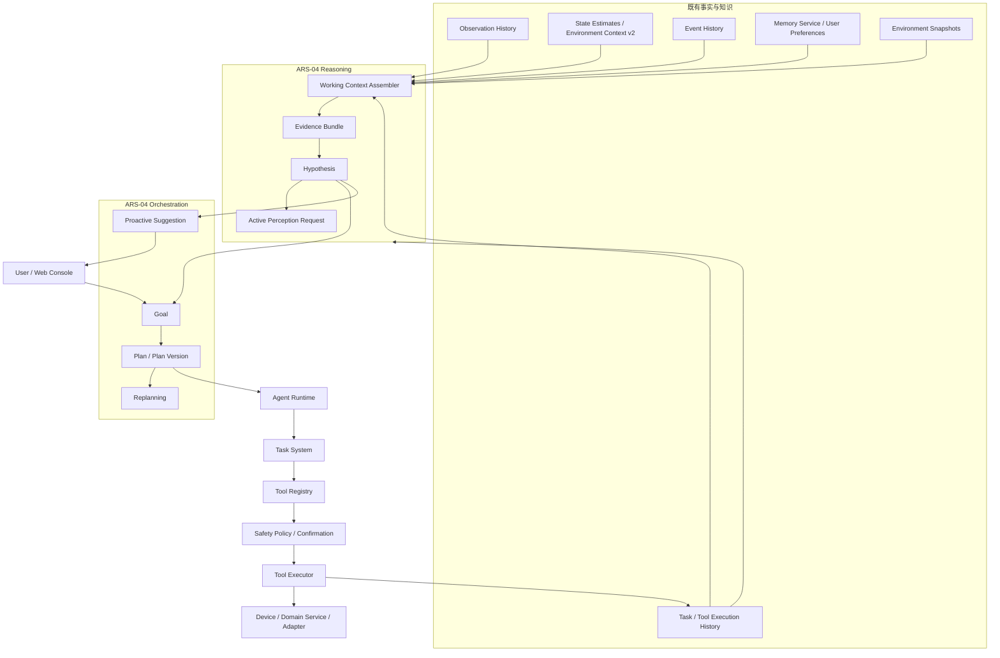
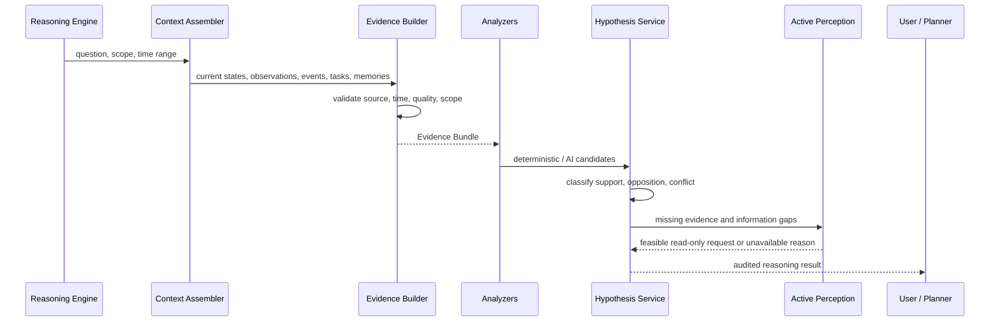
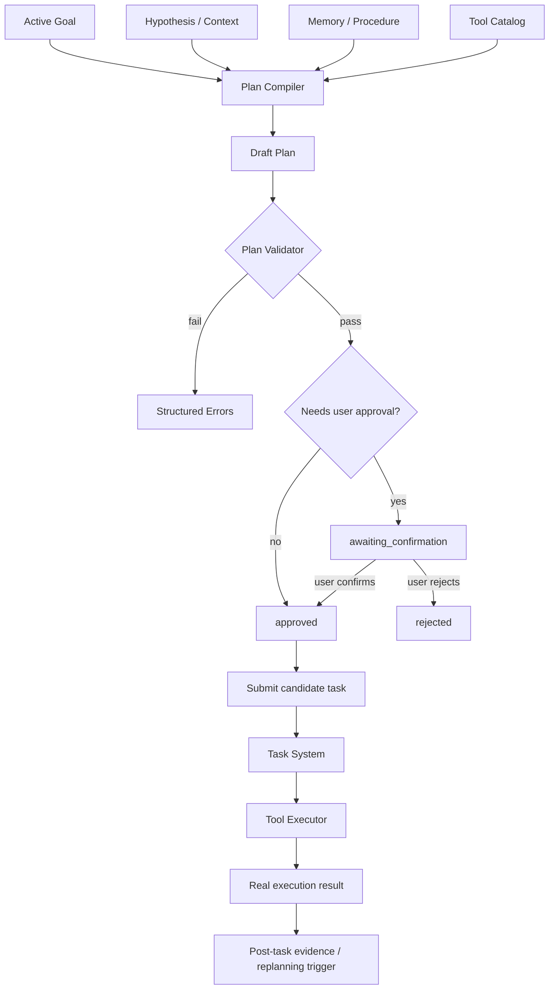
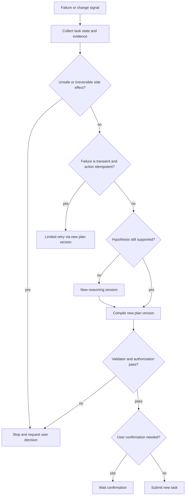
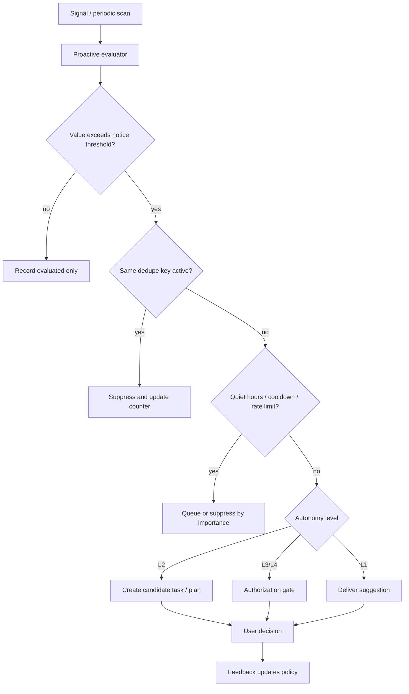
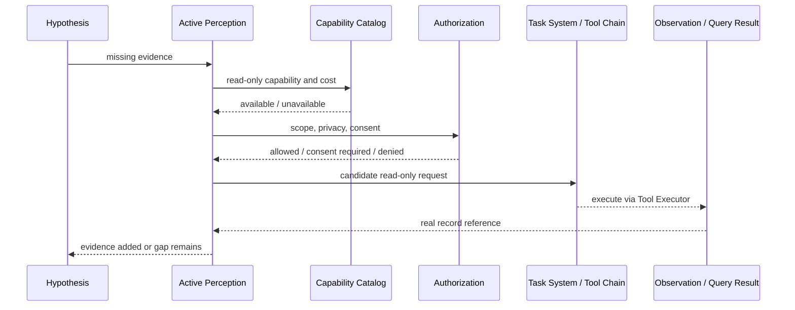
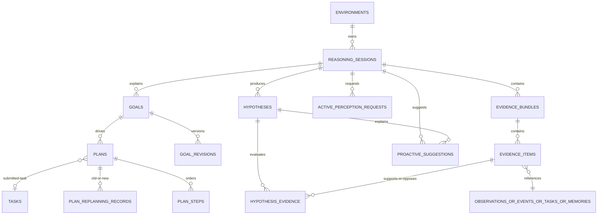

# 29. ARS-04 World Reasoning & Orchestration 设计

- 阶段：`ARS-04.0：架构设计与数据契约冻结`
- 日期：2026-11-04
- 状态：设计完成，等待用户确认；本文不是已实现行为
- 范围：Reasoning Engine、Evidence Model、Hypothesis Model、Planning Engine、Goal Model、Plan Model、Replanning、Proactive Intelligence、Active Perception、用户授权和自主执行范围
- 禁止事项：本文不修改业务代码、数据库迁移、API、依赖或前端页面；不实现自主设备控制、多 Agent 框架、机器人控制、向量数据库或通用自动化编辑器

## 1. 设计结论

ARS-04 的目标是让 Arvuno 从“能查询和执行”升级为“能解释、比较、规划、提出建议并知道还缺什么信息”。它不改变既有事实源和执行链路：

1. Observation History 继续是原始观测事实源。
2. State Estimate 继续是当前状态判断的事实源。
3. Event History 继续是重要事件事实源。
4. Task History 和 Tool Execution 继续是执行过程事实源。
5. Memory 继续是经过筛选和授权的长期知识。
6. Agent Runtime 继续负责理解用户输入和组织候选输出。
7. Task System 继续管理实际任务状态。
8. Tool Executor 继续独占参数校验、权限、确认、审计和结果验证。

ARS-04 新增的是“可审计的推理工作产品”：Evidence Bundle、Hypothesis、Goal、Plan、Replanning Record、Proactive Suggestion 和 Active Perception Request。这些记录保存分析和决策过程，不复制原始历史，也不能替代原始历史。

核心判断：

| 问题 | 回答 |
| --- | --- |
| 现实现在怎么样 | Environment Context v2 与 State Estimate |
| 过去发生了什么 | Observation / Event / Task / Snapshot History |
| 长期知道什么 | Memory 与 User Preference |
| 这些证据可能说明什么 | Reasoning Engine 与 Hypothesis |
| 用户想达到什么 | Goal Model |
| 应该怎么做 | Planning Engine 与 Plan |
| 谁真正执行 | Task System 与 Tool Executor |
| 什么时候值得提醒 | Proactive Intelligence |
| 还缺什么信息 | Active Perception |

最重要的安全结论是：Reasoning 和 Planning 都是候选分析能力，不是执行权限。模型输出不能扩大用户授权，不能绕过 Safety Policy，不能把推断改写为 observed 事实，也不能把时间相关误写为因果结论。

## 2. 总体架构

### 2.1 架构图



图中的 `Reasoning` 读入事实和知识，输出证据、假设、感知缺口、建议或候选计划；`Task System` 是唯一把计划变为执行过程的地方。Reasoning 不直接连接 `DEV`，Planning 也不直接连接 `EXEC`。

### 2.2 职责矩阵

| 模块 | 负责 | 明确不做 |
| --- | --- | --- |
| Reasoning Engine | 组装证据、生成和评价候选解释、暴露不确定性、提出信息缺口 | 不控制设备、不直接执行工具、不直接创建执行任务、不写永久事实 |
| Evidence Model | 引用并结构化已有记录，记录时间、质量、信任级别和选择原因 | 不复制完整历史表、不改写原始记录、不把引用伪装成原始观测 |
| Hypothesis Model | 保存可审计候选解释及其支持、反对、冲突和状态 | 不把 AI 候选当事实、不把相关当因果、不自动写入 semantic memory |
| Planning Engine | 把已确认目标和推理结论编译为版本化候选计划并验证结构 | 不执行工具、不绕过 Task System、不发明未注册工具 |
| Goal Model | 保存用户目标、范围、约束、成功条件、失败条件和授权 | 不把一次自然语言请求直接当作已确认长期目标 |
| Replanning | 记录计划失效原因、差异和风险，生成新候选版本 | 不静默重试非幂等设备动作、不覆盖旧版本 |
| Proactive Intelligence | 判断何时值得提醒、建议或创建候选任务，并控制频率 | 不直接执行动作、不绕过静默期、不持续打扰用户 |
| Active Perception | 判断缺什么观测、是否值得补充、用哪个只读能力获取 | 不直接访问 Adapter、摄像头或 Repository、不伪造观测 |
| Agent Runtime | 理解用户意图、调用只读检索工具、提交候选 Task | 不访问 SQLAlchemy / Repository、不直接执行设备动作 |
| Task System | 管理任务、步骤、状态、确认和执行过程 | 不做环境分析、不生成自由形式工具调用 |
| Tool Executor | Schema 校验、Safety Policy、确认、审计、执行、结果验证 | 不决定长期目标、不解释因果关系、不改 Reasoning 结论 |

### 2.3 模块依赖边界

| 模块 | 允许依赖 | 禁止依赖 |
| --- | --- | --- |
| Reasoning Service | Environment Context 只读接口、Memory Retrieval、History Query、Task / Event 查询服务、AI Provider 抽象 | SQLAlchemy Session、Repository、Device Adapter、Home Assistant HTTP 客户端、Tool Executor |
| Planning Service | Reasoning 结果、Goal Service、Tool Catalog 只读投影、Memory Retrieval、Task System 提交接口 | Tool Handler、数据库 Session、Device Adapter、任意系统命令 |
| Proactive Service | Reasoning 结果、规则、通知服务、候选任务创建接口、用户反馈接口 | 直接执行设备动作、直接调用 Tool Handler |
| Active Perception Service | Evidence 缺口、观测能力目录、只读查询服务、授权服务 | 摄像头或机器人硬件客户端、伪造 Observation 写入、绕过授权 |
| API | Pydantic Schema、对应 Service | Repository、SQLAlchemy、Provider Prompt、设备客户端 |

现有 `retrieve_memory` 和 `query_history` 工具继续作为 Agent 的只读入口。ARS-04 工程实现可以复用其 Service 层，但 Reasoning Service 不应通过 HTTP 调用本进程内部 API，也不应让 AI Provider 拿到数据库对象。

## 3. Reasoning Engine

### 3.1 定位

Reasoning Engine 回答“当前证据支持哪些解释、还有哪些不确定性、还需要什么信息”。它位于状态估计之上、计划编制之下。

输入：

1. 用户问题或触发场景。
2. Environment Context v2 当前状态和缺失覆盖。
3. 相关 Observation、Event、Task、Snapshot 历史引用。
4. 相关 Memory、User Preference 和已验证 Procedural Memory。
5. 时间、空间、实体和授权范围。
6. 用户提供的补充陈述。

输出：

1. Evidence Bundle。
2. 一个或多个 Hypothesis。
3. 支持和反对每个假设的证据关系。
4. 冲突、过期、缺失和低质量数据说明。
5. 信息缺口和 Active Perception Request。
6. 可供 Planner 使用的结构化诊断，而不是自由文本结论。

Reasoning Engine 可以包含两类分析器：

| 类型 | 示例 | 规则 |
| --- | --- | --- |
| 确定性分析器 | 时间窗口统计、状态变化检测、阈值比较、空间覆盖缺口、任务关联 | 输入输出固定、可测试、可重复；优先实现 |
| AI 候选分析器 | 根据证据生成候选解释或下一步需要的信息 | 输出只能是 hypothesis candidate 或 perception request candidate，必须经过结构化校验和来源标注 |

AI 输出不能直接改变 State Estimate、Memory、Goal、Plan 状态或设备状态。

### 3.2 推理流程



### 3.3 事实与推断语言

回答必须区分：

| 表述 | 允许的条件 |
| --- | --- |
| “观测到” | 有 Observation 或设备状态原始记录 |
| “当前估计为” | 有 State Estimate 和生成规则 |
| “事件发生” | 有 Event 或 Task / Tool Execution 记录 |
| “长期知识表明” | 有 active / corrected Memory 或 active Preference |
| “证据支持” | Evidence 关系成立，但不是事实改写 |
| “可能是” | Hypothesis 状态最高为 plausible 或 supported，且保留不确定性 |
| “因为 A 导致 B” | 有明确机制、可控实验、受控任务或可复验证据链 |
| “无法判断” | 证据不足、冲突、过期或缺少采集时间 |

时间先后、空间共现和任务相关性只能表述为关联或候选解释。只有满足以下至少一项，才能升级为因果结论：

1. 用户明确确认了现实机制。
2. 经过可重复的验证任务并保留执行前后证据。
3. 领域规则有明确物理或系统机制，且输入满足适用条件。
4. 反事实或对照组证据足够，且结论仍带适用范围。

即使满足上述条件，也应保存在 Hypothesis 或 Memory 的对应来源规则中，不得改写原始 Observation。

## 4. Evidence Model

Evidence 是对既有记录的受控引用和评估，不是第二条历史。所有 Evidence Item 必须指向一个真实存在的原始记录或明确的用户陈述上下文。

### 4.1 数据契约

#### `reasoning_sessions`

| 字段 | 类型 / 约束 | 说明 |
| --- | --- | --- |
| `id` | UUID / PK | 推理会话 ID |
| `environment_id` | FK → `environments.id` | 运行范围 |
| `question` | text | 用户问题、触发规则说明或分析任务 |
| `session_type` | string | `user_query`、`task_diagnosis`、`proactive_scan`、`plan_review`、`postmortem` |
| `trigger_type` | string | `user`、`task`、`event`、`schedule`、`system` |
| `trigger_record_id` | string，nullable | 触发来源记录 ID |
| `status` | string | `running`、`completed`、`failed`、`cancelled`、`expired` |
| `time_range_start` / `time_range_end` | UTC datetime，nullable | 分析范围 |
| `space_scope` | JSON | 空间范围和是否包含后代 |
| `entity_scope` | JSON | 实体或设备范围 |
| `context_cutoff_at` | UTC datetime | 参与数据的最大时间 |
| `model_id` / `model_version` | string，nullable | 若使用 AI，记录模型身份 |
| `reasoning_policy_id` / `reasoning_policy_version` | string | 分析器和提示策略版本 |
| `summary` | JSON | 结论、不确定性、缺口和候选下一步的结构化摘要 |
| `created_by` | string | `user`、`automation`、`system`、`model` |
| `created_at` / `updated_at` / `completed_at` | UTC datetime | 生命周期时间 |

#### `evidence_bundles`

| 字段 | 类型 / 约束 | 说明 |
| --- | --- | --- |
| `id` | UUID / PK | 证据包 ID |
| `session_id` | FK → `reasoning_sessions.id` | 所属推理会话 |
| `environment_id` | FK → `environments.id` | 冗余查询和删除边界 |
| `purpose` | string | `context`、`supporting`、`opposing`、`conflict`、`baseline`、`gap` |
| `selection_policy` | JSON | 选择窗口、排序、数量、过滤条件和排除原因 |
| `coverage` | JSON | 时间、空间、实体和属性覆盖情况 |
| `quality_summary` | JSON | 输入数量、有效数量、冲突数、过期数、缺失数 |
| `source_digest` | string | 证据引用集合摘要，用于检测相同输入重复推理 |
| `created_at` | UTC datetime | 创建时间 |

#### `evidence_items`

| 字段 | 类型 / 约束 | 说明 |
| --- | --- | --- |
| `id` | UUID / PK | 证据项 ID |
| `bundle_id` | FK → `evidence_bundles.id` | 所属证据包 |
| `source_type` | string | `observation`、`state_estimate`、`event`、`task`、`task_step`、`tool_execution`、`memory`、`user_preference`、`conversation_message`、`environment_snapshot`、`user_statement` |
| `source_id` | string | 原始记录 ID；`user_statement` 可指向用户确认消息 |
| `source_revision` | string，nullable | 记录版本或时间点，防止歧义 |
| `subject_type` / `subject_id` | string | 实体、空间、设备或环境主体 |
| `attribute` | string，nullable | 温度、湿度、电源状态等属性 |
| `recorded_at` | UTC datetime，nullable | 原始记录语义时间 |
| `received_at` / `processed_at` | UTC datetime，nullable | 继承上游时间语义 |
| `quality` | JSON | 有效、迟到、未来偏差、缺失采集时间、单位、精度 |
| `trust_level` | string | `direct`、`high`、`normal`、`low`、`unknown` |
| `relevance` | string | `direct`、`supporting`、`opposing`、`context`、`negative` |
| `selection_reason` | string | 为什么进入证据包 |
| `snapshot` | JSON | 最小必要摘要，不含完整原始记录 |
| `created_at` | UTC datetime | 关联时间 |

唯一约束：`(bundle_id, source_type, source_id, source_revision)`。索引覆盖 `source_type/source_id`、`subject_type/subject_id` 和 `recorded_at`。

### 4.2 来源规则

1. 创建 Evidence 时必须验证来源记录存在且属于当前 environment / 授权范围。
2. 原始记录被隐私删除或保留清理后，Evidence 默认保留引用和最小摘要，但必须显示 `source_unavailable`；不得继续冒充可追溯事实。
3. 不把 Prompt、模型中间 token、完整对话或 API Key 写入 Evidence。
4. Evidence 不承担原始记录修复职责；发现数据问题时输出诊断。
5. 用户陈述必须记录会话、消息或确认来源，并区分明确事实陈述和临时表达。
6. 所有时间字段沿用 SQLite naive UTC 存储、API aware datetime 的现有约定，并保留采集 / 接收 / 处理时间差异。

## 5. Hypothesis Model

Hypothesis 保存“候选解释”，不是事实。它必须保留竞争假设，不能只保存一个胜者。

### 5.1 数据契约

#### `hypotheses`

| 字段 | 类型 / 约束 | 说明 |
| --- | --- | --- |
| `id` | UUID / PK | 假设 ID |
| `session_id` | FK → `reasoning_sessions.id` | 来源推理会话 |
| `environment_id` | FK → `environments.id` | 运行范围 |
| `statement` | text | 可读假设，例如“客厅湿度升高可能与晾晒衣物有关” |
| `hypothesis_type` | string | `state_explanation`、`causal_candidate`、`anomaly`、`device_fault`、`user_need`、`task_outcome`、`data_quality` |
| `origin_type` | string | `rule`、`model`、`user`、`task_validation`、`system` |
| `origin_id` | string，nullable | 规则、模型输出、用户消息或任务验证 ID |
| `status` | string | `unsupported`、`plausible`、`supported`、`conflicted`、`refuted`、`expired`、`superseded` |
| `confidence_level` | string | `unknown`、`low`、`medium`、`high`；不是概率值 |
| `explanation` | JSON | 机制、适用范围、前提条件和排除条件 |
| `uncertainty` | JSON | 缺失证据、冲突、替代解释和时间限制 |
| `causal_claim` | boolean | 是否声称因果关系 |
| `causal_evidence_level` | string，nullable | `none`、`correlation`、`mechanism`、`controlled_task`、`user_confirmed` |
| `valid_from` / `valid_until` | UTC datetime | 解释适用区间 |
| `superseded_by_id` | FK → `hypotheses.id`，nullable | 被哪个假设替代 |
| `memory_id` | FK → `memories.id`，nullable | 若用户确认后形成长期记忆，仅引用 |
| `created_at` / `updated_at` / `closed_at` | UTC datetime | 生命周期时间 |

#### `hypothesis_evidence`

| 字段 | 类型 / 约束 | 说明 |
| --- | --- | --- |
| `hypothesis_id` | FK → `hypotheses.id` | 假设 |
| `evidence_item_id` | FK → `evidence_items.id` | 证据 |
| `relation` | string | `supports`、`opposes`、`context`、`contradicts`、`missing` |
| `weight` | string | `unknown`、`weak`、`normal`、`strong`；不允许任意数值 |
| `reason` | text | 关系依据 |
| `created_at` | UTC datetime | 关联时间 |

主键为 `(hypothesis_id, evidence_item_id)`。

### 5.2 状态规则

| 状态 | 进入条件 |
| --- | --- |
| `unsupported` | 只有问题或猜测，没有足够证据 |
| `plausible` | 有部分一致证据，无决定性验证 |
| `supported` | 多个独立高质量证据一致，且没有未解释冲突 |
| `conflicted` | 高质量证据互相矛盾 |
| `refuted` | 反证明确，或验证任务结果否定前提 |
| `expired` | 适用时间、空间或实体范围失效 |
| `superseded` | 被更完整、更新或用户确认的假设替代 |

状态迁移：

```text
unsupported → plausible / refuted / expired
plausible → supported / conflicted / refuted / expired / superseded
supported → conflicted / refuted / expired / superseded
conflicted → plausible / supported / refuted / expired / superseded
closed states → expired / superseded
```

规则：

1. `supported` 仍不是现实事实；对外表述必须保留“基于保留证据”。
2. `causal_claim=true` 时必须给出 `causal_evidence_level`；仅有 correlation 时不得声称因果。
3. AI 生成的假设初始只能是 `unsupported` 或 `plausible`，不能自评为 `supported`。
4. 用户确认可以提升解释的可信度，但不改变原始观测；是否写入 Memory 必须走 ARS-03 授权和来源规则。
5. 新证据到达时可以创建新假设或版本，不静默改写旧结论；被替代记录保留。

## 6. Goal Model

Goal 保存用户或系统明确承认的目标，是 Plan 的输入。自然语言目标首先只能是 candidate goal。

### 6.1 数据契约

#### `goals`

| 字段 | 类型 / 约束 | 说明 |
| --- | --- | --- |
| `id` | UUID / PK | 目标 ID |
| `environment_id` | FK → `environments.id` | 运行范围 |
| `title` | string | 用户可读标题 |
| `description` | text | 目标说明 |
| `origin_type` | string | `user`、`model`、`automation`、`system` |
| `origin_record_id` | string，nullable | 用户消息、任务或建议来源 |
| `status` | string | `candidate`、`active`、`paused`、`completed`、`failed`、`cancelled`、`expired` |
| `goal_type` | string | `comfort`、`energy`、`device_state`、`routine`、`diagnosis`、`safety_check`、`other` |
| `scope` | JSON | 空间、实体、设备、时间、用户范围 |
| `desired_state` | JSON | 期望状态或条件表达式 |
| `constraints` | JSON | 温度范围、时间窗、费用、噪音、设备限制 |
| `prohibitions` | JSON | 明确禁止的动作或设备 |
| `success_conditions` | JSON | 可验证成功条件 |
| `failure_conditions` | JSON | 会终止或要求确认的条件 |
| `priority` | string | `low`、`normal`、`high`、`critical`；critical 不代表可绕过安全 |
| `authorization_scope` | JSON | 允许的最大工具风险、设备范围和自动化等级 |
| `time_window` | JSON | 生效时间、重复周期或截止时间 |
| `reasoning_session_id` | FK → `reasoning_sessions.id`，nullable | 目标编译依据 |
| `parent_goal_id` | FK → `goals.id`，nullable | 目标分解或依赖 |
| `confirmed_by_user` | boolean | 是否用户确认 |
| `created_at` / `updated_at` / `closed_at` | UTC datetime | 生命周期时间 |

#### `goal_revisions`

| 字段 | 类型 / 约束 | 说明 |
| --- | --- | --- |
| `id` | UUID / PK | 修订 ID |
| `goal_id` | FK → `goals.id` | 目标 |
| `revision` | integer | 版本号 |
| `change_type` | string | `create`、`clarify`、`rescope`、`confirm`、`pause`、`resume`、`close` |
| `before` / `after` | JSON | 目标关键字段快照 |
| `reason` | text | 修改原因 |
| `source_type` / `source_id` | string | 修订来源 |
| `created_at` | UTC datetime | 修订时间 |

### 6.2 生命周期

```text
candidate → active → paused → active
candidate → cancelled
active → completed / failed / cancelled / expired
paused → cancelled / expired
completed / failed → reopened as new revision or new goal
```

确认规则：

1. `origin_type=model` 或来自模糊自然语言的目标必须先作为 candidate 展示给用户。
2. 影响设备执行、费用、隐私或安全的目标必须用户确认。
3. 用户确认只能收紧或确认既有范围，不能被模型输出解释为扩大授权。
4. 目标修改必须保留 revision，不覆盖原始意图。
5. 成功和失败条件必须尽量绑定可查询状态、事件、任务结果或观测范围；完全不可验证的目标不能自动执行。

## 7. Planning Engine 与 Plan Model

### 7.1 定位

Planning Engine 把 Goal 和 Reasoning 结论编译为候选 Plan。它负责“应该按什么顺序做什么、满足什么条件、怎么验证”，不负责实际执行。

Planner 输入：

1. active Goal。
2. Environment Context 和相关 Hypothesis。
3. 用户偏好和已验证程序记忆。
4. Tool Catalog 只读投影。
5. 设备能力、状态和授权摘要。
6. 时间、依赖、风险和资源约束。

Planner 输出：

1. Plan 主记录。
2. 有序 Plan Step。
3. 前置条件、后置条件和验证方式。
4. 风险说明和需要确认的步骤。
5. 失败停止策略。
6. 提交给 Agent Runtime / Task System 的候选任务。

### 7.2 数据契约

#### `plans`

| 字段 | 类型 / 约束 | 说明 |
| --- | --- | --- |
| `id` | UUID / PK | 计划 ID |
| `environment_id` | FK → `environments.id` | 运行范围 |
| `goal_id` | FK → `goals.id` | 目标 |
| `reasoning_session_id` | FK → `reasoning_sessions.id`，nullable | 推理依据 |
| `version` | integer | 同一目标下递增版本 |
| `status` | string | `draft`、`validated`、`awaiting_confirmation`、`approved`、`submitted`、`superseded`、`cancelled`、`rejected` |
| `planner_type` | string | `rule`、`model`、`hybrid`、`template`、`user` |
| `strategy` | JSON | 选择该计划的理由、替代方案和不选择原因 |
| `constraints` | JSON | 从 Goal、安全策略和环境读取的约束 |
| `max_risk_level` | string | 计划声明最大风险 |
| `estimated_duration` | JSON，nullable | 估算和依据；无法估算则显式 unknown |
| `resource_requirements` | JSON | 设备、数据、授权或用户在场要求 |
| `success_criteria` | JSON | 计划级可验证条件 |
| `failure_policy` | JSON | 停止、等待确认或请求重规划的规则 |
| `submitted_task_id` | FK → `tasks.id`，nullable | 提交后的任务 |
| `superseded_by_id` | FK → `plans.id`，nullable | 新版本 |
| `created_at` / `updated_at` / `closed_at` | UTC datetime | 生命周期时间 |

唯一约束：`(goal_id, version)`。

#### `plan_steps`

| 字段 | 类型 / 约束 | 说明 |
| --- | --- | --- |
| `id` | UUID / PK | 步骤 ID |
| `plan_id` | FK → `plans.id` | 所属计划 |
| `step_index` | integer | 执行顺序 |
| `name` | string | 人类可读步骤名 |
| `purpose` | text | 该步骤对目标的作用 |
| `tool_name` | string | 只能引用 Tool Registry 中存在的工具名 |
| `tool_version` | string，nullable | 编译时看到的工具版本 |
| `input` | JSON | 符合工具 input schema 的候选参数 |
| `preconditions` | JSON | 设备在线、状态范围、时间窗、用户在场 |
| `expected_effect` | JSON | 预期状态或输出 |
| `postconditions` | JSON | 步骤后应成立的条件 |
| `verification` | JSON | 用哪个只读工具或状态检查验证 |
| `risk_level` | string | 从工具和能力推导的候选风险 |
| `requires_confirmation` | boolean | Planner 的候选判断；最终仍由 Safety Policy 决定 |
| `idempotency_key` | string，nullable | 可安全重复执行的幂等键 |
| `retry_policy` | JSON | 仅允许显式声明安全的幂等重试 |
| `on_failure` | string | `stop`、`request_user_confirmation`、`request_replan` |
| `depends_on` | JSON | 前置步骤 ID 列表 |
| `created_at` | UTC datetime | 创建时间 |

### 7.3 计划状态

```text
draft → validated → awaiting_confirmation → approved → submitted
draft / validated → rejected / cancelled
awaiting_confirmation → rejected / cancelled
submitted → superseded by new plan revision
any active state → cancelled
```

状态语义：

1. `validated` 只表示结构、工具、Schema、依赖和风险检查通过，不表示已授权执行。
2. `approved` 必须来自用户或明确授权规则。
3. `submitted` 表示已转换为 Task；后续执行状态以 Task System 为准。
4. Plan 不复制 Task 的执行状态，不把模型预测写成执行结果。
5. Plan API 不提供执行按钮；提交后仍由既有任务确认和执行接口处理。

### 7.4 计划验证

Plan Validator 至少检查：

1. Goal 为 active 且未过期。
2. 每个 `tool_name` 存在、启用且在当前授权目录内。
3. `input` 逐项通过工具 input schema。
4. 参数引用的空间、实体、设备存在且属于 scope。
5. 依赖无环，`step_index` 与 `depends_on` 不矛盾。
6. 非只读步骤有预期效果和验证方式。
7. 风险等级不超过 Goal 授权范围和系统最大自主等级。
8. `prohibitions` 没有被任何步骤违反。
9. 非幂等动作没有自动重试。
10. 需要用户在场的步骤不能标记为可自动执行。
11. AI 输出没有夹带 Handler、SQL、Repository、URL、系统命令或任意代码。

验证失败必须返回结构化错误，不能静默修正模型输出后执行。

### 7.5 计划流程



## 8. Replanning

### 8.1 触发条件

Replanning 只生成新的 Plan version，不覆盖旧版本。触发来源包括：

1. 前置条件失效。
2. 设备离线、不可用或能力变化。
3. 状态与预期显著不一致。
4. 用户修改 Goal 或授权范围。
5. 用户取消当前任务。
6. 工具执行失败。
7. 后置条件验证失败。
8. 更高优先级目标或安全约束出现。
9. 时间窗即将结束或已结束。
10. 新观测推翻关键假设。

### 8.2 数据契约

#### `plan_replanning_records`

| 字段 | 类型 / 约束 | 说明 |
| --- | --- | --- |
| `id` | UUID / PK | 重规划记录 ID |
| `environment_id` | FK → `environments.id` | 运行范围 |
| `old_plan_id` | FK → `plans.id` | 旧计划 |
| `new_plan_id` | FK → `plans.id`，nullable | 新计划；可能只失败不生成 |
| `task_id` | FK → `tasks.id`，nullable | 关联任务 |
| `trigger_type` | string | `precondition_failed`、`tool_failed`、`verification_failed`、`goal_changed`、`environment_changed`、`user_cancelled`、`priority_preempted`、`timeout` |
| `trigger_record_type` / `trigger_record_id` | string，nullable | 触发证据 |
| `change_summary` | JSON | 状态、目标、工具或环境变化 |
| `risk_delta` | JSON | 新旧风险、授权和不可逆动作差异 |
| `already_executed_steps` | JSON | 已执行步骤和结果引用 |
| `reversible_steps` | JSON | 可补偿步骤和条件 |
| `decision` | string | `replan`、`stop`、`wait_user_confirmation`、`reject` |
| `reason` | text | 决策原因 |
| `created_at` | UTC datetime | 记录时间 |

### 8.3 重规划流程



安全规则：

1. 非幂等设备动作不允许静默自动重试。
2. 超时后不能假设动作没有发生，必须先读取或验证状态。
3. 已产生物理影响的计划不能被描述为回滚；只能通过新的设备动作尝试补偿未来状态。
4. 新版本风险提高、扩大范围或改变设备时必须重新确认。
5. 连续重规划设置上限，超过后停止并请求用户处理。
6. 每次重规划必须记录新旧差异和已执行步骤。

## 9. Proactive Intelligence

### 9.1 定位

Proactive Intelligence 判断“什么时候值得打扰用户或创建候选任务”。它不直接执行设备动作。

建议输入：

1. Supported / conflicted Hypothesis。
2. 环境趋势和异常。
3. 用户目标偏差。
4. 任务失败或验证失败。
5. 设备 / 传感覆盖异常。
6. 用户偏好和历史反馈。

建议输出：

1. 不提醒，只记录内部评估。
2. 给用户一条建议。
3. 创建候选任务，等待用户批准。
4. 在明确授权范围内执行有限的低风险动作，本设计默认不开放。

### 9.2 自主等级

| 等级 | 名称 | 行为 | 默认策略 |
| --- | --- | --- | --- |
| L0 | Observe | 只记录评估结果，不通知 | 允许 |
| L1 | Inform | 发送一条低打扰建议 | 可配置，默认允许 |
| L2 | Candidate | 创建候选任务或计划，等待用户批准 | 默认允许 |
| L3 | Confirm | 请求一次性确认后执行 | 必须显式授权 |
| L4 | Autonomy | 在限定范围和风险内自动执行 | 本设计默认禁止 |

L4 即便未来开放，也必须同时满足：

1. Goal 已确认。
2. 动作只读或明确声明幂等的 low-risk。
3. 设备、空间、时间窗和用户在场条件满足。
4. 静默期、冷却和频率限制通过。
5. 有执行后验证和失败停止策略。
6. 用户可以随时撤销授权。

### 9.3 数据契约

#### `proactive_suggestions`

| 字段 | 类型 / 约束 | 说明 |
| --- | --- | --- |
| `id` | UUID / PK | 建议 ID |
| `environment_id` | FK → `environments.id` | 运行范围 |
| `reasoning_session_id` | FK → `reasoning_sessions.id` | 推理依据 |
| `hypothesis_id` | FK → `hypotheses.id`，nullable | 相关假设 |
| `goal_id` | FK → `goals.id`，nullable | 相关目标 |
| `trigger_type` | string | `trend`、`anomaly`、`goal_deviation`、`task_failure`、`coverage_gap`、`device_fault`、`cost_risk` |
| `title` / `message` | text | 用户可见内容 |
| `importance` | string | `low`、`normal`、`high`；不得自动称 emergency |
| `autonomy_level` | integer | 0-4 |
| `candidate_action` | JSON | 建议动作或候选计划，不是已执行结果 |
| `evidence_refs` | JSON | 关键证据引用 |
| `dedupe_key` | string | 相同主体、触发和动作的去重键 |
| `status` | string | `evaluated`、`suppressed`、`queued`、`delivered`、`opened`、`accepted`、`dismissed`、`expired` |
| `delivered_at` | UTC datetime，nullable | 通知时间 |
| `user_feedback` | JSON | 有用、无用、不要再次提醒、授权或拒绝 |
| `cooldown_until` | UTC datetime，nullable | 冷却截止时间 |
| `created_at` / `updated_at` | UTC datetime | 时间 |

索引覆盖 `(environment_id, dedupe_key)`、`status`、`cooldown_until`。

### 9.4 流程与频率控制



控制要求：

1. 相同 `dedupe_key` 在冷却期内只保留一条 active 建议。
2. 静默时间内只有用户显式标记为允许打扰的高重要度建议可以发出。
3. 每小时 / 每天建议数有硬上限。
4. 用户选择“不要再次提醒”必须生成偏好或 suppression 记录，并说明保留时间。
5. 建议质量按打开、接受、忽略、拒绝和用户纠错统计。
6. 低质量触发规则可自动降级或禁用。
7. 通知必须携带证据引用，不得只给模型结论。

## 10. Active Perception

### 10.1 定位

Active Perception 回答“当前结论缺什么证据、是否值得补充、可以用哪个只读能力补充”。它不直接控制传感器、摄像头、机器人或 Adapter。

感知缺口类型：

1. 空间覆盖缺口：没有某个空间的温度、占用等估计。
2. 时间缺口：窗口内无记录或采样不足。
3. 质量缺口：数据冲突、过期、缺少采集时间或时钟偏差。
4. 实体缺口：设备或空间归属不明确。
5. 验证缺口：动作后缺少状态确认。
6. 程序缺口：缺少已验证流程。

### 10.2 数据契约

#### `active_perception_requests`

| 字段 | 类型 / 约束 | 说明 |
| --- | --- | --- |
| `id` | UUID / PK | 请求 ID |
| `environment_id` | FK → `environments.id` | 运行范围 |
| `reasoning_session_id` | FK → `reasoning_sessions.id` | 来源推理 |
| `hypothesis_id` | FK → `hypotheses.id`，nullable | 相关假设 |
| `gap_type` | string | `space_coverage`、`time_coverage`、`quality`、`entity_identity`、`post_action_verification`、`procedure` |
| `subject_type` / `subject_id` | string | 目标空间、实体或设备 |
| `attribute` | string，nullable | 期望属性 |
| `needed_time_range` | JSON | 期望时间范围 |
| `current_coverage` | JSON | 已知覆盖和缺口 |
| `expected_value` / `would_resolve` | JSON | 新观测如何帮助判断 |
| `proposed_capability` | string | 只读工具、既有轮询来源、任务验证或历史查询 |
| `proposed_input` | JSON | 候选输入，仍需 Schema 和权限验证 |
| `privacy_level` | string | `normal`、`sensitive` |
| `requires_user_consent` | boolean | 敏感观测必须为 true |
| `cost_estimate` | JSON | 时间、打扰、费用、带宽或硬件动作 |
| `status` | string | `proposed`、`awaiting_consent`、`rejected`、`queued`、`executed`、`fulfilled`、`unavailable`、`expired` |
| `fulfilled_by_type` / `fulfilled_by_id` | string，nullable | Observation、Task 或查询记录 |
| `unavailable_reason` | text，nullable | 没有硬件、无授权或成本过高 |
| `created_at` / `updated_at` | UTC datetime | 时间 |

### 10.3 流程



规则：

1. 当前没有对应硬件或数据源时，状态必须是 `unavailable`，不得生成虚构 Observation。
2. 补充观测优先使用已有轮询、历史查询和只读工具。
3. 摄像头、麦克风、位置等敏感能力必须显式授权；本阶段不实现这些硬件能力。
4. 需要执行只读工具时仍走 Task System 和 Tool Executor。
5. `fulfilled` 必须引用真实 Observation、Task 或查询结果，不得引用模型输出。
6. 补充观测后必须重新评估 Hypothesis，而不是把新数据直接当作原结论正确。

## 11. 用户授权与自主执行范围

### 11.1 授权矩阵

| 风险 | API / 用户显式操作 | Agent 候选任务 | 自动化 / Proactive |
| --- | --- | --- | --- |
| `read_only` | 登录后允许，记录审计 | 允许，仍走 Tool Executor | 允许，受频率和范围限制 |
| `low_risk` | 依设备和系统配置 | 可提交，Safety Policy 决定 | 仅显式授权范围内允许 |
| `medium_risk` | 通常需确认 | 可生成 waiting confirmation | 默认需用户确认，不静默执行 |
| `high_risk` | 默认禁止 | 拒绝 | 禁止 |

授权不能由以下内容扩大：

1. AI 输出中的“用户已经同意”。
2. 设备名称或事件内容中的提示注入。
3. Memory 中没有授权依据的偏好。
4. Proactive 建议。
5. Plan 或 Hypothesis 状态。

### 11.2 确认内容

用户确认界面必须展示：

1. Goal 和 Plan 版本。
2. 每个非只读步骤的工具、设备、动作和参数。
3. 最大风险和可能影响。
4. 是否不可逆或非幂等。
5. 前置条件、执行窗口和验证方式。
6. 关键证据引用。
7. 已执行步骤（重规划时）。
8. 拒绝后的后果或替代建议。

确认令牌沿用现有一次性、绑定任务、有效期和审计规则。

### 11.3 隐私边界

1. Reasoning 只读取当前问题所需的最小上下文。
2. Provider 输入不包含 API Key、数据库连接、完整历史或未授权敏感记忆。
3. Evidence 的 `snapshot` 只保存最小摘要，敏感值必须受访问级别限制。
4. 用户可以查看、导出和删除 Reasoning Session、Hypothesis、Goal、Plan、Suggestion 和 Perception Request。
5. 删除原始历史时，不自动删除用户明确创建的推理工作产品，但引用必须标记不可用；隐私删除要求级联时应显式执行。
6. 访问 Memory、敏感空间、设备执行历史和用户目标必须记录审计。
7. 通知内容默认不暴露完整家庭活动；详情登录后查看。

## 12. API 草案

所有 API 使用 Bearer Token。本节是设计，不是已实现接口。

### 12.1 Reasoning

| 方法 | 路径 | 用途 |
| --- | --- | --- |
| POST | `/api/reasoning/sessions` | 创建推理会话并异步或同步分析 |
| GET | `/api/reasoning/sessions` | 按状态、时间、空间、触发类型过滤 |
| GET | `/api/reasoning/sessions/{id}` | 查看会话、证据包、假设和缺口摘要 |
| POST | `/api/reasoning/sessions/{id}/cancel` | 取消未完成会话 |
| GET | `/api/reasoning/sessions/{id}/evidence` | 分页查看证据 |
| GET | `/api/reasoning/evidence/{id}/source` | 跳转或解析原始来源 |
| GET | `/api/reasoning/hypotheses` | 按状态、类型、主体、会话过滤 |
| GET | `/api/reasoning/hypotheses/{id}` | 查看假设、证据关系和不确定性 |
| PATCH | `/api/reasoning/hypotheses/{id}` | 用户补充说明或关闭假设 |
| POST | `/api/reasoning/hypotheses/{id}/revise` | 用新证据生成替代版本 |
| POST | `/api/reasoning/hypotheses/{id}/confirm` | 用户确认解释；不等于确认事实写入 |
| DELETE | `/api/reasoning/sessions/{id}` | 按隐私策略删除会话及派生工作产品 |

### 12.2 Goals 和 Plans

| 方法 | 路径 | 用途 |
| --- | --- | --- |
| POST | `/api/goals` | 创建 candidate 或 active goal |
| GET | `/api/goals` | 按状态、类型、范围和优先级过滤 |
| GET | `/api/goals/{id}` | 查看目标和当前计划 |
| PATCH | `/api/goals/{id}` | 澄清、暂停、恢复或关闭 |
| POST | `/api/goals/{id}/confirm` | 用户确认 candidate |
| GET | `/api/goals/{id}/revisions` | 查看目标历史 |
| DELETE | `/api/goals/{id}` | 删除未执行或按隐私策略处理 |
| POST | `/api/plans` | 为 goal 编译 draft plan |
| GET | `/api/plans` | 按goal、状态、版本和风险过滤 |
| GET | `/api/plans/{id}` | 查看计划和步骤 |
| POST | `/api/plans/{id}/validate` | 执行结构、Schema、依赖和授权预检 |
| POST | `/api/plans/{id}/approve` | 用户批准 |
| POST | `/api/plans/{id}/submit` | 转换为候选 Task；不直接执行 |
| POST | `/api/plans/{id}/replan` | 生成新版本 |
| GET | `/api/plans/{id}/replanning-records` | 查看重规划历史 |
| DELETE | `/api/plans/{id}` | 删除未提交或按隐私策略处理 |

### 12.3 Proactive 与 Active Perception

| 方法 | 路径 | 用途 |
| --- | --- | --- |
| GET | `/api/proactive/suggestions` | 查看建议和状态 |
| GET | `/api/proactive/suggestions/{id}` | 查看建议、证据和频率决策 |
| POST | `/api/proactive/suggestions/{id}/dismiss` | 忽略 |
| POST | `/api/proactive/suggestions/{id}/accept` | 接受并创建候选任务或计划 |
| POST | `/api/proactive/suggestions/{id}/feedback` | 提交质量反馈 |
| DELETE | `/api/proactive/suggestions/{id}` | 删除建议 |
| GET | `/api/active-perception/requests` | 查看感知请求 |
| GET | `/api/active-perception/requests/{id}` | 查看缺口、成本、授权和结果 |
| POST | `/api/active-perception/requests/{id}/consent` | 批准敏感请求 |
| POST | `/api/active-perception/requests/{id}/reject` | 拒绝请求 |
| DELETE | `/api/active-perception/requests/{id}` | 删除请求 |

### 12.4 Agent 工具入口

未来工程阶段可新增只读工具：

| 工具 | 用途 | 风险 |
| --- | --- | --- |
| `inspect_reasoning` | 按问题、空间、时间或主体读取 Evidence Bundle、Hypothesis 和缺口摘要 | `read_only` |
| `inspect_plan` | 读取 Goal、Plan、版本、风险、前置条件和未执行原因 | `read_only` |
| `request_active_perception` | 创建或查询补充观测请求，不直接采集 | `read_only`；敏感能力仍需授权 |

这些工具只返回 Service 层结构化结果和来源引用。Agent 依旧不能访问 Repository、SQLAlchemy、Device Adapter 或内部 HTTP。

## 13. 事件、审计与数据库关系

### 13.1 事件草案

| 事件 | 时机 |
| --- | --- |
| `reasoning.session.completed` | 推理会话完成 |
| `reasoning.hypothesis.updated` | 假设状态或关系变化 |
| `reasoning.evidence.unavailable` | 原始来源被删除或不可解析 |
| `goal.created` / `goal.confirmed` / `goal.status_changed` | 目标生命周期 |
| `plan.validated` / `plan.approved` / `plan.submitted` | 计划生命周期 |
| `plan.replanning_requested` | 重规划触发 |
| `proactive.suggestion.delivered` | 建议发出 |
| `proactive.suggestion.suppressed` | 频率控制命中 |
| `active_perception.requested` / `fulfilled` / `rejected` | 感知请求生命周期 |

事件 payload 只包含 ID、状态和摘要，不复制大 JSON。

### 13.2 关系图



### 13.3 存储原则

1. 继续使用 SQLite 和关系查询，不引入向量数据库。
2. 所有表带 `environment_id` 和创建时间，支持分页与生命周期清理。
3. Reasoning 工作产品 append-first；状态变化保留 revision 或 supersession。
4. 原始记录保留策略优先；Evidence 引用失效时显式标记。
5. JSON 字段必须有 Pydantic Schema 校验，不用无结构字典作为核心契约。
6. 需要 SQLite FTS 时只能作为文本检索补充，不能称为语义推理。
7. 索引必须覆盖常用过滤：environment、status、subject、time、goal、version、dedupe key。

## 14. 测试与验收方案

### 14.1 单元测试

覆盖：

1. Evidence 来源类型、存在性、scope、时间和质量校验。
2. Evidence Bundle 覆盖率、冲突和缺失统计。
3. Hypothesis 状态迁移和非法迁移拒绝。
4. AI 假设初始状态限制。
5. 相关性不能自动升级为因果。
6. Goal candidate / active 状态和授权字段。
7. Plan Step 工具名、Schema、依赖、风险和禁止项验证。
8. 非幂等动作禁止自动重试。
9. Replanning 风险差异和已执行步骤记录。
10. Proactive dedupe、冷却、静默时间和硬上限。
11. Active Perception unavailable 状态和真实结果引用。
12. 所有时间查询的 UTC 存储和 aware API 边界。

### 14.2 集成测试

覆盖：

1. 从 Observation / State Estimate / Event / Task / Memory 建 Evidence，并跳转原始来源。
2. Reasoning 输出两个竞争假设，保留支持和反对证据。
3. 用户新增证据后生成 superseded hypothesis，不覆盖旧记录。
4. Goal 确认前后 Plan 编译权限差异。
5. Plan approved 后提交 Task，Task 再通过 Tool Executor 执行。
6. Planner 生成未知工具、非法参数或环依赖时拒绝。
7. Tool 失败触发 stop 或 wait_user_confirmation，不直接重试非幂等动作。
8. 重规划生成新 Plan version，旧版本保留。
9. Proactive 在冷却期内重复触发被 suppress。
10. 敏感 Active Perception 请求未授权前不能执行。
11. 推理结果不自动写入 State Estimate 或 permanent Memory。
12. 用户确认后再按 ARS-03 规则创建 candidate memory。

### 14.3 安全与边界回归

1. Agent Runtime 不导入 Repository、SQLAlchemy、Device Adapter 或 Home Assistant HTTP 客户端。
2. Reasoning / Planning Service 不导入 Tool Handler 或直接执行工具。
3. Plan API 没有直接执行设备动作的端点。
4. 模型输出不能改变 Goal 授权、Safety Policy 或设备权限。
5. Prompt 注入设备名称或事件文本不能产生工具调用。
6. 高风险计划在提交前被拒绝。
7. medium-risk 计划进入既有确认链路。
8. 审计记录包含用户、Goal、Plan、Task、Tool、风险和确认结果。
9. 敏感值不进入日志。

### 14.4 验收问题示例

验收时必须能用真实测试记录回答：

1. 为什么判断客厅温度偏高？列出 state estimate、observation、时间和质量。
2. 哪些证据支持“空调关闭后温度上升”，哪些证据只是相关？
3. 当前缺少哪些空间或时间证据？
4. 为了达到用户设定的舒适目标，计划包含哪些工具步骤和验证方式？
5. 某步骤失败后为什么停止、等待确认或重规划？
6. 为什么某个主动建议被冷却抑制？
7. 哪个计划版本被执行，旧版本和新版本差异是什么？
8. 用户拒绝或删除目标后，派生计划和任务如何处理？

### 14.5 阶段验收门槛

ARS-04 每个子阶段验收前：

1. 后端全量回归通过。
2. Ruff lint 和格式检查通过。
3. Alembic 空库升级和 head 检查通过。
4. API 认证、参数校验和错误结构通过。
5. 所有证据能回到真实来源或显式标记不可用。
6. 所有非只读执行仍经过 Task System、Tool Registry、Safety Policy、确认和 Tool Executor。
7. 没有把 AI 推断写成 observed / derived 事实。
8. 没有引入向量数据库、多 Agent 框架或机器人控制。

## 15. 实施切分建议

1. **ARS-04.1 Reasoning 工作产品**：新增 Reasoning Session、Evidence、Hypothesis 数据模型、Service、Repository 和 API；先实现确定性分析器。
2. **ARS-04.2 Goal 与 Plan**：新增 Goal、Plan、Plan Step、验证和提交 Task 链路；只允许已注册工具。
3. **ARS-04.3 Replanning**：接入任务失败、验证失败和目标变化，生成版本化新计划。
4. **ARS-04.4 Proactive Intelligence**：实现建议评估、通知、候选任务、去重和反馈。
5. **ARS-04.5 Active Perception**：实现缺口识别和只读能力请求；敏感硬件能力保持预留。
6. **ARS-04.6 AI Reasoning 集成**：在安全边界内接入 Provider，只允许结构化候选假设和感知请求。
7. **ARS-04.7 验收**：完整安全回归、真实 Mock / HA Demo 场景和第 29 号测试方案验收。

实施顺序可在用户确认后调整，但 Reasoning 的证据和来源链必须先于 AI 候选输出落地，Plan 执行必须后于 Goal 授权确认。

## 16. 当前未实现能力

截至本文完成时，以下能力均未实现：

1. Reasoning Session、Evidence Bundle、Hypothesis 表和服务。
2. Goal、Plan、Plan Step、Plan Version 表和服务。
3. Replanning 记录和自动重规划流程。
4. Proactive Suggestion、频率控制和反馈闭环。
5. Active Perception Request。
6. ARS-04 API 和前端管理界面。
7. Agent 的 `inspect_reasoning`、`inspect_plan` 等只读工具。
8. AI Provider 结构化假设输出链路。
9. ARS-04 Alembic migration。

本文获得用户确认后，才能开始对应工程实现。
