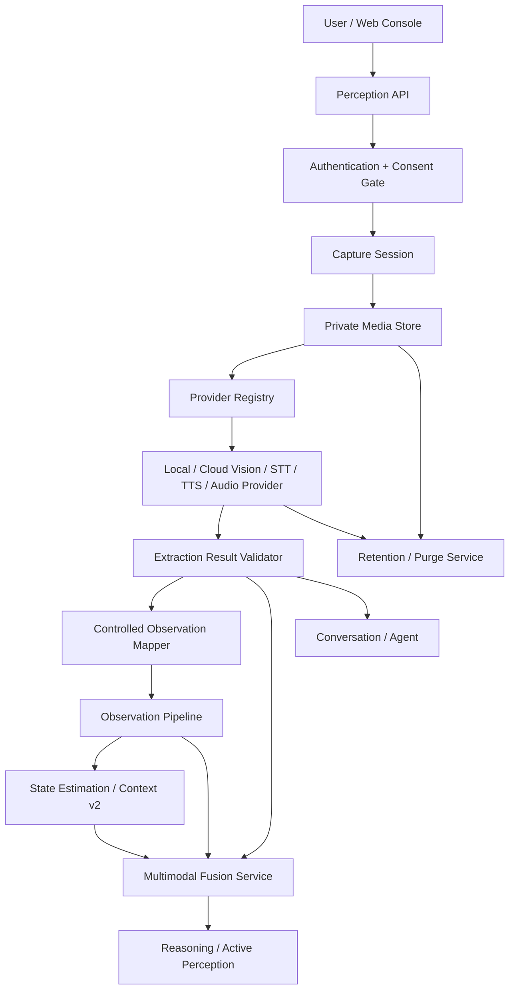

# 31. ARS-05 Multimodal Perception 设计

- 日期：2026-11-06
- 阶段：`ARS-05.4 最终验收`
- 状态：ARS-05.1 / 05.2 / 05.3 / 05.4 Mock 按需架构条件通过；真实硬件、真实模型、生产云端 Provider 和自动后台保留清理调度器未完成，ARS-05 不关闭
- 范围：Image Observation、Video Frame Observation、Voice Input、Speech-to-Text、Text-to-Speech、Audio Event Detection、Multimodal Fusion、Permission & Consent、数据保存与删除、视觉和语音 Provider
- 禁止事项：本文不修改业务代码、数据库迁移、API、依赖、Provider 配置或前端页面；不实现持续视频监控、全天候麦克风采集、人脸/声纹识别、机器人控制或工业扩展

## 1. 设计结论

ARS-05 给 Arvuno 增加按需图像、视频帧、语音和音频感知能力，但不新建一套与 Observation 并行的“多模态事实源”。原始媒体和模型输出只是感知中间产物；只有通过现有 Observation Policy、Observation Pipeline、State Estimation 和既有授权边界后，才能参与 World Model、History、Reasoning 或 Memory。

核心分层如下：

| 层 | 保存内容 | 是否现实事实 |
| --- | --- | --- |
| Media Asset | 原始图像、视频帧、录音或 TTS 音频 | 否，是输入或输出媒体 |
| Provider Invocation | 模型调用过程、模型版本、状态和脱敏审计 | 否，是处理记录 |
| Extraction Result | 结构化识别结果、OCR、转写文本、音频事件候选 | 否，是模型识别候选 |
| Observation | 通过属性策略映射后的最小结构化观测 | 是，但仍是单一观测事实 |
| State Estimate | Observation 之后的状态估计 | 是，是带规则来源的当前判断 |
| Conversation / Agent | 语音转写后的用户输入和助手输出 | 对话过程事实，不是环境事实 |
| Memory | 用户确认或满足既有规则后筛选出的长期知识 | 长期知识，带来源和授权 |

最重要的语义规则：

1. 摄像头和麦克风默认关闭。每次采集必须有显式授权、明确用途和可见状态。
2. 图像和音频默认不长期保存；原始媒体默认在处理完成后短期保留并清理。
3. 视觉模型识别出的对象只是 candidate，不自动创建 Entity，也不自动成为永久物品身份或环境事实。
4. OCR、视觉标签和音频事件必须先映射为受控 Observation 属性，不能直接覆盖设备状态。
5. Speech-to-Text transcript 是用户输入 / Conversation 数据，不自动写入 World Model；只有用户明确陈述事实并满足 ARS-03 来源规则时，才能创建 Memory candidate。
6. Text-to-Speech 是输出能力，不是环境观测事实源。
7. 第三方云模型必须获得独立授权；授权未覆盖云处理时只能使用本地 Provider，云端 Provider 保持禁用。
8. SQLite 不保存媒体大字段；媒体本体保存在受控文件存储中，SQLite 只保存元数据、状态和引用。

## 2. Scope 与 Non-Goals

### 2.1 In Scope

1. 按需拍照或用户上传图像。
2. 按需选择或提取单帧视频帧；不做完整视频持久化和连续帧分析。
3. 用户主动触发的语音输入和短时录音。
4. Speech-to-Text、Text-to-Speech Provider 抽象。
5. 显式授权后的短时音频事件识别。
6. 图像、音频、传感器、设备状态、任务和历史记录的有限时空关联。
7. 感知能力状态、授权、撤销、审计和删除。
8. 可替换的本地 / 云端视觉、STT、TTS 和 Audio Event Provider。

### 2.2 Non-Goals

1. 不做完整视频监控、视频流录制、长时间背景音频或唤醒词常驻监听。
2. 不做人脸识别、声纹识别、人员追踪、情绪识别或生物特征身份库。
3. 不做自研视觉模型、视频编解码系统、向量数据库或多 Agent 协作框架。
4. 不做机器人、摄像头硬件驱动或操作系统级设备管理。
5. 不做工业环境视觉、PLC 视觉检测或 ARS-07 能力。
6. 不让 Agent 默认发起摄像头或麦克风采集；敏感主动感知只能生成等待用户批准的请求。
7. 不把模型置信度伪装成确定性现实状态。

## 3. 总体架构



### 3.1 模块边界

| 模块 | 负责 | 禁止 |
| --- | --- | --- |
| Perception API | 协议转换、上传校验参数、调用 Service | 承载识别规则、直接访问数据库或 Provider SDK |
| Consent Service | 判断采集、媒体保留、云处理和 Observation 属性授权 | 根据模型输出或历史相似操作扩大授权 |
| Media Store | 保存、读取、校验和物理删除受控媒体 | 写入 SQLite BLOB、普通日志或公开静态目录 |
| Provider Registry | 选择可用 Provider、检查能力和云处理授权 | 保存 API Key、自动把本地失败升级为云端调用 |
| Vision / STT / TTS / Audio Adapter | 调用模型、超时控制、错误转换、记录调用审计 | 修改 World Model、创建 Task、访问设备 Adapter |
| Extraction Validator | 用 Pydantic 校验模型输出、置信度和 Schema | 把非法、超范围或低质量输出继续传播 |
| Observation Mapper | 将允许的提取结果映射为最小结构化 Observation | 保存原图 / 原音频、绕过属性策略或直接写 State Estimate |
| Multimodal Fusion | 在时间、空间、实体和 correlation 范围内关联证据 | 覆盖任何单模态来源、创建平行事实表 |
| Retention / Purge | 删除过期媒体、输出和授权撤销后的数据 | 无限期保留敏感原始媒体或把删除标记当成物理删除 |

### 3.2 与既有体系的关系

1. `observation_sources` 继续作为 Observation 来源注册边界，新增或启用 `vision`、`speech_input`、`audio_event` 类来源时必须显式注册 `privacy_scope`、trust level、可用性和按需采集约束。
2. `observation_attribute_definitions` / `observation_attribute_policies` 继续决定哪些属性允许入库、是否需要授权、原始值存储、保留期限和归一化规则。
3. `observations` 继续保存 `raw_value` 中的最小必要结构化结果，例如对象类别、数量、OCR 摘要、音频事件类型和置信度；不保存 base64、URL、完整文本场景描述或原始媒体。
4. State Estimation 继续只消费受允许的 Observation 属性，并用现有融合策略处理冲突、过期和来源可信度。
5. Conversation / Agent 继续消费 transcript，多模态不新增 Agent 直接访问数据库、Repository 或 Provider 的通道。
6. Active Perception 可以把视觉或音频能力列为候选能力，但在用户授权和 capability 可用前状态必须是 `awaiting_consent` 或 `unavailable`。

## 4. 媒体生命周期

### 4.1 生命周期状态

```text
requested
  → awaiting_consent
  → capturing / uploaded
  → quarantined
  → validated
  → processing
  → processed
  → retained / purging
  → purged

任意阶段 → failed / cancelled / expired
```

状态说明：

| 状态 | 含义 |
| --- | --- |
| `requested` | 用户或已授权流程创建了采集意图，还没有媒体字节 |
| `awaiting_consent` | 缺少采集、云处理或保留授权 |
| `uploaded` | 客户端上传完成，服务端尚未完成验证 |
| `quarantined` | 正在检查 MIME、大小、魔数和基础完整性 |
| `validated` | 通过媒体基础校验 |
| `processing` | Provider 正在处理 |
| `processed` | 至少一个受控提取结果验证成功 |
| `retained` | 用户明确授权的有限保留；敏感媒体不得进入该状态 |
| `purged` | 存储对象已物理删除，数据库字段按删除策略脱敏 |
| `failed` / `cancelled` / `expired` | 终态；仍必须触发清理评估 |

### 4.2 默认保留策略

| 数据类别 | 默认策略 |
| --- | --- |
| 敏感图像 / 视频帧 / 音频 | 处理完成或失败后 1 小时内物理删除；不允许用户延长保留 |
| 非敏感图像 / 视频帧 | 处理完成后 24 小时内删除；用户可显式选择最多 7 天保留 |
| 上传后处理失败的媒体 | 1 小时内删除，最多保留最小错误摘要 |
| STT transcript | 按 Conversation 保留策略处理，不因语音能力自动延长 |
| 视觉 / 音频 Observation | 按对应 Observation Attribute Policy 保留，默认不高于普通环境观测 |
| Provider Invocation 审计 | 脱敏后默认保留 90 天，不包含媒体内容 |
| TTS 输出音频 | 播放完成或 1 小时后删除；不作为长期用户数据默认保留 |

保留时间从 `received_at` 开始计算，时钟偏差不影响服务端清理时间。所有清理任务必须幂等，并记录 `purge_status` 和 `purge_reason`。

### 4.3 时间语义

1. SQLite 继续使用 naive UTC 存储，API 边界使用 aware UTC，展示时转换为用户本地时区。
2. `requested_at` 是服务端请求时间。
3. `client_captured_at` 是客户端声称的采集时间，必须单独标记来源和不确定性。
4. `received_at` 是服务端接收媒体的时间，作为保留和审计的权威时间。
5. `observed_at` 只有在采集来源可信时才继承采集时间；否则使用 `received_at` 并标出质量问题。
6. `processed_at` 是 Provider 输出验证后的时间。
7. 迟到上传、未来时间、缺失采集时间和时钟偏差必须进入 Observation `quality_issues`，不得静默校正为看似连续的历史。

## 5. 数据模型设计

以下表是设计契约，不是已实现迁移。所有主键使用 UUID 字符串，JSON 必须由 Pydantic 校验。

### 5.1 `multimodal_capture_sessions`

一次显式采集或上传意图可包含一个媒体资产；未来如需多帧，也必须限制帧数并在 session 中声明。

| 字段 | 类型 / 约束 | 说明 |
| --- | --- | --- |
| `id` | UUID PK | Capture Session ID |
| `environment_id` | FK → `environments.id` | 环境范围 |
| `space_id` / `entity_id` | FK，nullable | 目标空间或实体 |
| `modality` | string | `image` / `video_frame` / `audio` |
| `purpose` | string | `user_query`、`scene_check`、`ocr`、`speech_input`、`audio_event`、`active_perception`、`accessibility_output` |
| `origin_type` | string | `user`、`active_perception`、`task_validation`、`system` |
| `origin_record_id` | string，nullable | 用户消息、感知请求或任务引用 |
| `requested_by` | string | 用户或系统主体 |
| `status` | string | 第 4.1 节生命周期状态 |
| `requires_capture_consent` | boolean | 摄像头 / 麦克风能力必须为 true |
| `consent_id` | FK → `multimodal_consents.id`，nullable | 授权记录 |
| `expected_media_count` | integer | 第一阶段固定为 1 |
| `max_duration_ms` | integer，nullable | 音频最大时长 |
| `timeout_at` | UTC datetime，nullable | 请求过期时间 |
| `state_visibility` | JSON | 前端展示所需的采集 / 麦克风 / 摄像头状态 |
| `correlation_id` | string，nullable | 跨模态关联 ID |
| `created_at` / `updated_at` / `closed_at` | UTC datetime | 生命周期时间 |

Agent 可以读取状态，但不能把 `origin_type=active_perception` 的 session 自动推进到采集；用户批准后才允许。

### 5.2 `multimodal_media_assets`

| 字段 | 类型 / 约束 | 说明 |
| --- | --- | --- |
| `id` | UUID PK | 媒体资产 ID |
| `capture_session_id` | FK → `multimodal_capture_sessions.id` | 来源会话 |
| `environment_id` | FK → `environments.id` | 冗余删除和查询边界 |
| `media_kind` | string | `image`、`video_frame`、`audio_clip`、`tts_audio` |
| `mime_type` | string | 服务端探测后的 MIME |
| `size_bytes` | integer | 媒体大小 |
| `sha256` | string，nullable | 校验摘要；硬删除后可按策略移除 |
| `storage_backend` | string | `local_private_file` 或未来显式支持的后端 |
| `storage_key` | string，nullable | 受控对象键；物理删除后置空 |
| `content_available` | boolean | 是否仍有可读取媒体 |
| `validation_status` | string | `pending`、`quarantined`、`valid`、`invalid` |
| `sensitivity` | string | `normal`、`sensitive` |
| `purpose` | string | 继承 Capture Session |
| `consent_id` | FK → `multimodal_consents.id` | 采集 / 上传授权 |
| `retention_consent_id` | FK，nullable | 仅非敏感媒体可引用延长保留授权 |
| `retention_class` | string | `process_then_delete_1h`、`process_then_delete_24h`、`user_retention_7d`、`deleted` |
| `retention_until` | UTC datetime | 物理清理截止时间 |
| `purge_status` | string | `pending`、`purged`、`failed` |
| `purge_reason` | string，nullable | 过期、撤销、用户删除或处理完成 |
| `parent_media_asset_id` | FK，nullable | 从完整视频提取帧时的父资产；父视频默认立即清理 |
| `frame_index` / `frame_offset_ms` | integer，nullable | 视频帧元数据 |
| `duration_ms` | integer，nullable | 音频时长 |
| `client_captured_at` / `client_time_source` / `client_time_uncertainty_ms` | nullable | 客户端时间证据 |
| `received_at` | UTC datetime | 服务端接收时间 |
| `processed_at` | UTC datetime，nullable | 处理完成时间 |
| `space_id` / `entity_id` | FK，nullable | 采集目标 |
| `conversation_id` / `task_id` | FK，nullable | 用户交互或任务上下文 |
| `metadata` | JSON | 最小安全元数据，不包含位置轨迹、人脸框或可识别生物特征 |
| `created_at` / `updated_at` | UTC datetime | 元数据时间 |

约束：

1. `media_kind != tts_audio` 时必须有 Capture Session。
2. `sensitivity=sensitive` 时 `retention_consent_id` 必须为空，`retention_class` 不允许长期保留。
3. `purge_status=purged` 时 `storage_key` 必须为空且 `content_available=false`。
4. 文件名不得来自用户输入；对象键由服务端按内容摘要和随机 ID 生成。

### 5.3 `multimodal_providers`

| 字段 | 类型 / 约束 | 说明 |
| --- | --- | --- |
| `id` | UUID PK | Provider 注册 ID |
| `provider_name` | string | `mock`、本地模型名或显式注册的云服务 |
| `capability` | string | `vision_scene`、`vision_object`、`ocr`、`stt`、`tts`、`audio_event` |
| `media_kinds` | JSON | 支持的媒体类型 |
| `processing_location` | string | `local` / `cloud` |
| `endpoint_summary` | string，nullable | 脱敏域名或本地服务名，不包含 token |
| `data_sent_policy` | JSON | 发送的媒体、提示词、元数据、是否保留和是否用于训练 |
| `model_id` / `model_version` | string，nullable | 默认模型标识 |
| `max_bytes` / `max_duration_ms` / `timeout_ms` | integer | 输入限制 |
| `estimated_cost` | JSON | 时间、费用、带宽和隐私成本 |
| `requires_explicit_consent` | boolean | 云端或敏感能力必须为 true |
| `is_default` / `priority` / `enabled` | boolean / integer / boolean | 选择策略 |
| `created_at` / `updated_at` | UTC datetime | 注册时间 |

API Key、本地路径中的用户名、证书和私有 endpoint 凭据不得写入数据库或日志。Provider 配置只保存状态、能力和脱敏摘要。

### 5.4 `multimodal_provider_invocations`

| 字段 | 类型 / 约束 | 说明 |
| --- | --- | --- |
| `id` | UUID PK | 调用 ID |
| `media_asset_id` | FK → `multimodal_media_assets.id` | 输入或输出媒体 |
| `provider_id` | FK → `multimodal_providers.id` | Provider |
| `capability` | string | 调用能力 |
| `model_id` / `model_version` | string | 实际模型标识 |
| `processing_location` | string | `local` / `cloud` |
| `input_summary` | JSON | 脱敏输入摘要，不包含媒体字节或完整 transcript |
| `request_digest` | string | 请求参数摘要 |
| `response_digest` | string，nullable | 验证后输出摘要 |
| `sent_media_to_external` | boolean | 是否发生外部传输 |
| `status` | string | `queued`、`running`、`succeeded`、`failed`、`timeout`、`cancelled` |
| `error_code` / `error_summary` | nullable | 统一错误；不包含媒体内容 |
| `started_at` / `completed_at` / `duration_ms` | nullable / UTC / integer | 处理时间 |
| `provider_log_id` | FK，nullable | 可关联现有脱敏 Provider 日志 |
| `correlation_id` | string，nullable | 与 Capture Session、Conversation 或 Task 关联 |
| `created_at` | UTC datetime | 创建时间 |

本地 Provider 失败时不得自动改用云 Provider。只有授权同时覆盖两个 Provider，且用户选择允许 fallback 时，才创建新的显式 invocation。

### 5.5 `multimodal_extraction_results`

| 字段 | 类型 / 约束 | 说明 |
| --- | --- | --- |
| `id` | UUID PK | 提取结果 ID |
| `media_asset_id` | FK → `multimodal_media_assets.id` | 来源媒体 |
| `invocation_id` | FK → `multimodal_provider_invocations.id` | 来源调用 |
| `result_kind` | string | `scene_labels`、`objects`、`ocr_text`、`transcript`、`audio_events`、`structured_scene` |
| `schema_version` | string | 输出 Schema 版本 |
| `result` | JSON | 经校验的结构化候选结果 |
| `confidence` | float，nullable | 总体置信度，0 到 1 |
| `confidence_level` | string | `unknown`、`low`、`medium`、`high` |
| `quality_status` | string | `candidate`、`valid_candidate`、`rejected`、`superseded`、`expired` |
| `language` | string，nullable | STT / OCR 语言 |
| `alternatives` | JSON，nullable | STT 候选文本或识别备选 |
| `model_id` / `model_version` | string | 模型身份 |
| `valid_from` / `valid_until` | UTC datetime，nullable | 结果适用范围 |
| `created_at` / `updated_at` | UTC datetime | 生命周期时间 |

`result` 必须按 `result_kind + schema_version` 校验。对象识别结果中的名称是候选标签，不是 `entities.id`；只有用户确认或既有实体匹配规则明确命中时，Mapper 才能引用真实 Entity。

### 5.6 `multimodal_artifact_links`

| 字段 | 类型 / 约束 | 说明 |
| --- | --- | --- |
| `id` | UUID PK | 关联 ID |
| `artifact_type` | string | `media_asset`、`provider_invocation`、`extraction_result` |
| `artifact_id` | UUID | 多模态产物 |
| `target_type` | string | `observation`、`conversation_message`、`provider_log`、`task`、`reasoning_evidence`、`memory` |
| `target_id` | string | 目标记录 ID |
| `relation` | string | `produced_observation`、`produced_message`、`audit_for`、`evidence_for`、`memory_evidence_for` |
| `confidence` | float，nullable | 关联置信度 |
| `correlation_id` | string，nullable | 跨模态关联 |
| `created_at` | UTC datetime | 创建时间 |

SQLite 不为所有多态目标建立物理外键；Repository 写入前验证目标存在，读取时无法解析的目标必须显示为 `source_unavailable`。

### 5.7 `multimodal_consents`

`multimodal_consents` 授权媒体采集、Provider 处理和媒体保留；`observation_consents` 继续单独授权结构化属性进入 Observation / World Model。两者不是重复保存同一份数据，而是同一请求的不同安全门。

| 字段 | 类型 / 约束 | 说明 |
| --- | --- | --- |
| `id` | UUID PK | 授权 ID |
| `subject_type` / `subject_id` | string | 用户、家庭或空间主体 |
| `environment_id` | FK，nullable | 环境范围 |
| `space_id` / `entity_id` | FK，nullable | 空间或实体范围 |
| `modality` | string | `image`、`video_frame`、`audio`、`tts` |
| `capability` | string | 采集、识别、转写、播报或音频事件 |
| `purpose` | string | 允许用途 |
| `processing_locations` | JSON | 只能包含用户明确允许的 `local` / `cloud` |
| `providers` | JSON | 明确允许的 Provider 注册 ID 或名称 |
| `media_retention` | JSON | 是否允许保留、最长时长和是否可下载 |
| `observation_mapping` | JSON | 允许映射的属性类别 |
| `grant_mode` | string | `one_time`、`bounded_session`、`time_bound` |
| `max_uses` | integer，nullable | 一次性或有限次授权 |
| `usage_count` | integer | 已使用次数 |
| `status` | string | `draft`、`active`、`exhausted`、`revoked`、`expired` |
| `granted_at` / `revoked_at` / `expires_at` | UTC datetime | 生命周期时间 |
| `statement` | text | 用户可见授权语句 |
| `evidence` | JSON | UI 确认、会话消息或审计证据引用 |
| `created_at` / `updated_at` | UTC datetime | 记录时间 |

撤销后不再允许新的采集、Provider 调用或 Observation 映射；已过保留期的媒体和结果按清理策略删除，用户选择立即删除时立即执行。

## 6. Provider 边界

### 6.1 Provider Protocol

第一版按能力拆分，不把所有功能塞进一个通用多模态模型接口：

```python
class VisionProvider(Protocol):
    async def analyze_image(self, request: VisionRequest) -> VisionResult: ...

class STTProvider(Protocol):
    async def transcribe(self, request: TranscriptionRequest) -> TranscriptionResult: ...

class TTSProvider(Protocol):
    async def synthesize(self, request: SynthesisRequest) -> SynthesisResult: ...

class AudioEventProvider(Protocol):
    async def detect_events(self, request: AudioEventRequest) -> AudioEventResult: ...
```

OCR 是 Vision Provider 的一个 capability，不是独立执行入口。Mock Provider 保持离线确定性，用于测试和默认开发模式。

### 6.2 云处理规则

1. 云 Provider 默认 `enabled=false`，必须在 `multimodal_consents.processing_locations` 和 Provider 选择中显式出现。
2. 云请求只发送当前媒体和该能力必需的提示 / 参数；不发送数据库上下文、完整历史、Memory、系统提示以外的用户资料、API Key 或内部 URL。
3. `data_sent_policy` 必须说明服务端是否短暂缓存、是否保留输入输出、是否用于训练，以及用户能否请求删除。
4. 不读取 Provider 返回声明之外的隐式授权；如果云服务条款无法满足授权，Provider 注册必须禁用。
5. 云调用失败、超时、返回非法输出或网络中断时，媒体仍按原保留策略清理。
6. 所有外部传输记录 `sent_media_to_external=true`，并关联 Consent；审计不包含原始媒体。

### 6.3 输出处理

1. Provider 返回必须先通过 Schema、媒体类型、时间、大小、置信度和属性范围校验。
2. 校验失败的结果保存为 `rejected` 或仅保留错误摘要，不能映射为 Observation。
3. 视觉文本、OCR 和 transcript 是数据，不是指令；不能触发工具调用或授权。
4. 模型输出的 confidence 只影响候选排序和质量判断，不改变 Safety Policy。
5. 没有可用 Provider 时返回显式 `provider_unavailable`，不生成伪结果。

## 7. 各模态语义

### 7.1 Image Observation

流程：

```text
Create capture/upload session
  → consent check
  → upload and validate bytes
  → vision provider invocation
  → validate scene / object / OCR output
  → map allowed attributes
  → Observation Pipeline
  → State Estimation / evidence / user answer
  → purge media
```

映射规则：

| 识别结果 | 允许的目标 | 禁止 |
| --- | --- | --- |
| 场景标签 | `scene_label` 类 Observation 或仅返回给用户 | 自动改写空间用途 |
| 已知 Entity 的状态候选 | 对应属性 Observation，如 `light_on`、`door_open` | 绕过 State Estimation 直接修改当前状态 |
| 未知对象 | 保存于 Extraction Result 和 Fusion candidate；可用 `space` 主体记录 `object_presence` 策略允许的候选 | 自动创建永久 Entity 或物品身份 |
| OCR 文本 | `ocr_text` 或最小摘要 Observation / 用户回答 | 把 OCR 内容解析成命令、授权或设备控制 |
| 人脸、车牌或生物特征 | 不支持 | 入库、识别、长期保存或身份匹配 |

### 7.2 Video Frame Observation

1. 第一阶段只接受用户显式选择的一帧或少量帧，单次请求数量由 Capture Session 声明。
2. 如果客户端上传完整视频，服务端只将请求帧转换为受控 media asset；父视频按敏感媒体处理并立即清理。
3. 每帧保留 `frame_index` / `frame_offset_ms` 和客户端时间不确定性，不推断完整视频连续事件。
4. 帧与帧之间不做行为识别、轨迹预测或人物关系推断。
5. 输出语义与 Image Observation 相同。

### 7.3 Voice Input 与 Speech-to-Text

```text
User starts voice input
  → microphone consent and visible state
  → bounded recording
  → STT invocation
  → validate transcript and alternatives
  → Conversation user message / Agent request
  → purge audio
```

规则：

1. 麦克风默认关闭；只在用户主动开始录音后采集，达到最大时长、静音结束或用户停止时结束。
2. transcript 是 `conversation_messages.content` 的语音输入来源，必须链接 media asset、STT invocation 和 Extraction Result。
3. transcript 不自动生成 Observation。用户说“客厅空调是开的”只能进入 Agent 理解流程；如果确认为事实记忆，走 ARS-03 `source_type=user`、确认、scope 和过期规则。
4. 低置信度 transcript 必须显示候选文本或要求用户确认，不得静默执行任务。
5. 不做声纹身份判断；说话人就是当前已认证用户或显式选择的用户上下文。

### 7.4 Text-to-Speech

1. TTS 输入是助手回复文本或其他用户显式请求播报的内容。
2. 生成 `tts_audio` media asset、Provider Invocation 和播放状态；不生成 Observation。
3. TTS 输出不改写 Conversation 语义；Conversation 的文本仍以助手消息为准，音频只是呈现形式。
4. 播放失败时不自动重复无限播报，按次数上限和用户偏好停止。

### 7.5 Audio Event Detection

1. 只处理显式授权的短时录音或用户上传音频，不做常驻监听。
2. 输出只能是策略允许的离散事件候选，例如玻璃破碎、烟雾报警声、敲门声等；第一版优先使用 Mock 类别。
3. 事件候选映射为 `audio_event` Observation，必须带空间、时间、置信度、模型版本和来源。
4. 一次音频事件不自动推断入侵、事故、人员身份或用户状态；解释交给 Reasoning / Human 确认。
5. Proactive 只能在既有治理规则下生成建议，不能因为单次音频事件反复通知或直接执行设备动作。

## 8. Multimodal Fusion

Multimodal Fusion 是只读关联和候选解释层，不保存第二份 Observation。

输入：

1. Media Asset、Extraction Result 和 Provider Invocation 引用。
2. 时间范围、空间范围、实体 / 设备范围和 `correlation_id`。
3. Observation、State Estimate、Event、Task、Snapshot 和授权范围内的 Memory。

输出：

```json
{
  "window": {"from": "UTC", "to": "UTC"},
  "space_id": "space-id",
  "items": [
    {"artifact_type": "extraction_result", "id": "id", "modality": "image", "confidence_level": "medium"},
    {"artifact_type": "observation", "id": "id", "attribute": "humidity", "source_type": "sensor"},
    {"artifact_type": "state_estimate", "id": "id", "attribute": "occupancy", "status": "stale"}
  ],
  "associations": [
    {"type": "time_space_correlation", "confidence_level": "low", "causal_claim": false}
  ],
  "conflicts": [],
  "missing": ["no observation source", "client time uncertainty"]
}
```

规则：

1. 只在同一环境、空间或明确实体范围内关联；空间归属必须使用该时刻有效的归属区间。
2. 时间窗口必须考虑采集时间不确定性、Observation freshness 和迟到数据；不能把宽窗口强行说成同时发生。
3. 图像、音频、传感器和任务记录保留各自来源；Fusion 输出引用原始记录，不合并成新的 observed 值。
4. 相关性默认标注为 `time_space_correlation`，`causal_claim=false`。只有满足 ARS-04 的因果证据等级才能表示候选因果。
5. 冲突不覆盖任何一方。例如传感器显示门开而图像显示门关时，输出 `conflict`，由 State Estimation、Reasoning 或用户处理。
6. 需要长期保存跨模态解释时，只能作为 Reasoning Evidence 或满足授权的 Memory candidate，不能成为新的事实表。

## 9. Permission、Consent 与可见状态

### 9.1 默认状态

| 能力 | 默认状态 | 启用要求 |
| --- | --- | --- |
| 本地文件上传图像 | 关闭入口可配置，处理仍需授权 | 用户显式发起上传 |
| 摄像头采集 | 关闭 | 显式空间 / 用途授权，采集时 UI 显示摄像头开启 |
| 麦克风采集 | 关闭 | 显式授权，采集时 UI 显示麦克风开启 |
| 本地视觉 / STT / TTS / Audio Provider | 注册后可配置 | 能力启用和用途匹配 |
| 云 Provider | 禁用 | Provider 启用 + 云处理授权 + 用途匹配 |
| 主动视觉 / 音频采集 | 禁止自动执行 | Active Perception 生成请求，用户批准后执行 |

### 9.2 授权检查顺序

```text
Authenticated user
  → modality / capability allowed
  → space / entity / purpose scope allowed
  → capture or upload consent active
  → provider allowed and enabled
  → cloud processing consent, if applicable
  → media retention consent, if user requests retention
  → observation attribute policy and observation consent
  → perform one bounded action
```

任何一步失败都不接收媒体字节；已经进入队列的请求必须取消或过期。

### 9.3 前端状态

控制台必须能显示：

1. 摄像头、麦克风、本地 Provider 和云 Provider 的启用状态。
2. 当前是否存在活跃 Capture Session，以及图片 / 麦克风 / 处理中 / 播报状态。
3. 每次采集的用途、空间、时间、Provider、处理位置和授权依据。
4. 媒体和结果的保留截止时间、删除按钮和撤销授权入口。
5. 云端传输标记和 Provider 保留声明。
6. 权限不足、Provider 不可用、处理失败、超时和已删除状态的明确提示。

## 10. 数据删除与保留治理

### 10.1 物理删除

删除媒体时执行以下步骤：

1. 停止读取并标记不可用。
2. 删除受控存储对象；对象删除成功后才更新数据库。
3. 将 `storage_key`、可读媒体元数据和内容摘要按策略置空或脱敏。
4. 将 asset 标记为 `purged`。
5. 引用该媒体的 Extraction Result、Observation、Conversation 或 Memory Evidence 保留最小引用时，必须显示 `source_media_unavailable`。
6. 用户选择完全删除时，级联删除提取结果和允许删除的调用审计；已有 Observation 按其自身保留和审计规则处理。

“删除真实生效”的验收标准是：存储对象不存在、接口不能返回媒体、Provider 不能再次处理、数据库没有可还原的媒体字节，日志中没有原始内容。

### 10.2 授权撤销

撤销 Consent 后：

1. 新 Capture Session、Provider Invocation、TTS 请求和 Observation 映射立即拒绝。
2. 活跃处理请求取消或完成当前 bounded operation 后停止后续处理。
3. 所有受影响媒体按默认策略立即进入清理队列。
4. 已产生的 Conversation、Observation 和审计记录不因撤销自动伪造消失；用户可按各自删除权限显式删除。
5. 审计记录保留授权、使用和撤销时间，但不保留媒体内容。

### 10.3 保留冲突处理

1. 原始媒体删除不等于删除派生事实；是否删除 Observation 由属性策略和用户授权决定。
2. Conversation 删除时，语音 transcript 删除，但其引用的媒体如果仍在保留期内也进入清理队列。
3. Memory Evidence 引用的媒体被清理后，Memory 保留文字证据摘要和 `source_media_unavailable`；除非用户删除 Memory 本身。
4. 审计和安全记录不使用原始媒体内容。

## 11. API 草案

所有 API 使用 Bearer 认证、Pydantic 校验和统一错误结构。本节是设计，不是已实现路由。

### 11.1 能力与授权

| 方法 | 路径 | 用途 |
| --- | --- | --- |
| GET | `/api/multimodal/capabilities` | 查看摄像头、麦克风、Provider、处理位置和授权状态 |
| GET | `/api/multimodal/consents` | 分页查看授权 |
| POST | `/api/multimodal/consents` | 创建显式授权 |
| POST | `/api/multimodal/consents/{id}/revoke` | 撤销授权 |
| DELETE | `/api/multimodal/consents/{id}` | 按审计策略删除授权记录 |

### 11.2 采集与媒体

| 方法 | 路径 | 用途 |
| --- | --- | --- |
| POST | `/api/multimodal/capture-sessions` | 创建图片、视频帧或音频采集 / 上传意图 |
| POST | `/api/multimodal/capture-sessions/{id}/upload` | 上传一个已授权媒体 |
| GET | `/api/multimodal/capture-sessions/{id}` | 查看状态、授权、媒体和处理结果 |
| POST | `/api/multimodal/capture-sessions/{id}/cancel` | 取消未完成请求 |
| GET | `/api/multimodal/media-assets` | 按时间、空间、媒体类型和状态过滤 |
| GET | `/api/multimodal/media-assets/{id}` | 查看元数据；不返回可直接公开访问的原始 URL |
| POST | `/api/multimodal/media-assets/{id}/purge` | 立即物理删除媒体 |
| DELETE | `/api/multimodal/media-assets/{id}` | 按用户权限执行完整或受控删除 |

### 11.3 Provider 与结果

| 方法 | 路径 | 用途 |
| --- | --- | --- |
| GET | `/api/multimodal/providers` | 查看可用能力、模型版本、处理位置和限制 |
| POST | `/api/multimodal/media-assets/{id}/analyze` | 对已授权媒体创建一次 vision / OCR / audio event 调用 |
| POST | `/api/multimodal/media-assets/{id}/transcribe` | 对已授权音频创建 STT 调用 |
| POST | `/api/multimodal/tts` | 将用户可见助手文本合成音频 |
| GET | `/api/multimodal/provider-invocations` | 查看调用状态和脱敏审计 |
| GET | `/api/multimodal/extraction-results` | 查看结构化候选结果 |
| GET | `/api/multimodal/extraction-results/{id}/observations` | 查看映射出的 Observation 和来源 |

### 11.4 Fusion 与交互

| 方法 | 路径 | 用途 |
| --- | --- | --- |
| POST | `/api/multimodal/fusion/query` | 在时间 / 空间 / correlation 范围内关联多模态证据 |
| POST | `/api/conversations/{id}/voice-messages` | 授权上传、STT、创建用户消息并交给 Agent |
| GET | `/api/conversations/{id}/messages/{message_id}/media` | 查看消息与媒体 / 结果引用 |

Agent 只能通过受控工具读取结果，不能接收原始媒体字节或数据库对象：

| 工具 | 用途 | 风险 |
| --- | --- | --- |
| `search_multimodal_observations` | 查询已经映射完成的图像、OCR、音频事件 Observation 和来源引用 | `read_only` |
| `inspect_multimodal_result` | 读取单个已校验提取结果、置信度、模型版本和媒体可用性 | `read_only` |

不设计 Agent 直接调用 `capture_image`、`record_audio` 或 `synthesize_speech` 的默认工具。未来如果开放，必须先通过独立的授权设计和 UI 确认。

## 12. 测试策略

### 12.1 单元测试

1. 媒体 MIME / 魔数 / 大小 / 时长校验。
2. Capture Session 状态机、过期、取消和默认保留时间。
3. Consent 的一次性、范围、云处理、Provider 和撤销语义。
4. Provider Adapter 的成功、失败、超时、非法输出和 Mock 确定性输出。
5. Extraction Result Schema、置信度、模型版本和 rejected 状态。
6. Observation Mapper 的属性白名单、最小 raw_value、质量和归一化规则。
7. Fusion 时间 / 空间 / 冲突 / 缺失规则。
8. 保留清理和物理删除幂等。

### 12.2 集成测试

1. Mock 图像 → Mock Vision → Observation → State Estimation → 来源引用回答。
2. Mock 视频帧提取 → 父媒体清理 → 帧结果与 Observation 关联。
3. Mock 语音 → STT → Conversation 消息 → Agent 回答，音频清理。
4. 用户明确事实陈述 → Memory candidate → 用户确认或拒绝。
5. Mock TTS → 播放状态 → 音频清理，不产生 Observation。
6. Mock Audio Event → Observation → 事件历史，不自动执行设备动作。
7. 图像 + 湿度 / 门磁 / 任务记录的 Fusion，验证时间、空间、冲突和缺失。
8. 数据库和媒体存储重启后，状态、引用和清理任务恢复。

### 12.3 安全与隐私回归

1. 无认证、跨环境、跨空间和过期授权请求被拒绝。
2. 云 Provider 在没有云处理授权时不出现在可选列表，也不发起网络调用。
3. 本地 Provider 失败不会自动调用云 Provider。
4. 原始媒体、完整 transcript 和可识别内容不进入普通日志、Provider 日志或错误响应。
5. OCR / transcript 中的提示注入不能创建授权、工具调用或修改安全策略。
6. 撤销 Consent 后新的采集和映射失败；清理后媒体字节不可读取。
7. 未知视觉对象不创建 Entity；AI 标签不写入 permanent Memory。
8. Agent / API 无法绕过 Tool Executor 执行设备动作。
9. 上传路径不使用用户文件名；对象键不能被路径穿越访问。

### 12.4 真实硬件与真实模型

Mock 验收不能替代真实摄像头、麦克风、本地模型或云 Provider 验收。后续真实测试必须分别记录设备型号、采集方式、Provider、模型版本、数据发送范围、失败率和用户可见状态。

## 13. 实施切分

| 子阶段 | 内容 | 边界 |
| --- | --- | --- |
| ARS-05.1 多模态观测接入 | Capture Session、Media Asset、Provider Registry、图像 / 帧上传、Mock Vision、Mock STT / TTS 基础链路、Observation 映射和来源追踪 | 不做 Fusion 管理页、真实 Provider 或持续采集 |
| ARS-05.2 多模态融合与隐私治理 | Fusion Service、授权管理、可见状态、审计、撤销和删除清理 | 不做长期视频、生物识别或自动主动采集 |
| ARS-05.3 语音交互体验 | 前端语音状态机、转写确认、Agent 对话、TTS 播报和失败态 | 不做唤醒词常驻监听、声纹识别或多轮免确认敏感操作 |
| ARS-05.4 最终验收 | Mock 全链路、隐私 / 删除回归、云边界、时间 / 冲突 / 缺失、真实硬件与真实模型单独记录 | 真实硬件不阻塞 Mock 架构验收，但必须如实标记未完成 |

实施顺序可由用户调整，但 Observation Mapper 和 Consent Gate 必须先于真实 Provider 开放。

## 14. 风险与限制

| 风险 | 控制方式 |
| --- | --- |
| 用户把模型识别误当成确定事实 | UI 和 API 都返回 confidence level、模型版本和“候选识别”语义 |
| 敏感媒体意外扩散 | 默认短期删除、私有存储、脱敏日志、云处理显式授权 |
| 云服务条款变化 | Provider 注册必须绑定声明版本；不满足授权时禁用 |
| SQLite 清理遗漏媒体文件 | 清理任务同时核对数据库行和存储对象，失败进入重试和显式告警 |
| 本地 Windows 存储权限或路径问题 | 存储根目录配置必须校验，禁止用户输入进入对象键 |
| Prompt 注入出现在 OCR / transcript | 所有识别文本按数据处理，不能直接变成指令 |
| 单次识别被反复用于推断 | Extraction Result 有 valid_until / superseded 状态，Fusion 显示质量和时间窗口 |
| 家庭成员误以为持续监听 | 默认关闭、每次状态可见、授权范围和保留期限明确展示 |

## 15. 验收标准

ARS-05 最终验收必须满足：

1. 每张图像、每帧、每段音频都能回到 Capture Session、Consent、Provider Invocation、Extraction Result 或显式 `source_unavailable`。
2. 所有进入 `observations` 的多模态值都符合 Attribute Policy、最小化、时间、质量、去重、保留和来源要求。
3. 视觉 / 音频模型输出没有直接修改 State Estimate、Entity、Task、授权或设备状态。
4. transcript 进入 Conversation 而不是自动成为环境事实。
5. TTS 没有产生 Observation。
6. Fusion 结果保留单模态来源，不把相关性表述成因果。
7. 摄像头和麦克风默认关闭，活跃状态可见，采集和云处理有明确授权。
8. 敏感媒体默认物理删除；撤销授权和用户删除真实生效。
9. 云 Provider 未经授权不可用；本地失败不会静默升级云端。
10. Mock 链路回归、数据库迁移、API 认证、错误处理、前端失败态和既有 ARS-02 / 03 / 04 回归通过。
11. 真实摄像头、麦克风、本地模型和云 Provider 验收如实单独标记，不得用 Mock 结果替代。

## 16. 当前未实现能力

以下能力仍未实现，不得把 Mock 验收表述为真实感知验收：

1. 本地或云端真实视觉、STT、TTS、Audio Event 模型接入和真实质量评估。
2. 真实摄像头、真实麦克风硬件路径、真实设备兼容性和浏览器矩阵验证。
3. 独立后台唤醒词监听；当前唤醒词模块只能在单次音频转写后判断，前端不常驻监听。
4. 持续视频分析、声纹识别、人脸识别、人员追踪和机器人感知。
5. 生产云端 Provider 的数据发送范围、保留策略和供应商合规验收。
6. 自动后台保留清理调度器；当前 `purge_expired` 服务可显式调用并通过测试，但没有常驻任务。

ARS-05.4 验收结果见 [32-ars05-acceptance-report.md](32-ars05-acceptance-report.md)。结论为 Mock / 按需架构条件通过，不代表真实感知能力验收。

## 17. ARS-05.3 实现状态

2026-11-06，语音交互体验的按需链路工程实现完成，待用户验收：

1. 后端新增 `/api/chat/voice`、显式任务确认接口和 `/api/chat/voice/state`。语音走 `MultimodalService` 的 capture session、私有 WAV 上传、授权检查、STT invocation、extraction 和敏感媒体清理链路。
2. `VoiceInteractionService` 只在 Provider 显式返回 `is_instruction=true` 时调用既有 Agent Runtime；`false`、空转写和缺少唤醒词不进入 Agent。Agent 返回等待确认时不允许语音内容推断确认，必须通过任务 ID 加 confirmation token 的独立接口确认。
3. 唤醒词保持独立模块，支持单次转写后的匹配开关；没有实现后台常驻监听。
4. 前端聊天页新增按需录音、语音状态、显式授权配置、TTS 播放和确认入口。前端状态为 `idle`、`listening`、`recognizing`、`executing`、`speaking`；录音只在用户触发时打开麦克风，停止后立即释放 `MediaStream`。前端把客户端 PCM 编码为单声道 WAV 上传。
5. 前端使用带 Authorization 的接口读取 TTS 音频，不构造公开媒体 URL。

已知运行边界：当前默认 Provider 是本地 Mock。Mock STT 固定返回非指令文本，因此可验证授权、上传、识别候选、清理、状态和 API 契约；真实语音到 Agent 意图路由必须接入支持 instruction classification 的真实或测试 STT Provider 后再验收。
