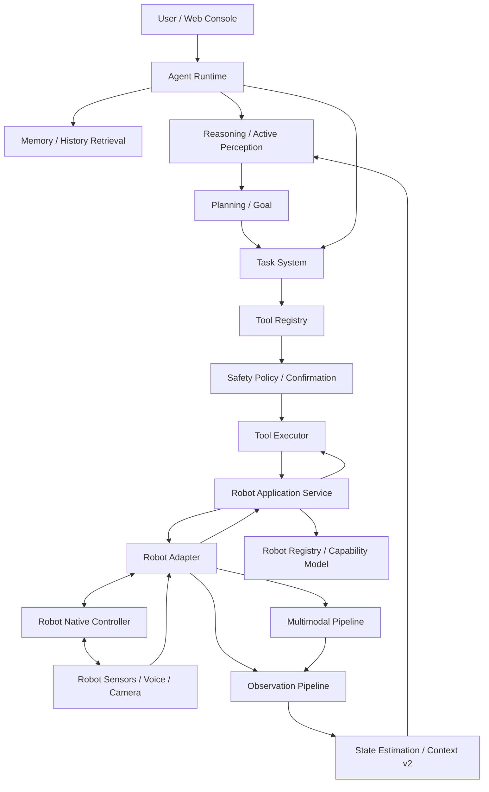
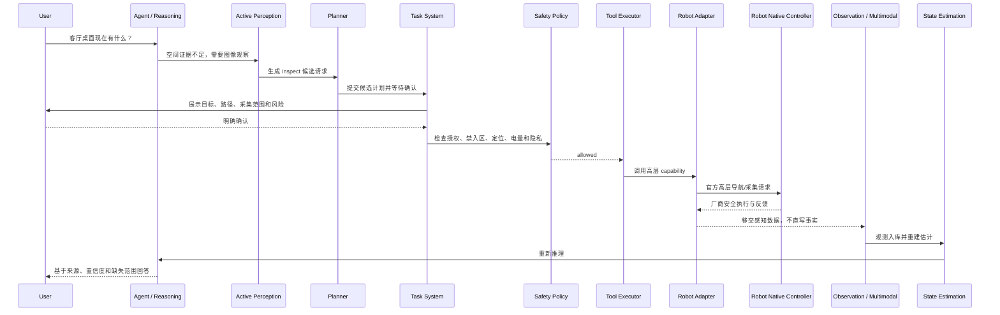

# 33. ARS-06 Embodied Intelligence 设计

- 阶段：`ARS-06.0：智元机器人接入架构设计与安全确认`
- 日期：2026-11-06
- 状态：商用机器人 / 通用 Robot Adapter 参考；当前载体已改为自制桌面机器人，选型设计见第 34 号文档；本文不是已实现行为
- 范围：Robot Adapter、Robot Capability Model、Robot State、API、权限与安全、仿真测试方案
- 禁止事项：本文不修改业务代码、数据库迁移、API、依赖或前端页面；不实现真实机器人控制、关节控制、电机控制、持续视觉采集、持续麦克风采集、机器人 SDK 接入或自主任务执行

## 1. 设计结论

ARS-06 的目标是将智元机器人接入为 Arvuno 的移动感知、语音交互和现实任务执行终端，但机器人不是 Arvuno 的唯一大脑。Arvuno Core 继续独立拥有 World Model、Memory、Reasoning、Planning、Permission、Task System 和 Tool Executor；机器人离线时，环境模型、历史查询、设备管理、Web Console 和既有自动化必须继续可用。

核心分层：

```text
Arvuno Core
  世界模型 / 记忆 / 推理 / 规划 / 权限 / 任务管理
        ↓ 高层任务与只读能力目录
Robot Adapter
  连接 / 状态投影 / 高层能力调用 / 感知移交 / 反馈标准化
        ↓ 官方支持的高层接口
Robot Native Controller
  实时运动 / 关节电机 / 碰撞保护 / 急停 / 厂商安全机制
```

本设计最重要的安全决策：

1. Arvuno 只调用官方文档确认存在且可安全使用的高层能力，不直接控制关节、电机、速度、扭矩或实时运动循环。
2. 机器人本体安全系统始终拥有最终控制权；Arvuno 发出的中断或停止只能是高层请求，不能绕过厂商急停。
3. 运动和机械臂不是普通智能家居开关动作，必须使用独立 Robot Adapter、独立能力模型和独立授权。
4. 能力默认全部 `unverified`，只有拿到最终型号、固件/软件版本和官方开发文档证据后才可注册。
5. 第一工程阶段只允许 Mock Robot 和只读状态；真实机器人初期只允许状态读取与经用户确认的低风险导航。
6. 机械臂、负载、抓取、开门、递送物品等能力需要单独安全设计与确认，本阶段不注册。
7. 机器人传感器和模型输出不能直接成为 World Model 事实，必须进入 ARS-02 Observation Pipeline、ARS-05 多模态处理和 State Estimation。
8. 机器人位置是带可信度和地图坐标系的位置观测或估计，不是自动 ground truth。
9. Agent Runtime 不能访问机器人 SDK、Robot Adapter、Repository、SQLAlchemy 或数据库会话，只能通过受控工具和只读目录投影获得能力。
10. 规划器只能生成候选机器人计划；实际执行仍由 Task System、Tool Registry、Safety Policy 和 Tool Executor 管理。

## 2. Scope 与 Non-Goals

### 2.1 In Scope

1. Arvuno Core 与 Robot Adapter 的模块边界。
2. 机器人注册、能力目录、证据链和状态模型设计。
3. 高层任务 API、反馈 API、观测移交 API 和安全事件 API 设计。
4. 急停状态、人工接管、任务中断、离线、低电量、定位损失等安全语义。
5. 禁入区域、导航边界、隐私授权、云处理授权和审计设计。
6. Mock Robot 仿真测试方案。
7. 最终型号确定后需要补充核验的官方接入研究清单。

### 2.2 Non-Goals

1. 不自研机器人硬件或实时控制系统。
2. 不绕过、替代或屏蔽智元机器人本体安全系统。
3. 不实现任意关节、电机、速度、扭矩或底层运动控制接口。
4. 不假设某个智元型号支持某项能力；没有官方开发文档证据不得注册。
5. 不实现持续视觉监控、持续麦克风采集或后台人员追踪。
6. 不做人脸识别、声纹识别、人员身份库或行为画像。
7. 不把机器人作为 World Model 的平行事实源。
8. 不实现机械臂操作、负载搬运或自主物理操作。
9. 不引入 ROS 2、SDK、消息队列或额外基础设施依赖，除非后续型号确认后单独批准。
10. 不进入 ARS-07 工业环境扩展。

## 3. 官方接入研究结论

### 3.1 当前信息边界

截至本文日期，用户尚未提供或确认最终机器人型号、硬件版本、固件/软件版本和官方开发环境。因此本文不能把任何具体型号能力注册为可用能力。

当前可访问的官方公开入口：

| 入口 | 官方地址 | 当前可确认内容 | 不能推出的结论 |
| --- | --- | --- | --- |
| AGIBOT 官方站点 | https://www.agibot.com/ | 官方产品和文档入口存在 | 不能证明任何开发接口可用 |
| Product Manual / Open Source | https://www.agibot.com/DOCS/OS | 官方文档与开源入口存在，页面包含 X1 文档路径和 X1 开源仓库链接 | 不能证明 AimDK、SDK、ROS 2 或 HTTP RPC 可用 |
| X1 文档入口 | https://www.agibot.com/DOCS/OS/X1-PDG | X1 产品文档入口存在 | 不能推广为所有智元型号能力 |
| AGIBOT X1 hardware | https://github.com/AGIBOTTech/AGIBOT_x1_hardware | 官方页面列出该开源仓库入口 | 本环境未取得完整仓库契约，不能注册任何硬件接口 |
| AGIBOT X1 infer | https://github.com/AGIBOTTech/AGIBOT_x1_infer | 官方页面列出该开源仓库入口 | 不能假设其提供 Arvuno 可用的推理服务接口 |
| AGIBOT X1 train | https://github.com/AGIBOTTech/AGIBOT_x1_train | 官方页面列出该开源仓库入口 | 不能假设其提供机器人控制 API |

A2 Ultra 官方产品页曾列出激光雷达、RGB-D、RGB 相机、麦克风阵列、扬声器、遥控器、无线急停、电池和充电器等硬件信息。这些是型号营销/规格描述，不是开发者能力契约，不能作为 Capability 注册依据，也不能推广到最终型号。

未获得权威官方文档确认的内容：

1. AimDK 是否适用于最终型号。
2. 官方 SDK 名称、版本、接口协议和鉴权方式。
3. ROS 2 版本、话题、服务、动作、QoS 和安全语义。
4. HTTP / RPC 接口契约。
5. 语音输入、语音输出、相机、深度相机、IMU、激光雷达、电池、充电和急停的开发者接口。
6. 地图坐标系、定位方式、位置可信度算法和重定位行为。
7. 断线、超时、异常、恢复、心跳和事件回放行为。
8. 第三方云处理的数据范围、目的地和保留策略。

### 3.2 接入通道候选矩阵

在最终型号确认前，以下全部是候选通道，不是已选方案。

| 候选通道 | 设计定位 | 当前状态 | 必须补充的官方证据 |
| --- | --- | --- | --- |
| 智元官方 SDK | 首选高层能力通道 | `unverified` | SDK 名称、版本、平台、安装方式、鉴权、API 列表、超时、错误、安全停止、支持型号 |
| AimDK | 可能的开发/模型工具链 | `unverified` | 官方文档 URL、适用型号、接口边界、部署要求、数据处理和保留策略 |
| ROS 2 | 可能的机器人和传感器通道 | `unverified` | 发行版、接口定义、话题/服务/动作、QoS、安全声明、实时性边界 |
| HTTP / RPC | 可能的进程间通道 | `unverified` | OpenAPI/IDL、鉴权、网络范围、幂等性、超时、重试安全、事件契约 |
| 厂商语音接口 | `speak` / `listen` 候选通道 | `unverified` | 音频格式、采样率、唤醒/会话模型、麦克风状态、云端边界、隐私策略 |
| RGB / RGB-D 相机 | `observe` / `inspect` 候选来源 | `unverified` | 分辨率、帧率、时间戳、标定、取流方式、隐私授权、本地/云处理 |
| IMU | 姿态与运动状态观测来源 | `unverified` | 数据契约、坐标系、频率、偏差、校准、时间同步 |
| 激光雷达 / 3D LiDAR | 定位与空间感知来源 | `unverified` | 点云契约、频率、范围、标定、隐私和本地处理范围 |
| Dock / 充电接口 | `return_to_dock` / `charge` 候选通道 | `unverified` | 充电语义、对接成功率、低电策略、任务中断和恢复行为 |
| 急停 / 遥控器 | 厂商安全通道 | `unverified` | 触发方式、状态上报、恢复流程、是否自动复位、人工接管语义 |

能力验证必须记录：

1. 确切型号和硬件版本。
2. 固件、系统、SDK、ROS 包或服务版本。
3. 官方文档 URL。
4. 文档版本或更新日期。
5. 具体 API、消息、字段和调用语义。
6. 鉴权和网络边界。
7. 超时、错误、断线、恢复和幂等行为。
8. 安全停止、碰撞保护、速度限制和人工接管行为。
9. 采集了什么数据、发往哪里、保留多久。
10. 官方示例是否覆盖该能力，以及实测结果。

第三方博客、搜索结果摘要、非官方镜像仓库和营销规格页不能单独作为能力注册证据。

## 4. 总体架构



### 4.1 职责矩阵

| 模块 | 负责 | 明确不做 |
| --- | --- | --- |
| Arvuno Core | World Model、Memory、Reasoning、Planning、Permission、Task 管理、审计和安全策略 | 不做实时运动控制，不绕过厂商安全系统，不因机器人离线停摆 |
| Agent Runtime | 理解目标、调用只读检索工具、生成候选意图或候选计划 | 不访问 SDK、Robot Adapter、SQLAlchemy、Repository 或硬件客户端 |
| Reasoning / Active Perception | 判断信息缺口、提出观测请求或机器人候选能力 | 不直接导航、采集或执行 |
| Planning Engine | 生成和验证版本化候选计划 | 不执行工具、不扩大授权、不直接调用机器人 |
| Task System | 管理任务、步骤、确认、取消、超时和执行历史 | 不实现机器人协议、不做安全最终裁决 |
| Tool Executor | 参数校验、权限、确认、审计、执行和结果验证 | 不绕过 Safety Policy，不直接操作底层硬件 |
| Robot Application Service | 机器人目录、状态聚合、能力可用性、任务请求标准化、反馈和事件分发 | 不承载协议细节、不保存原始观测主存储 |
| Robot Adapter | 官方接口连接、高层能力调用、状态和反馈标准化、感知数据移交 | 不做实时控制、不注册未验证能力、不把模型输出写成事实 |
| Robot Registry / Capability Model | 机器人档案、能力、证据、版本和可用状态 | 不保存厂商全部配置、不复制机器人系统日志 |
| Robot Native Controller | 厂商实时控制、碰撞保护、急停、运动安全、电池保护 | 不承担 Memory、Reasoning 或家庭设备管理 |
| Observation Pipeline | 标准化观测、时间语义、质量、保留和授权 | 不直接信任机器人模型结论 |
| State Estimation | 融合机器人与其他来源并形成当前估计 | 不把位置或视觉候选自动写成确定事实 |

### 4.2 依赖边界

| 模块 | 允许依赖 | 禁止依赖 |
| --- | --- | --- |
| Agent Runtime | AI Provider、Task System、Memory Retrieval、History Query、只读 Robot 能力目录投影 | 机器人 SDK、Robot Adapter、SQLAlchemy、Repository、数据库会话 |
| Planner | Reasoning 结果、Robot Capability Catalog 只读投影、Task System 提交接口 | Robot Adapter、SDK、直接观测写入 |
| Robot Tool Handler | Robot Application Service | AI Provider、SQLAlchemy Session、厂商 SDK |
| Robot Application Service | Robot Adapter 抽象、Robot Registry、Observation/Event/Multimodal Service 受控接口 | Agent Runtime 内部对象、Tool Executor 反向调用、任意系统命令 |
| Robot Adapter | 官方 SDK / ROS / RPC 客户端、配置、超时和错误转换 | 数据库 Repository、Agent Runtime、Task System、Memory 直写 |
| API 路由 | Pydantic Schema、Robot Application Service | Robot SDK、SQLAlchemy、Repository |

## 5. Robot Capability Model

### 5.1 能力验证状态

| 状态 | 含义 | 可否注册到运行时 |
| --- | --- | --- |
| `unverified` | 只有候选能力名或营销规格，没有最终型号官方开发契约 | 不可注册为可用能力 |
| `documented` | 有最终型号、版本和官方文档契约，但未实测 | 可注册为 catalog 能力，默认 disabled |
| `mock_verified` | Mock Robot 验证了 Arvuno 内部链路 | 只能用于开发/测试，不得代表真实机器人支持 |
| `real_robot_verified` | 官方接口和真实机器人实测均通过 | 可在满足授权和安全前置条件后启用 |

能力目录必须区分：

1. `catalog_visible`：Agent / Planner 可看到能力摘要。
2. `runtime_enabled`：Safety Policy 允许进入执行链。
3. `currently_available`：当前在线、电量、安全状态、定位、授权和传感器满足条件。

### 5.2 通用 Capability Schema

每个能力必须声明：

```text
capability_id
schema_version
robot_id / exact_model / hardware_version
firmware_version / sdk_version / interface_version
verification_status
evidence_refs[]
input_schema
output_schema
preconditions
risk_level
default_permission
requires_confirmation
requires_consent[]
supported_modes[]
safety_stop_behavior
timeout / retry_policy
latency_profile
localization_requirement
battery_requirement
privacy_scope
data_egress_scope
availability_rules
error_contract
audit_fields
```

输入输出 Schema 必须使用 Pydantic 或等价结构化校验。能力参数中不得出现“任意底层命令”“任意系统调用”“任意网络地址”。

### 5.3 候选能力定义

以下能力只是目标语义，全部默认 `unverified`，不能代表最终型号支持。

| 能力 | 目标语义 | 建议风险 | 主要前置条件 | 特殊限制 |
| --- | --- | --- | --- | --- |
| `report_status` | 读取连接、电量、安全、定位、传感器和能力可用性 | `read_only` | 连接可用，状态读取授权 | 状态必须标注来源和采集时间 |
| `observe` | 在当前位置按需获取指定观测，例如图像、深度或空间点 | `read_only`，但隐私可升级 | 观测目标、属性和空间授权齐全 | 不持续采集，不做人脸/声纹识别 |
| `inspect` | 导航或调整到可观测位置后执行有限观察 | `medium_risk` | 导航授权、目标空间授权、定位可信、无禁入冲突 | 只允许生成候选提取结果和 Observation |
| `navigate_to` | 导航到已批准 waypoint、空间锚点或安全点 | `medium_risk` | 运动授权、地图版本、定位阈值、电量、禁入区、用户确认 | 不接受任意未审坐标流；不绕过本体避障 |
| `return_to_dock` | 返回充电坞或安全停靠点 | `medium_risk` | 停靠能力已验证、路径授权、定位可信 | 低电量或安全事件时可建议，但不默认自主执行 |
| `charge` | 开始或继续充电 | `low_risk` 或 `medium_risk` | 厂商充电接口、电量状态、停靠状态 | 不得阻塞安全停止；异常时禁止重试风暴 |
| `speak` | 播放受限文本或既有音频输出 | `low_risk` | 语音输出能力、内容策略、音量限制 | 不用语音输出伪造用户确认 |
| `listen` | 开始一次受时限语音输入会话 | `read_only`，隐私按 ARS-05 授权 | 麦克风显式授权、会话状态可见 | 默认关闭，不做常驻监听 |
| `cancel_task` | 请求取消或中断当前高层任务 | `high_risk` 但安全优先 | 当前存在任务或能力调用 | 只能发高层取消请求，不绕过厂商急停 |
| `request_safe_stop` | 请求安全停止运动类能力 | `high_risk` 但安全优先 | 连接可用或重连后可见 | 停止结果以厂商安全状态为准 |
| `arm_control` / `manipulate` | 机械臂或抓取操作 | `high_risk` | 独立安全设计、测试和用户确认 | 本阶段禁止注册和实现 |

`navigate_to` 的目标必须解析到：

1. 用户命名的已批准 waypoint。
2. 空间模型中的已授权空间锚点。
3. 用户在本次确认中显式选择的坐标。
4. 系统登记的安全点，例如停靠点或紧急安全位置。

不能因为模型输出“去卧室”就自动创建越过卧室授权的导航目标。

### 5.4 能力证据表设计

每条能力证据至少包含：

| 字段 | 说明 |
| --- | --- |
| `robot_capability_id` | 能力 ID |
| `evidence_type` | `official_document`、`official_repo`、`sdk_contract`、`real_robot_test`、`mock_test` |
| `url` | 官方文档或仓库地址 |
| `exact_model` | 确切型号 |
| `software_version` | 固件 / SDK / ROS / 服务版本 |
| `document_version` | 文档版本或更新日期 |
| `contract_snapshot` | 接口字段和安全语义摘要 |
| `verification_status` | 第 5.1 节状态 |
| `verified_at` | 验证时间 |
| `verified_by` | 用户、开发者或自动化测试标识 |
| `result` | 通过、失败、部分通过或未执行 |
| `limitations` | 适用范围、版本限制和禁止事项 |

Mock 测试证据必须明确标注不替代真实机器人验收。

## 6. Robot State Model

### 6.1 状态域

| 状态域 | 示例值 | 语义 |
| --- | --- | --- |
| `connection_state` | `disconnected`、`connecting`、`connected`、`degraded`、`reconnecting` | Adapter 到机器人接口的连接状态 |
| `online` | true / false / unknown | 是否在心跳窗口内可用 |
| `operating_mode` | `idle`、`manual`、`autonomous`、`charging`、`maintenance`、`unknown` | 厂商运行模式投影 |
| `safety_state` | `normal`、`caution`、`protective_stop`、`emergency_stop`、`unknown` | 厂商安全状态投影 |
| `emergency_stop` | `active`、`inactive`、`unknown` | 厂商急停状态；恢复规则由官方定义 |
| `manual_takeover` | `none`、`requested`、`active`、`unknown` | 人工接管状态 |
| `battery` | percent、charging、discharging、estimated runtime、reported_at | 厂商报告值 |
| `dock_state` | `docked`、`undocked`、`docking`、`unknown` | 停靠状态 |
| `localization` | map frame、confidence、status、last_updated_at | 定位状态和可信度 |
| `pose` | x、y、z、orientation、covariance、map_version、frame_id | 位置观测或估计候选 |
| `current_task` | task ID、capability、state、started_at、last_event_at | Arvuno 任务与机器人反馈关联 |
| `sensor_availability` | 每个传感器的 available / unavailable / unauthorized | 不表示观测事实 |
| `capability_availability` | 每个能力的 available / disabled / unsupported / unsafe / offline / consent_missing | 执行前检查 |
| `permission_state` | motion、observe、voice、cloud、arm 等授权状态 | 只来自用户或配置，不来自模型 |
| `heartbeat` | last_received_at、latency_ms、clock_offset | 连接健康和时间语义 |

### 6.2 状态来源语义

每个状态字段必须带 `provenance`：

| 来源类型 | 说明 | 处理规则 |
| --- | --- | --- |
| `vendor_reported` | 厂商接口直接报告 | 保存官方返回值、时间戳和版本 |
| `adapter_inferred` | Adapter 根据连接、超时或事件推断 | 必须标为 inferred，不得写成厂商事实 |
| `arvuno_estimate` | State Estimation 融合结果 | 带规则、来源和可信度 |
| `user_assertion` | 用户明确设置或确认 | 带用户、时间和授权范围 |
| `model_candidate` | 视觉、语音或模型输出 | 只能是候选，不得直接覆盖状态 |
| `unknown` | 缺失、过期或冲突 | 显式返回，不猜测 |

### 6.3 时间语义

1. SQLite 继续保存 naive UTC，API 边界使用 aware UTC，展示时转换为用户 IANA 时区。
2. `robot_reported_at` 是机器人或厂商接口声称的报告时间。
3. `adapter_received_at` 是 Adapter 收到事件的时间，作为连接诊断权威时间。
4. `processed_at` 是 Arvuno 标准化处理时间。
5. `observed_at` 只有采集链路可信时才使用采集时间；缺失或偏差时标记质量。
6. 心跳、定位、传感器和任务事件必须独立记录时间，不用同一个 `updated_at` 替代。
7. 断线期间机器人事件重放时必须保留原始报告时间，同时标记 `late_arrival`。
8. 未来时间、时钟偏差和乱序事件不得被静默修正为平滑连续历史。

## 7. 任务与执行流程

### 7.1 主动观察流程



### 7.2 执行状态

机器人任务请求建议使用以下状态：

```text
created
→ validated
→ awaiting_confirmation
→ confirmed
→ submitted
→ accepted
→ running
→ succeeded
  / partially_succeeded
  / failed
  / timed_out
  / cancelled
  / interrupted
  / safety_stopped
  / unavailable
  / rejected
```

规则：

1. `submitted` 不代表机器人开始动作，只代表请求已交给官方接口。
2. `accepted` 必须来自机器人或厂商接口真实反馈。
3. `succeeded` 必须验证后置条件；观察任务必须确认有受控 Observation 结果。
4. `timed_out` 不自动重试运动类非幂等能力，必须先读取状态并评估风险。
5. `safety_stopped` 以厂商安全状态为权威，Arvuno 不能自动清除。
6. `partially_succeeded` 必须列明成功部分、缺失部分和失败原因。
7. 断线时任务保持可观察状态，不能标为成功。

### 7.3 失败与恢复

| 场景 | 目标行为 |
| --- | --- |
| 机器人离线 | 拒绝新运动任务，现有任务标记 `unavailable` 或保持运行观察 |
| 请求超时 | 记录超时，读取状态；运动类动作不得盲目重试 |
| 定位丢失 | 拒绝导航和 inspect，可允许只读状态 |
| 低电量 | 拒绝非必要导航，生成返坞/充电候选建议，需确认 |
| 厂商急停 | 禁止新任务，等待用户或厂商规定流程恢复 |
| 人工接管 | 暂停 Arvuno 后续步骤，记录接管状态 |
| 传感器失败 | 任务部分失败或不可用，不伪造观测 |
| 观测违反授权 | 在 Adapter 边界丢弃/隔离，写入安全审计，不进入 Observation |
| 断线后事件重放 | 保留原始时间，去重，标记迟到，状态重新投影 |
| Core 重启 | 机器人状态从持久化任务、事件和官方状态读取恢复，不假装实时在线 |

## 8. 权限与安全设计

### 8.1 授权范围

| 授权 | 默认 | 覆盖内容 | 不可扩大规则 |
| --- | --- | --- | --- |
| 机器人接入 | disabled | 注册和连接机器人 | 打开一台机器人不代表允许其他机器人 |
| 状态读取 | disabled | report_status 只读投影 | 不包含摄像头、麦克风或位置公开给其他系统 |
| 运动授权 | disabled | navigate_to、return_to_dock 等运动能力 | 一次导航不授权全部空间或长期自主 |
| 空间授权 | disabled | 允许进入或停靠的空间/waypoint | 客厅授权不代表卧室授权 |
| 观察授权 | disabled | 图像、深度、点云、音频等敏感属性 | 观察桌面不授权观察人 |
| 麦克风授权 | disabled | 单次 listen 会话 | 不因语音交互打开常驻监听 |
| 语音输出授权 | disabled | speak 内容和音量范围 | 不用于伪造确认或紧急广播 |
| 云处理授权 | disabled | 传感器/媒体发送到第三方云 | 必须列明 provider、数据范围、保留策略 |
| 机械臂授权 | disabled | 机械臂和操作能力 | 需要独立设计和测试，本阶段不开放 |
| Level 4 自主 | disabled | 明确范围内有限自动执行 | 本设计不启用，不因历史相似任务扩大 |

授权必须包含：

1. 授权主体。
2. 机器人 ID。
3. 能力 ID。
4. 空间或 waypoint 范围。
5. 数据类别和处理边界。
6. 最大风险等级。
7. 有效期和过期时间。
8. 单次任务 ID 或长期授权 ID。
9. 撤销时间。
10. 审计记录。

模型输出、机器人反馈和历史任务成功记录都不能扩大授权范围。

### 8.2 安全策略

Safety Policy 必须独立检查：

1. 机器人存在、启用且属于当前环境。
2. 能力是 `real_robot_verified` 或开发模式下的 `mock_verified`。
3. 当前型号、固件和接口版本仍满足证据。
4. 连接和心跳有效。
5. 厂商安全状态为 normal。
6. 急停 inactive。
7. 无人接管。
8. 定位可信度超过能力阈值。
9. 地图版本匹配。
10. 目标不在禁入区且路径边界可检查。
11. 电量满足能力和返程预留。
12. 隐私和云处理授权匹配。
13. 用户确认有效。
14. 当前无冲突机器人任务。
15. 超时和重试策略满足安全要求。

任何一项失败都必须拒绝或等待条件满足，不得降级为“尝试一下”。

### 8.3 急停与人工接管

1. 物理急停、遥控器急停和厂商安全系统始终优先。
2. Arvuno 可提供 `request_safe_stop` 高层请求，但不得宣称已替代厂商急停。
3. 急停状态恢复必须遵循官方流程，通常需要人工确认；Arvuno 不自动复位。
4. 人工接管事件会冻结 Arvuno 发起的后续运动步骤。
5. 人工接管期间可以继续读取非敏感状态，但不能自动恢复任务。
6. 所有急停和接管事件写入 `robot_safety_events`，并关联 task、capability 和 correlation ID。
7. Web Console 必须显示急停、人工接管、连接、电量、定位和当前任务状态。

### 8.4 禁入区与导航边界

1. 禁入区绑定空间树和地图版本，不使用自由文本区域判断。
2. 每个导航目标必须能解析到地图坐标系和空间 ID。
3. 目标点、途经区域和停靠点都要做边界检查。
4. 厂商避障和碰撞保护不能被 Arvuno 禁用。
5. 空间边界未知、地图过期或定位低可信时拒绝运动。
6. 禁入区更新立即影响新任务；已在执行的任务需要触发中断评估。
7. 禁入区版本变化必须记录审计，且不重写历史任务执行时的边界快照。

### 8.5 电量与任务预算

每个能力必须声明电量预算，包括：

1. 最低启动电量。
2. 预计消耗。
3. 返坞预留。
4. 低电阈值。
5. 充电完成条件。
6. 充电中断策略。

低电量时只允许：

1. 状态读取。
2. 已授权的返坞/充电候选。
3. 用户明确确认后的必要任务。

不得因连续重试导致电量耗尽。

## 9. API 设计

以下 API 是后续工程契约，不在本阶段实现。所有 API 必须复用现有认证、错误结构和审计机制。

### 9.1 机器人与能力

| 方法 / 路径 | 用途 | 风险 |
| --- | --- | --- |
| `GET /api/robots` | 机器人列表和连接摘要 | `read_only` |
| `GET /api/robots/{robot_id}` | 机器人档案、型号、版本、状态摘要 | `read_only` |
| `GET /api/robots/{robot_id}/capabilities` | 能力目录、验证状态、授权状态、当前可用性 | `read_only` |
| `GET /api/robots/{robot_id}/state` | 当前状态投影和来源 | `read_only` |
| `GET /api/robots/{robot_id}/connection` | 心跳、连接历史、延迟和重连状态 | `read_only` |
| `GET /api/robots/{robot_id}/tasks` | 任务请求历史 | `read_only` |
| `GET /api/robots/{robot_id}/safety-events` | 安全事件历史 | `read_only` |
| `GET /api/robots/{robot_id}/audit-records` | 权限和执行审计 | `read_only` |

### 9.2 任务与控制

| 方法 / 路径 | 用途 | 风险 |
| --- | --- | --- |
| `POST /api/robots/{robot_id}/task-requests` | 创建高层能力任务请求 | 按能力风险 |
| `POST /api/robots/{robot_id}/task-requests/{id}/confirm` | 用户确认待确认任务 | 认证 + 一次性 token |
| `POST /api/robots/{robot_id}/task-requests/{id}/cancel` | 用户取消任务 | 安全操作 |
| `POST /api/robots/{robot_id}/request-safe-stop` | 请求高层安全停止 | 安全操作 |
| `GET /api/robots/{robot_id}/task-requests/{id}` | 查询任务状态和事件 | `read_only` |

请求体必须包含：

```text
capability_id
schema_version
input
purpose
origin_type / origin_record_id
expected_postconditions
time_limit
idempotency_key
correlation_id
```

禁止提供以下 API：

1. 关节位置或轨迹直接控制。
2. 电机、速度、扭矩或电流直接控制。
3. 绕过厂商安全系统。
4. 任意 shell 命令。
5. 任意 SDK 方法透传。
6. 未结构化的传感器流转发。
7. 绕过 Observation Pipeline 的 World Model 写入。

### 9.3 事件与观测移交

| 方法 / 路径 | 用途 | 说明 |
| --- | --- | --- |
| `POST /api/robots/{robot_id}/events` | Adapter 或本地桥接服务上报标准化状态、任务、安全事件 | 必须鉴权、验签或本机受控通道 |
| `POST /api/robots/{robot_id}/observations` | 移交受控感知数据或提取结果 | 必须复用 ARS-05 授权和 Observation Mapper |
| `GET /api/robots/{robot_id}/map-frames` | 查询地图版本和坐标框架 | 只读 |
| `GET /api/robots/{robot_id}/consents` | 查询当前授权 | 只读 |
| `POST /api/robots/{robot_id}/consents` | 创建授权 | 用户显式操作 |
| `DELETE /api/robots/{robot_id}/consents/{consent_id}` | 撤销授权 | 用户显式操作 |

外网远程机器人直连 API 不在第一阶段设计范围内。若未来需要远程通道，必须单独设计网络边界、证书、重放防护和入侵策略。

## 10. 数据模型设计

以下表是设计契约，不是已实现迁移。工程实现时应优先复用现有表，不复制已有事实源。

### 10.1 核心表

#### `robots`

| 字段 | 说明 |
| --- | --- |
| `id` | 机器人 ID |
| `environment_id` | 所属 Arvuno 环境 |
| `entity_id` | 关联 `entities.id`，机器人作为现实实体 |
| `vendor` | 厂商标识，例如 `agibot` |
| `exact_model` | 确切型号 |
| `hardware_version` | 硬件版本 |
| `firmware_version` | 固件版本 |
| `interface_version` | SDK / ROS / RPC 契约版本 |
| `serial_number_hash` | 序列号摘要，不保存明文 |
| `map_frame_id` | 当前地图框架 |
| `map_version` | 当前地图版本 |
| `status` | enabled / disabled / retired |
| `created_at` / `updated_at` | 管理时间 |

#### `robot_capabilities`

| 字段 | 说明 |
| --- | --- |
| `id` | 能力注册 ID |
| `robot_id` | 所属机器人 |
| `capability_id` | `navigate_to`、`observe` 等 |
| `schema_version` | 输入输出契约版本 |
| `verification_status` | `unverified` / `documented` / `mock_verified` / `real_robot_verified` |
| `runtime_enabled` | 是否允许进入运行时 |
| `risk_level` | 最低风险等级 |
| `input_schema` / `output_schema` | JSON Schema 或 Pydantic 序列化摘要 |
| `preconditions` | 结构化前置条件 |
| `safety_contract` | 停止、超时、重试、定位、电量要求 |
| `privacy_scope` | 敏感属性和处理范围 |
| `created_at` / `updated_at` | 版本时间 |

#### `robot_capability_evidence`

保存第 5.4 节证据链。没有官方证据的记录只能保留为候选，不能启用。

#### `robot_state_snapshots`

保存状态投影的受控快照，用于控制台和审计，不作为 Observation 主存储。原始传感器值仍进入 `observations`。

| 字段 | 说明 |
| --- | --- |
| `id` | 快照 ID |
| `robot_id` | 机器人 ID |
| `state` | 第 6.1 节结构化状态 |
| `provenance` | 每个状态域的来源 |
| `reported_at` / `received_at` / `processed_at` | 时间语义 |
| `correlation_id` | 关联事件或任务 |
| `created_at` | 入库时间 |

#### `robot_task_requests`

| 字段 | 说明 |
| --- | --- |
| `id` | 请求 ID |
| `robot_id` / `capability_id` / `schema_version` | 调用目标 |
| `task_id` / `task_step_id` | 关联 Task System |
| `plan_id` / `plan_step_id` | 关联 Planner |
| `input` / `boundary_snapshot` | 请求参数和执行时安全边界 |
| `status` | 第 7.2 节状态 |
| `confirmation_id` | 用户确认引用 |
| `origin_type` / `origin_record_id` | 用户、主动感知或任务来源 |
| `idempotency_key` | 幂等键 |
| `correlation_id` | 贯穿审计 |
| `created_at` / `closed_at` | 生命周期 |

#### `robot_task_events`

保存 submitted、accepted、running、progress、feedback、timeout、failure、cancel、interrupt 等事件。事件必须带机器人报告时间、Adapter 接收时间、处理时间和幂等键。

#### `robot_safety_events`

保存急停、保护停止、人工接管、碰撞保护、定位损失、低电保护、禁入区冲突、授权拦截和安全停止请求。该表不替代机器人厂商安全日志，只保存 Arvuno 可追溯投影。

#### `robot_permissions`

保存第 8.1 节授权状态和版本。撤销后保留审计摘要，不保留可继续使用的授权令牌。

#### `robot_audit_records`

保存能力注册、启用、禁用、授权、撤销、任务调用、安全拒绝、事件重放和隐私拦截。

### 10.2 与既有表的复用

| 既有模型 | ARS-06 复用方式 | 禁止事项 |
| --- | --- | --- |
| `entities` | 机器人作为 `robot` 类型实体，保留稳定身份 | 不复制成第二条实体身份 |
| `spaces` / `space_paths` | 禁入区、授权空间、导航锚点归属 | 不在机器人表中新建空间树 |
| `observations` | 保存机器人传感器和提取结果的最小结构化观测 | 不把厂商状态流另存为事实主表 |
| `state_estimates` | 融合机器人位置、传感器和环境状态 | 不让 Adapter 直写当前状态 |
| `multimodal_capture_sessions` / `media_assets` / `provider_invocations` | 管理图像、音频、云端处理和删除 | 不绕过 ARS-05 授权与保留策略 |
| `active_perception_requests` | 保存信息缺口和观测请求 | 不复制机器人任务状态 |
| `tasks` / `task_steps` / `tool_executions` | 管理执行过程、确认、取消和审计 | 不让 Planner 直接执行机器人 |
| `events` | 保存重要机器人领域事件 | 不把所有机器人遥测当成 Arvuno 事件 |
| `memories` | 仅按 ARS-03 生命周期保存经过筛选的长期知识 | 不把一次机器人任务自动写成事实 |

机器人原始地图、点云、媒体和厂商日志默认不进入 SQLite；如未来需要保留，必须单独设计文件存储、保留和删除策略。

## 11. 感知与 World Model 边界

1. Robot Adapter 只移交原始或标准化感知数据，不直接创建 semantic fact。
2. 图像、深度、音频先进入 ARS-05 Provider 和 Extraction Result，保持模型版本、置信度和处理时间。
3. 允许入库的属性必须映射为 Observation，并带来源、时间、质量和授权。
4. 视觉对象身份只能是 candidate，不得自动变成永久 Entity 身份。
5. 语音转写是用户输入或音频候选，不自动写入环境事实。
6. 机器人位置必须记录 map frame、地图版本、协方差或可信度，并进入 State Estimation。
7. 多传感器冲突按来源可信度、时间、空间范围和既有融合策略处理，不得简单“最新覆盖旧值”。
8. Reasoning 重新运行后只能生成 Evidence / Hypothesis / 建议，不修改 `observed` 状态。
9. Memory 只能通过 ARS-03 的创建、确认、更新和过期规则进入长期知识。
10. 授权撤销后，新的敏感观测不得继续采集；已保存数据按 ARS-05 删除策略处理。

## 12. 前端与用户可见性

Web Console 后续应提供：

1. 机器人列表、型号、连接和在线状态。
2. 能力目录、验证状态、当前可用性和禁用原因。
3. 电量、充电、停靠、急停、人工接管和定位可信度。
4. 当前任务、步骤、等待确认原因和安全拦截原因。
5. 摄像头、麦克风、云处理和运动授权状态。
6. 空间授权与禁入区查看。
7. 任务历史和安全事件时间线。
8. 只包含必要信息的一键取消和高层安全停止入口。
9. 明确说明“请求停止”不等同于物理急停按钮。

前端不得：

1. 直接连接机器人厂商云、SDK、ROS 或设备地址。
2. 展示未脱敏的敏感媒体。
3. 把 Mock 状态显示为真实机器人在线。
4. 提供“绕过确认”“忽略急停”“强制继续”按钮。
5. 伪造任务成功。

## 13. 仿真测试方案

ARS-06.1 应先实现 Mock Robot Adapter，并用它验证安全链路。Mock 结果不得记录为真实机器人验收。

### 13.1 Mock 场景

| 类别 | 场景 |
| --- | --- |
| 状态 | 状态报告成功、字段缺失、状态过期、心跳抖动、状态冲突 |
| 能力 | 未注册、未验证、disabled、unsupported、无授权、当前不可用 |
| 导航 | 成功、拒绝、超时、路径失败、目标不可达、定位低可信、禁入区冲突 |
| 观察 | 成功、空结果、部分结果、传感器失败、隐私拒绝、云处理未授权 |
| 语音 | speak 成功、listen 单次会话成功、麦克风授权缺失、会话超时 |
| 电量 | 正常、低电、充电中、返程预算不足、充电失败 |
| 连接 | 任务前离线、任务中离线、重连、事件迟到、重复事件回放 |
| 安全 | 急停、保护停止、人工接管、用户取消、安全停止请求、恢复待确认 |
| 并发 | 重复提交、幂等键冲突、两个任务争用、断线后重复反馈 |
| 隐私 | 授权创建、撤销后拒绝采集、敏感媒体物理删除、审计记录 |
| 系统健康 | 机器人离线时 Core 环境查询、设备控制、历史查询和 Web Console 正常 |

### 13.2 必测安全断言

1. Agent Runtime 没有 Robot Adapter、机器人 SDK、Repository 或 SQLAlchemy import。
2. Planner 不能直接调用 Robot Adapter。
3. Tool Executor 是唯一机器人高层能力执行入口。
4. 所有机器人执行工具都声明风险、确认和授权。
5. `unverified` 和 `documented` 能力不能进入执行。
6. Mock 能力不能在生产模式标记真实机器人已验证。
7. 运动能力默认 disabled 且需要确认。
8. 机械臂能力被拒绝注册或默认禁止。
9. 模型输出不能扩大授权或跳过确认。
10. 急停状态下新任务被拒绝。
11. 人工接管后后续步骤不会自动继续。
12. 禁入区目标被拒绝。
13. 定位低可信时导航和 inspect 被拒绝。
14. 低电时非必要运动被拒绝。
15. 敏感观测缺少授权时不会入库。
16. 撤销授权后采集请求被拒绝。
17. 超时后不自动重试非幂等运动能力。
18. 机器人离线不影响既有设备、环境、历史和 Memory API。
19. 观测结果全部有来源引用，模型候选不伪装成 observed。
20. 事件重放去重且保留迟到标记。

### 13.3 真实机器人验收前置条件

真实接入前必须提供：

1. 确切型号、硬件版本和序列号归属说明。
2. 固件、系统、SDK 或 ROS 包版本。
3. 官方开发文档链接和版本。
4. 官方能力接口契约。
5. 官方安全语义，特别是急停、碰撞、人工接管和恢复。
6. 网络拓扑和凭据保护方案。
7. 云处理数据范围和保留策略。
8. 测试场地、禁入区和人工监督安排。
9. Mock 全量回归通过记录。
10. 用户签署的 ARS-06 安全与授权确认记录。

没有上述条件时，只能继续仿真，不得开放真实运动能力。

## 14. 实施切分建议

### ARS-06.1：Robot Adapter 与 Mock Robot

1. Robot Adapter 抽象。
2. Robot Registry 和 Capability Schema。
3. Mock Robot 状态、能力、故障和事件。
4. 只读状态工具。
5. 任务请求状态机。
6. 安全事件与审计。
7. Web Console 最小状态页。
8. 全部在默认 disabled 下测试。

### ARS-06.2：真实机器人只读接入

1. 根据确认型号选择官方通道。
2. 官方证据核验。
3. 连接与心跳。
4. 只读状态投影。
5. 安全状态和人工接管状态读取。
6. 不开放运动、机械臂、语音和持续采集。

### ARS-06.3：有限导航与移动观察

1. 地图和空间授权。
2. 禁入区与定位可信度。
3. 用户确认后的 `navigate_to`。
4. 按需 `observe` / `inspect`。
5. Observation / Multimodal 链路复用。
6. 任务中断、返坞和电量策略。

### ARS-06.4：最终验收

验证独立 Adapter、能力证据、状态同步、导航、观察、隐私、授权、急停、人工接管、离线恢复和 Core 独立运行。真实机器人测试单独记录，不用 Mock 替代。

## 15. 设计验收标准

ARS-06.0 设计验收要求：

1. 用户确认系统边界：Core / Robot Adapter / Robot Native Controller。
2. 用户确认最终机器人型号确认前所有能力保持 `unverified`。
3. 用户确认不绕过机器人本体安全系统。
4. 用户确认运动、观察、语音、云处理和机械臂授权默认关闭。
5. 用户确认第一工程阶段只做 Mock 与只读状态。
6. 用户确认机器人观测必须复用 Observation / Multimodal / State Estimation。
7. 用户确认 Agent 只能通过受控工具目录使用机器人能力。
8. 用户确认机械臂和 Level 4 自主执行不在当前开放范围。
9. 用户确认仿真测试不能替代真实机器人验收。
10. 用户确认 Core 在机器人离线时必须保持完整可用。

在用户确认前，不得开始 ARS-06.1 工程实现。
