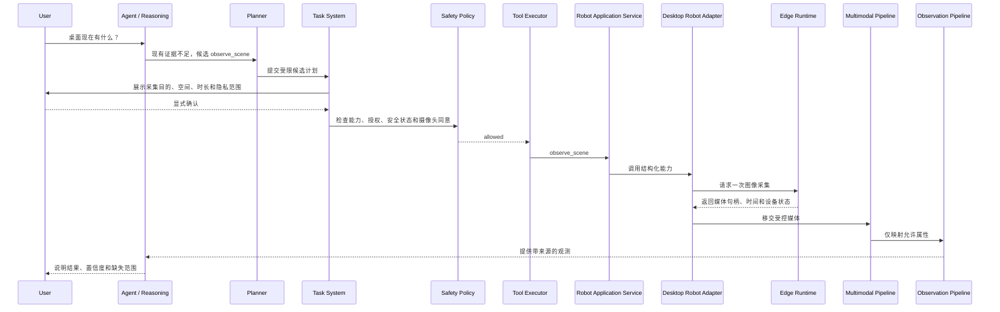

# 34. ARS-06 自制桌面机器人接入设计报告

- 阶段：`ARS-06.0：自制桌面机器人选型补充设计与安全确认`
- 日期：2026-11-06
- 状态：当前机器人载体已选定为自制桌面机器人；设计等待用户安全确认
- 范围：自制桌面机器人边界、硬件参考架构、Robot Adapter、Capability Model、安全机制、API、数据关系、权限、仿真与实测方案
- 禁止事项：本文不实现业务代码、数据库迁移、前端页面、固件、电机控制、真实语音或真实摄像头链路；不开放自主导航、机械臂、抓取、持续视频监控、常驻麦克风采集或 Level 4 自主执行

## 1. 选型结论

ARS-06 当前载体选定为**自制桌面机器人**。第 33 号文档保留为商用机器人和通用 Robot Adapter 参考；对当前工程而言，本文是后续 ARS-06.1 的有效选型设计。

这台机器人定位为 Arvuno 的桌面感知与交互终端，不是家庭移动机器人，也不是 Arvuno 的第二个大脑：

1. 默认固定放置在桌面上，不自主移动。
2. 第一版只考虑受限姿态调整、按需图像观察、单次语音输入、语音播报和状态上报。
3. 不配置机械臂、夹爪、轮式底盘、自主导航、开门、递物或负载能力。
4. Arvuno Core 继续独立拥有 World Model、Observation、Memory、Reasoning、Planning、Permission、Task System 和 Tool Executor。
5. 机器人离线时，家庭环境模型、历史查询、既有设备管理和 Web Console 必须保持可用。
6. 自制硬件没有厂商安全系统兜底，因此每一项运动和感知能力都必须通过内部安全设计、固件契约和实测证据后才能启用。

### 1.1 与第 33 号设计的关系

| 主题 | 第 33 号通用设计 | 本自制桌面机器人设计 |
| --- | --- | --- |
| 载体 | 智元机器人等商用机器人 | 自制桌面机器人 |
| 能力证据 | 厂商官方 SDK / 文档 | 内部硬件设计文档、固件接口契约、台架实测记录 |
| 安全兜底 | 厂商本体控制器和急停 | 必须自行实现硬件停止、机械限位、看门狗和失效安全策略 |
| 默认运动 | 导航、返坞等商用能力候选 | 只允许桌面范围内的受限 pan / tilt 或摄像头姿态调整 |
| 地图 | 可能使用厂商地图与定位 | 不引入家庭地图；只登记桌面安全包络和姿态限位 |
| 感知 | 商用相机、雷达、麦克风候选 | 明确的 USB / I2S / 板载摄像头和麦克风，必须复用 ARS-05 |
| Level 4 | 默认禁止 | 继续禁止 |

## 2. 系统边界

### 2.1 分层架构

```text
Arvuno Core
  World Model / Memory / Reasoning / Planning
  Permission / Task System / Tool Registry
  Safety Policy / Tool Executor / Audit
        ↓ 高层任务和结构化能力契约
Robot Application Service
  机器人目录 / 能力可用性 / 任务请求
  状态聚合 / 事件标准化 / 感知移交
        ↓ 本地受控接口
Desktop Robot Adapter
  连接 / 心跳 / 超时 / 错误转换
  高层能力调用 / 状态和事件上报
        ↓ 明确串口或本地网络协议
Desktop Robot Edge Runtime
  固件接口代理 / 设备发现 / 时间同步
  摄像头 / 麦克风 / 扬声器 / 传感器访问
        ↓ 控制命令与安全状态
Real-time Motion Controller
  舵机 / 电机限位 / 速度限制 / 电流温度保护
  硬件停止 / 看门狗 / 失效安全
```

### 2.2 职责矩阵

| 模块 | 负责 | 明确不做 |
| --- | --- | --- |
| Arvuno Core | 世界模型、记忆、推理、候选计划、权限、任务、审计和结果验证 | 不直接控制舵机、电机、摄像头或麦克风 |
| Agent Runtime | 理解请求、调用只读检索工具、形成候选意图 | 不访问 Robot Adapter、串口、固件、Repository 或 SQLAlchemy |
| Planning Engine | 生成和验证受限桌面任务候选计划 | 不执行能力、不扩大授权、不生成底层控制命令 |
| Task System | 管理任务、步骤、确认、取消、超时和执行历史 | 不实现机器人协议 |
| Tool Executor | 参数校验、权限、确认、审计、执行和结果验证 | 不绕过 Safety Policy |
| Robot Application Service | 机器人档案、能力目录、状态聚合、请求状态机和事件分发 | 不保存原始媒体主存储，不直接写 World Model |
| Desktop Robot Adapter | 本地连接、心跳、高层能力调用、错误和时间标准化 | 不做实时运动控制，不启用未验证能力 |
| Desktop Robot Edge Runtime | 摄像头、麦克风、扬声器、传感器和运动控制器的受控代理 | 不直接进入家庭网络路由，不暴露远程管理接口 |
| Real-time Motion Controller | 实时限位、速度、加速度、电流、温度、看门狗和停止 | 不请求 Memory、Reasoning 或家庭设备控制 |

### 2.3 依赖边界

| 模块 | 允许依赖 | 禁止依赖 |
| --- | --- | --- |
| Agent Runtime | Tool Registry 只读投影、Memory Retrieval、History Query | Robot Adapter、串口、固件、SQLAlchemy、Repository |
| Planner | Robot Capability Catalog 只读投影、Task System 提交接口 | Desktop Robot Adapter、Edge Runtime、硬件客户端 |
| Robot Tool Handler | Robot Application Service | AI Provider、数据库 Session、任意系统命令 |
| Robot Application Service | Robot Adapter 抽象、Robot Registry、Multimodal / Observation Service 受控接口 | Tool Executor 反向调用、Agent 内部对象 |
| Desktop Robot Adapter | 本地 HTTP / WebSocket / Serial 客户端、配置和超时策略 | 数据库 Repository、Task System、Memory 直写 |
| API 路由 | Pydantic Schema、Robot Application Service | Edge Runtime、串口库、硬件 SDK |

## 3. 硬件参考架构

最终 BOM、机械结构、供电和固件版本尚未冻结。以下只是设计参考，不能视为能力已存在。

### 3.1 推荐最小组成

| 组成 | 建议角色 | 设计要求 |
| --- | --- | --- |
| 稳定底座 | 固定或配重底座 | 防倾倒、防滑、线缆固定；不得伸出桌面危险边缘 |
| 计算模块 | 桌面机器人 Edge Runtime | 可运行本地代理、摄像头 / 麦克风访问和加密通信；型号待定 |
| 实时控制器 | 运动和安全控制 | 独立看门狗、限位、速度限制、电流 / 温度保护；不得只依赖上层软件 |
| 摄像头 | 按需图像观察 | 可见状态、可控采集、时间戳、标定信息；默认关闭 |
| 麦克风 | 单次语音输入 | 物理或固件可控使能、可见状态、默认关闭；不做常驻监听 |
| 扬声器 | TTS 播报 | 音量限制、播放状态、可取消；不用于伪造用户确认 |
| 姿态机构 | 受限 pan / tilt | 机械硬限位、行程开关或编码器、失效安全策略 |
| 电源管理 | 供电和保护 | 过流保护、欠压行为、断电安全状态、温度监控 |
| 停止通道 | 硬件停止或断电 | 用户可触及；优先断开执行器动力或进入已验证安全姿态 |
| 状态传感 | 温度、电流、倾角、位置 | 用于安全判断；不是环境事实的唯一来源 |

### 3.2 第一版不建议包含的硬件

1. 轮式底盘。
2. 机械臂或夹爪。
3. 激光雷达和家庭地图定位。
4. 深度相机。
5. 可充电移动坞站。
6. 人脸识别或声纹识别模块。
7. 远程公网接入模块。

这些能力不是永远禁止，而是必须先有独立安全设计、实测场地和用户确认。当前桌面机器人选择应优先降低运动风险。

### 3.3 自制能力证据

自制硬件没有厂商官方 API，能力验证证据改为以下内部证据链：

| 证据类型 | 必须包含 | 用途 |
| --- | --- | --- |
| `hardware_design` | 电气图、机械结构、BOM、供电和保护设计 | 证明硬件边界和安全设计存在 |
| `firmware_contract` | 接口版本、命令 Schema、限位、超时、错误和失效安全语义 | 作为 Adapter 能力契约 |
| `safety_analysis` | 风险清单、伤害场景、失效模式、防护措施和残余风险 | 安全评审输入 |
| `bench_test` | 台架测试记录、测试固件版本、通过 / 失败结果 | 验证基础行为 |
| `integration_test` | Arvuno Core、Adapter、固件和媒体链路联调记录 | 验证完整链路 |
| `safety_approval` | 用户或指定评审人的确认记录 | 能力启用前置条件 |

证据必须绑定硬件版本、固件版本、软件版本、测试日期、测试环境和结果。代码提交信息、口头描述或一次演示不能替代安全证据。

## 4. Capability Model

### 4.1 验证状态

| 状态 | 含义 | 运行时行为 |
| --- | --- | --- |
| `concept` | 只有想法或候选硬件 | 不进入能力目录执行面 |
| `specified` | 已有硬件设计、接口契约和安全分析 | 可显示为候选，默认 disabled |
| `bench_verified` | 台架测试通过 | 仍不能接入真实家庭执行 |
| `integration_verified` | Mock / 真实完整链路联调通过 | 可在开发模式测试 |
| `safety_approved` | 安全分析和实测通过，并获用户确认 | 才能按授权范围启用 |

能力目录必须区分：

1. `catalog_visible`：Agent / Planner 能看到摘要。
2. `runtime_enabled`：配置允许进入执行链。
3. `currently_available`：在线、安全、授权、传感器和前置条件满足。
4. `production_ready`：通过当前硬件版本实测和安全确认。

### 4.2 第一版候选能力

| 能力 | 目标语义 | 风险 | 前置条件 | 限制 |
| --- | --- | --- | --- | --- |
| `report_status` | 上报连接、电源、温度、姿态、安全和传感器可用性 | `read_only` | 接入授权 | 状态带来源和时间，不自动写成环境事实 |
| `request_safe_stop` | 请求进入安全状态并停止姿态运动 | 安全操作 | 接入授权 | 不能替代硬件断电或物理停止 |
| `cancel_task` | 取消当前高层任务 | 安全操作 | 存在任务 | 只取消 Arvuno 发起的任务 |
| `enter_idle_pose` | 回到已验证的空闲姿态 | `medium_risk` | 姿态能力安全确认 | 只允许预设安全姿态，不接受任意角度 |
| `look_at` | 在安全包络内调整观察方向 | `medium_risk` | 姿态限位、速度、稳定和授权 | 只允许相对桌面锚点的受限角度 |
| `observe_scene` | 按需采集一张图像或短帧序列 | `read_only`，隐私可升级 | 摄像头授权、用途明确、状态可见 | 不持续监控，不自动识别身份 |
| `listen_once` | 开始一次受时限语音输入 | `read_only`，隐私按 ARS-05 | 麦克风显式授权、状态可见 | 默认关闭，不做唤醒监听 |
| `speak` | 播报受限文本或既有 TTS 结果 | `low_risk` | 语音输出授权、音量限制 | 不把语音播放当作用户确认 |
| `run_diagnostics` | 读取自检和传感器健康状态 | `read_only` | 诊断授权 | 不输出原始敏感媒体 |

以下能力第一版不注册：

| 能力 | 原因 |
| --- | --- |
| `navigate_to` | 无轮式底盘和室内导航 |
| `return_to_dock` | 无移动坞站 |
| `charge` | 当前是桌面供电，不是自主充电任务 |
| `inspect` | 需要移动观察，第一版只保留固定位置 / 受限姿态观察 |
| `arm_control` | 无机械臂，且需要独立安全设计 |
| `manipulate` | 无抓取能力，高风险 |

### 4.3 通用能力 Schema

每个能力必须声明：

```text
capability_id
schema_version
robot_id
hardware_version
firmware_version
edge_runtime_version
verification_status
evidence_refs[]
input_schema
output_schema
preconditions
risk_level
default_permission
requires_confirmation
requires_consent[]
safe_state
motion_envelope
max_speed / max_acceleration
timeout
retry_policy
watchdog_requirement
sensor_requirements
privacy_scope
data_egress_scope
availability_rules
error_contract
audit_fields
```

输入 Schema 禁止出现：

1. 任意舵机角度。
2. 任意电机速度、扭矩、电流或 PWM。
3. 任意固件命令。
4. 任意 shell 命令。
5. 任意网络地址。
6. 未限制时长的音频或视频采集。

## 5. Robot State Model

### 5.1 状态域

| 状态域 | 示例 | 语义 |
| --- | --- | --- |
| `connection_state` | disconnected、connecting、connected、degraded | Core 到 Edge Runtime 的连接 |
| `online` | true / false / unknown | 心跳窗口内是否可用 |
| `power_state` | powered、under_voltage、over_current、unknown | 供电与健康 |
| `thermal_state` | normal、warning、critical、unknown | 控制器、执行器或计算模块温度 |
| `motion_safety` | normal、limit_reached、stalled、over_current、tilt_detected、stopped | 姿态机构安全状态 |
| `hardware_stop` | active、inactive、unknown | 硬件停止或断电通道状态 |
| `software_stop` | active、inactive、unknown | 固件 / 上层安全停止状态 |
| `pose_state` | current_pose、target_pose、calibrated、unknown | 姿态估计，不代表环境事实 |
| `camera_state` | disabled、idle、capturing、unavailable、unauthorized | 摄像头可见状态 |
| `microphone_state` | disabled、idle、recording、unavailable、unauthorized | 麦克风可见状态 |
| `speaker_state` | idle、speaking、muted、unavailable | 播报状态 |
| `current_task` | task_id、capability、state、started_at | 当前任务投影 |
| `capability_availability` | available、disabled、unsafe、offline、consent_missing | 每项能力当前可用性 |
| `permission_state` | status、motion、camera、microphone、speaker、cloud | 用户授权状态 |
| `heartbeat` | last_received_at、latency_ms、clock_offset | 连接和时间可信度 |

### 5.2 状态来源

每个字段必须带来源：

| 来源 | 例子 | 规则 |
| --- | --- | --- |
| `firmware_reported` | 限位、电流、温度、停止状态 | 保存原始值、固件版本和报告时间 |
| `edge_observed` | 进程状态、摄像头打开状态 | 保存 Edge Runtime 版本 |
| `adapter_derived` | 超时、离线、重连 | 不得伪装成固件直接报告 |
| `user_configured` | 授权、音量上限、默认能力 | 只能来自用户显式配置 |
| `model_inferred` | 图像标签、语音意图 | 只能是候选，不进入状态真值 |

### 5.3 时间语义

1. 固件事件必须包含事件发生时间；无法提供时标记 `missing_event_time`。
2. Edge Runtime 记录接收时间，Core 记录处理时间。
3. 时钟偏差必须显式上报，不得静默修正。
4. 乱序和迟到事件保留原始时间并标记 `late_arrival`。
5. 图像和音频必须记录采集开始、采集结束、接收、Provider 处理完成时间。
6. 状态有效期由能力契约声明；过期后显示 unknown，不得沿用旧值当作当前状态。

## 6. 通信与安全机制

### 6.1 通信通道

推荐两个候选通道，最终选择必须由硬件架构确认：

| 通道 | 适用场景 | 要求 |
| --- | --- | --- |
| 本地 HTTPS / WebSocket | Edge Runtime 能运行加密服务 | mTLS 或本地令牌、防重放、超时、心跳、接口版本 |
| USB / Serial | Core 直连实时控制器或简单硬件 | 帧校验、命令序号、超时、看门狗、错误恢复和固件版本握手 |

无论选择哪种通道，都必须满足：

1. 只允许局域网或本机通信，第一阶段不提供公网远程控制。
2. 请求包含能力 ID、Schema 版本、idempotency key 和 correlation ID。
3. 响应必须结构化，错误不得只有字符串。
4. 命令有超时，运动命令默认不可自动重试。
5. Adapter 断线时本地任务标记 `unavailable` 或 `timeout`，不得假设成功。
6. 重连后先读取状态和安全摘要，再恢复任何任务。
7. 心跳丢失超过安全阈值时，固件必须自行进入安全状态。

### 6.2 失效安全

自制机器人必须在固件层满足：

1. 上电默认禁止运动，直到自检和安全状态确认。
2. 心跳丢失、指令超时、Schema 不匹配、限位异常、过流、过温或倾角异常时进入安全状态。
3. 安全状态的具体行为必须按机构验证：断使能、保持受限姿态或回到预设姿态，不能默认“保持当前位置”总是安全。
4. 硬件停止通道优先级高于所有网络命令。
5. 安全状态恢复需要用户显式操作，不允许远程自动复位。
6. 姿态速度、加速度和角度范围由固件强制限制，Core 只能请求高层能力。
7. 断电后再上电不得自动恢复未完成任务。

### 6.3 桌面安全包络

每台机器人必须登记：

1. 所在空间和桌面实体。
2. 底座固定方式。
3. 桌面安全区域和禁止朝向。
4. pan / tilt 机械限位。
5. 软件限位必须小于机械限位。
6. 最大速度和加速度。
7. 线缆活动范围。
8. 倾倒、滑动和过热风险控制。
9. 人员不可进入的测试隔离区。

`look_at` 的目标只能来自：

1. 已登记的桌面锚点。
2. 用户本次确认的受限角度。
3. 系统安全预设姿态。

不能因为视觉模型输出“看那边”就生成未授权角度或越过安全包络的目标。

### 6.4 隐私安全

1. 摄像头、麦克风、云处理、运动和语音输出默认 disabled。
2. 每次图像或语音采集必须有用途、空间、时间限制、授权和可见状态。
3. 采集结束、失败或撤销授权后立即释放设备并按 ARS-05 清理敏感媒体。
4. 本地 Provider 失败不得自动升级云端 Provider。
5. 云端处理必须单独列明数据范围、目的地、模型版本和保留策略。
6. 摄像头和麦克风原始内容不得进入普通日志、事件正文或 Memory。
7. 视觉标签、OCR 和语音转写只能是候选结果或用户输入，不能自动成为环境事实。
8. 授权撤销后新采集立即拒绝，已保存数据按 ARS-05 删除策略处理。

## 7. 执行流程

### 7.1 按需观察流程



### 7.2 任务状态

`robot_task_requests` 建议状态：

| 状态 | 含义 |
| --- | --- |
| `created` | 请求已创建 |
| `awaiting_confirmation` | 等待用户确认 |
| `rejected` | 用户拒绝或安全拒绝 |
| `submitted` | 已提交 Adapter |
| `accepted` | Edge Runtime 接受 |
| `running` | 能力执行中 |
| `waiting_result` | 运动完成，等待感知或验证结果 |
| `succeeded` | 输出和后置条件验证通过 |
| `failed` | 能力、固件或验证失败 |
| `timeout` | 超时，状态需要重新读取 |
| `cancelled` | 用户或系统取消 |
| `safe_stopped` | 进入安全状态，任务未继续 |
| `unavailable` | 硬件、授权或前置条件不可用 |

状态只能由真实反馈或显式超时规则推进；不能由模型输出或前端乐观更新标记成功。

## 8. API 草案

以下 API 是后续工程契约，本阶段不实现。

### 8.1 机器人与能力

| 方法 / 路径 | 用途 |
| --- | --- |
| `GET /api/robots` | 机器人列表和连接摘要 |
| `GET /api/robots/{robot_id}` | 硬件版本、固件版本、状态摘要 |
| `GET /api/robots/{robot_id}/capabilities` | 能力目录、证据、授权和当前可用性 |
| `GET /api/robots/{robot_id}/state` | 状态、安全、摄像头、麦克风和扬声器状态 |
| `GET /api/robots/{robot_id}/safety-events` | 安全事件历史 |
| `GET /api/robots/{robot_id}/audit-records` | 权限与执行审计 |

### 8.2 任务与安全

| 方法 / 路径 | 用途 |
| --- | --- |
| `POST /api/robots/{robot_id}/task-requests` | 创建高层能力请求 |
| `POST /api/robots/{robot_id}/task-requests/{id}/confirm` | 用户确认 |
| `POST /api/robots/{robot_id}/task-requests/{id}/cancel` | 取消任务 |
| `POST /api/robots/{robot_id}/request-safe-stop` | 请求软件安全停止 |
| `GET /api/robots/{robot_id}/task-requests/{id}` | 查询状态和事件 |

### 8.3 授权

| 方法 / 路径 | 用途 |
| --- | --- |
| `GET /api/robots/{robot_id}/consents` | 查看当前授权 |
| `POST /api/robots/{robot_id}/consents` | 创建显式授权 |
| `POST /api/robots/{robot_id}/consents/{id}/revoke` | 撤销授权 |

不提供底层舵机、PWM、电机、固件升级、shell 命令或任意串口透传 API。

## 9. 数据模型关系

优先复用第 33 号设计中的关系模型，但当前自制桌面机器人需要补充以下字段和证据语义。

| 表 / 模型 | 自制机器人补充 |
| --- | --- |
| `robots` | `vendor=custom`、BOM 版本、机械结构版本、Edge Runtime 版本、实时控制器版本 |
| `robot_capabilities` | 增加 `motion_envelope`、`safe_state`、`watchdog_requirement`、`production_ready` |
| `robot_capability_evidence` | 使用 `hardware_design`、`firmware_contract`、`safety_analysis`、`bench_test`、`integration_test`、`safety_approval` |
| `robot_state_snapshots` | 增加电源、温度、姿态、硬件停止、摄像头、麦克风和扬声器状态 |
| `robot_task_requests` | 增加桌面安全包络快照和能力 Schema 版本 |
| `robot_safety_events` | 增加限位、过流、过温、倾倒、心跳丢失、看门狗和断电事件 |
| `robot_permissions` | 增加姿态运动、摄像头、麦克风、语音输出和云处理独立授权 |
| `robot_audit_records` | 增加固件版本、硬件版本和安全证据引用 |

与既有系统的复用边界：

| 既有模型 | 复用方式 | 禁止事项 |
| --- | --- | --- |
| `entities` | 机器人作为 `custom_desktop_robot` 实体 | 不复制第二条身份 |
| `spaces` | 登记所在房间、桌面和锚点 | 不创建家庭地图或导航拓扑 |
| `observations` | 保存允许入库的结构化观测 | 不保存原始媒体主存储 |
| `state_estimates` | 融合姿态、传感器和环境观测 | 不让 Adapter 直写当前状态 |
| ARS-05 媒体表 | 保存图像、音频、Provider 调用和删除状态 | 不绕过授权和物理删除 |
| `active_perception_requests` | 保存信息缺口和观测请求 | 不复制机器人任务状态 |
| `tasks` / `tool_executions` | 管理执行、确认、取消和审计 | 不让 Planner 直接调用硬件 |
| `events` | 保存重要机器人事件 | 不把所有遥测写成事件 |
| `memories` | 按生命周期保存长期知识 | 不把一次观察自动写成永久事实 |

## 10. 权限模型

| 授权 | 默认 | 覆盖 | 不可扩大规则 |
| --- | --- | --- | --- |
| 机器人接入 | disabled | 注册和连接 | 一台机器人不代表其他自制设备 |
| 状态读取 | disabled | 只读状态 | 不包含摄像头或麦克风 |
| 姿态运动 | disabled | `enter_idle_pose`、`look_at` | 一次观察不授权全部角度或长期运动 |
| 摄像头采集 | disabled | 单次 `observe_scene` | 不包含持续视频或身份识别 |
| 麦克风采集 | disabled | 单次 `listen_once` | 不包含常驻唤醒或声纹识别 |
| 语音输出 | disabled | 受限 `speak` | 不用于伪造确认或紧急广播 |
| 云处理 | disabled | 指定媒体和 Provider | 本地失败不自动升级云端 |
| 固件维护 | disabled | 升级或诊断维护 | 必须本地用户在场，不通过 Agent 自动执行 |
| Level 4 自主 | disabled | 无 | 当前不设计、不开放 |

授权记录必须包含机器人 ID、能力 ID、空间或角度范围、数据类别、处理位置、有效期、单次任务 ID、撤销时间和审计引用。

模型输出、视觉标签、语音转写和历史任务成功记录都不能扩大授权。

## 11. 测试与验收方案

### 11.1 Mock 测试

先实现 Mock Desktop Robot Adapter，覆盖：

1. 状态上报成功、字段缺失、状态过期和心跳抖动。
2. 能力 disabled、unsupported、unsafe、offline、consent_missing。
3. `look_at` 成功、限位拒绝、速度超限、堵转、过流和倾倒。
4. 摄像头采集授权缺失、成功、失败、超时和撤销后拒绝。
5. 麦克风单次会话成功、超时、授权缺失和默认关闭。
6. TTS 播报、取消、音量限制和失败。
7. 任务重复提交、幂等键冲突、任务中离线和事件重放。
8. 硬件停止、软件停止、用户取消和恢复待确认。
9. 机器人离线时 Core 环境查询、历史查询和既有设备控制不受影响。
10. Agent 与 Planner 不导入硬件 Adapter、串口库、SQLAlchemy 或 Repository。

### 11.2 硬件台架测试

| 类别 | 必测项 |
| --- | --- |
| 机械 | 限位、堵转、最大角度、速度、加速度、倾倒、线缆拉扯 |
| 电气 | 过流、欠压、过温、断电恢复、保险或保护电路 |
| 固件 | 看门狗、心跳丢失、非法命令、超时、校验失败、安全状态 |
| 通信 | 断线、重连、重放、乱序、重复事件、时钟偏差 |
| 感知 | 摄像头开启状态、麦克风开启状态、媒体时间戳、设备释放 |
| 隐私 | 授权缺失、撤销、敏感媒体删除、云端禁用 |
| 任务 | 确认、取消、失败、超时、安全停止和后置条件验证 |

### 11.3 真实机器人验收门槛

开放真实硬件前必须提供：

1. 最终 BOM 和硬件版本。
2. 机械结构图和桌面安全包络。
3. 电气保护设计。
4. 固件接口契约和安全分析。
5. 硬件停止方式与实测记录。
6. 看门狗、心跳丢失、限位、过流和断电测试记录。
7. Mock 全量回归通过记录。
8. 摄像头与麦克风真实硬件验收记录。
9. 用户签署的安全与授权确认。
10. 明确的残余风险和禁止使用场景。

Mock 结果不得标记为真实硬件验收。

## 12. 实施切分

### ARS-06.1：Mock Desktop Robot 与 Adapter

1. Robot Registry 和 Capability Schema。
2. Mock 桌面机器人状态、故障和安全事件。
3. 只读状态工具和任务请求状态机。
4. 安全停止、取消和审计。
5. Web Console 最小状态页。
6. 全部能力默认 disabled。

2026-11-09 实施状态：第 1、2、4、6 项已实现（Robot 接口、Registry、Capability Schema、状态 / 位置模型、任务请求状态机、事件、MockRobotAdapter、连接断线处理、带认证 REST API、SQLite 持久化和迁移 `a6b2c3d4e5f6`）。第 3 项部分实现：任务请求状态机已完成，面向 Agent 的只读状态工具未实现。第 5 项 Web Console 最小状态页未实现。Mock 支持移动成功、导航失败、定位丢失、低电量、任务取消、设备离线、人工接管、急停和超时；全部能力默认 concept / disabled / 需确认，急停默认激活，机器人默认禁用。真实硬件控制代码不存在；Web Console 与只读工具保留到后续阶段补齐。

### ARS-06.2：硬件契约与只读接入

1. 冻结 BOM、机械和电气设计。
2. 固件接口契约。
3. Edge Runtime 状态上报。
4. 心跳、时间同步和安全状态读取。
5. 不开放姿态运动、摄像头和麦克风。

### ARS-06.3：按需感知与受限姿态

1. 摄像头单次采集。
2. 麦克风单次输入。
3. TTS 播报。
4. 受限 `look_at` 和 `enter_idle_pose`。
5. ARS-05 媒体、授权、删除和 Provider 链路复用。
6. Observation 映射和 State Estimation 重建。

2026-11-10 实施状态：当前工程实现的是 `navigate_to` + `observe` 的移动机器人 Mock 观察链路，不是本设计的 `look_at` / `observe_scene` 受限姿态链路。该差异与本文“载体是自制桌面机器人、第一版不做轮式导航”的前提冲突，已记录在 `docs/35-ars06-acceptance-report.md` 第 6 节；ARS-06 关闭前必须确认唯一权威载体和能力清单。

2026-11-12 Profile 冻结状态：生产 Mock 与默认 Profile 已改为 `desktop_robot`，能力目录只包含 `report_status`、`look_at`、`observe_scene`、`request_safe_stop`、`enter_idle_pose`、`speak` 和 `listen`。`mobile_robot` 仅保留未来接口且治理锁定；旧移动 Mock 只能通过显式 `legacy_mock_mobile` 测试配置运行，不作为当前硬件目标。Adapter 能力事实与用户启用、批准、Consent 状态已分离；`executable` 需要全部条件同时满足。统一 Robot Tool Handler、真实硬件验收和实际能力实现仍在后续工作包。

### ARS-06.4：桌面机器人验收

验证能力证据、状态同步、安全停止、失效安全、隐私授权、媒体删除、时间语义、任务审计、机器人离线时 Core 独立运行，以及 Mock 与真实硬件结果分开记录。

2026-11-10 验收状态：已完成当前 Mock 链路的 ARS-06.4 验收并输出 `docs/35-ars06-acceptance-report.md`，结论为 **Mock 条件通过 / 不关闭**。独立 Adapter、能力注册、定位和状态同步、导航、观察、来源、授权、急停、人工接管、离线恢复和 Core 离线运行已有回归证据；真实硬件、本设计的受限姿态能力、媒体物理删除和桌面安全包络仍未验收，当前 Mock 能力集合与本设计不一致。

## 13. 设计验收标准

1. 用户确认当前载体是自制桌面机器人，而不是商用移动机器人。
2. 用户确认第一版不做轮式导航、机械臂、抓取和持续采集。
3. 用户确认所有能力默认 disabled，并需要内部安全证据链。
4. 用户确认硬件停止、机械限位、看门狗和失效安全必须存在于机器人侧。
5. 用户确认 Core 不能直接控制舵机、电机、串口、摄像头或麦克风。
6. 用户确认姿态运动、摄像头、麦克风、语音输出和云处理是独立授权。
7. 用户确认机器人观测必须复用 ARS-05 和 Observation Pipeline。
8. 用户确认模型输出不能成为事实、授权或执行指令。
9. 用户确认机器人离线不影响 Arvuno Core 既有能力。
10. 用户确认 Mock 验收不替代真实硬件安全验收。

在上述标准确认前，不得开始 ARS-06.1 工程实现。

## 14. 2026-11-13 REPAIR-01 实施状态（Mock）

本节是后续状态补充，不修改 2026-11-10 / 2026-11-12 的历史结论，也不宣告 ARS-06 关闭。

1. 当前权威载体为第 34 号自制桌面机器人设计；`desktop_robot` Profile 冻结为 `report_status`、`look_at`、`observe_scene`、`request_safe_stop`、`enter_idle_pose`、`speak` 和 `listen`。
2. `mobile_robot` 能力定义保留为未来接口，包括 `navigate_to`、`return_to_dock` 和 `charge`；在硬件和安全审批前治理锁定。`legacy_mock_mobile` 只用于显式历史测试，不是当前硬件目标。
3. Robot Tool Handler 已接入 Task System、Tool Registry、Safety Policy、确认检查、Tool Executor、Robot Adapter、状态验证和执行审计；Agent 不能直接调用 `RobotApplicationService`。
4. Camera、microphone、speaker 和 motion 分别使用 Consent；授权支持能力、数据类别、空间、授予 / 过期 / 撤销信息。执行前强制检查有效授权。
5. 服务端一次性确认 Token 绑定 robot、request、capability、参数摘要、空间范围和过期时间；`confirmed=true` 不是确认凭据，重放、参数变化和过期确认均拒绝。
6. 机器人运行状态支持 online、offline、stale、busy、idle、error、emergency_stopped 和 unknown；heartbeat 提供最后活动时间和 freshness，重连接口用于状态重新同步。
7. 取消失败和结果未知分别保留 `cancel_failed` 与 `execution_state_unknown`；安全停止只表示 Core 请求并监控反馈，不宣称已实测机器人本体急停。
8. Web Console 提供机器人列表、运行状态、能力治理、Consent 管理、任务历史、事件、安全状态和故障信息；Agent 提供只读状态、能力、任务历史和授权查询工具。
9. 直接 `POST /api/robots/{robot_id}/enable`、创建 / 确认 / 取消任务请求和移动感知执行入口当前统一返回 `ROBOT_EXECUTION_LOCKED`。
10. 以上状态全部基于 Windows 本地 Mock 和受控开发验证。真实硬件、固件契约、BOM、安全包络、摄像头 / 麦克风、运动与安全停止均未验收；第 13 节验收标准继续有效。
